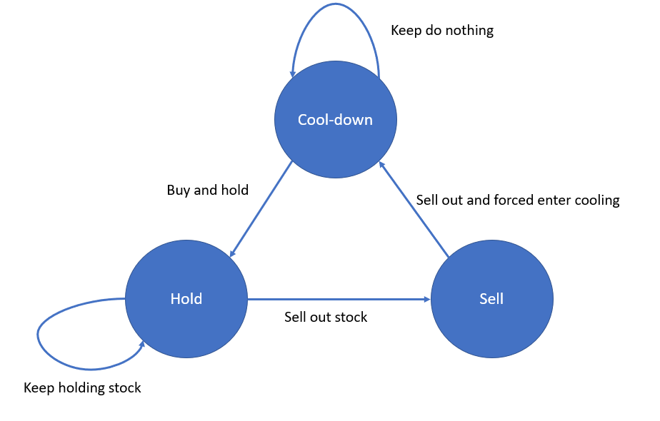

# Python/Go/Java/JS/C++ O(n) by DP and state machine. [w/ Visualization] 有中文解題文章

**Author:** brianchiang_tw
**Votes:** 148
**Link:** [https://leetcode.com/problems/best-time-to-buy-and-sell-stock-with-cooldown/solutions/761981/](https://leetcode.com/problems/best-time-to-buy-and-sell-stock-with-cooldown/solutions/761981/)

---

[\u4E2D\u6587\u89E3\u984C\u6587\u7AE0: \u6709\u51B7\u537B\u671F\u7684\u6700\u4F73\u80A1\u7968\u8CB7\u8CE3](https://vocus.cc/article/6587c8f1fd89780001b8853c)

[\u4E2D\u6587\u5C08\u6B04:
\u5F9EDP\u548CFSM\u6709\u9650\u72C0\u614B\u6A5F\u7684\u89D2\u5EA6\uFF0C\u53BB\u89E3\u958BLeetcode\u6700\u4F73\u80A1\u7968\u8CB7\u8CE3\u7CFB\u5217\u984C\u3002](https://vocus.cc/article/65fd41d2fd897800015721f3)

[DP\u6F14\u7B97\u6CD5\u6846\u67B6 \u8207 \u63A8\u85A6\u7684\u5B78\u7FD2\u8DEF\u5F91 (\u900F\u904E\u76F8\u4F3C\u984C\u53BB\u5F37\u5316\u5C0DDP\u7D50\u69CB\u7684\u8A8D\u8B58\u8207\u7406\u89E3)](https://vocus.cc/article/66616aeffd89780001cab1da)

O(n) by DP and state machine

---

**State Diagram**:

---

**cool_down** denotes the max profit of current Day_i, with either do nothing, or just sell out on previous day and enter cooling on Day_i

**sell** denotes the max profit of current Day_i, with selling stock with price quote of Day_i

**hold** denotes the max profit of current Day_i, with keep holding or buy and hold on Day_i

---

**Implementation** in bottom-up DP:
<iframe src="https://leetcode.com/playground/SYsUqp7j/shared" frameBorder="0" width="1000" height="600"></iframe>
---

Related leetcode challenge:

[Leetcode #121 Best Time to Buy and Sell Stock I](https://leetcode.com/problems/best-time-to-buy-and-sell-stock)

[Leetcode #122 Best Time to Buy and Sell Stock II](https://leetcode.com/problems/best-time-to-buy-and-sell-stock-ii)

[Leetcode #123 Best Time to Buy and Sell Stock III](https://leetcode.com/problems/best-time-to-buy-and-sell-stock-iii)

[Leetcode #188 Best Time to Buy and Sell Stock IV](https://leetcode.com/problems/best-time-to-buy-and-sell-stock-iv)

[Leetcode #714 Best Time to Buy and Sell Stock with Transaction Fee](https://leetcode.com/problems/best-time-to-buy-and-sell-stock-with-transaction-fee)