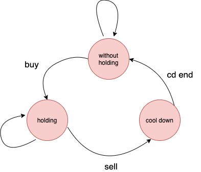

# scala: two line dynamic programming solution

**Author:** ccd9
**Votes:** 5
**Link:** [https://leetcode.com/problems/best-time-to-buy-and-sell-stock-with-cooldown/solutions/943676/](https://leetcode.com/problems/best-time-to-buy-and-sell-stock-with-cooldown/solutions/943676/)

---

Ok, I know it's an eye-catching title


Here is the code
```
object Solution {
  def maxProfit(prices: Array[Int]): Int = {
    val (withoutHold, hold, cooldown) = prices.foldLeft(0, Int.MinValue, 0) { case ((withoutHold, hold, cooldown), cost) => ( withoutHold max cooldown, hold max (withoutHold - cost), hold + cost)}
    withoutHold max cooldown
  }
}
```
* In scala, we always could chain functions in one line :)

----
**Explaination**
The following is the state transition picture



As you see, we only need three state in this problem
1. without holding: you don't have any stock on hand
2. holding: you keep a share on had
3. cool down: you have shorted your position and you need to rest one day


**Readable version**
```
object Solution {
    def maxProfit(prices: Array[Int]): Int = {
        val (withoutHold, hold, cooldown) = prices.foldLeft(0, Int.MinValue, 0) {
            case ((withoutHold, hold, cooldown), cost) => 
             (
                 withoutHold max cooldown,
                 hold max (withoutHold - cost),
                 hold + cost      
             )
        }
        withoutHold max cooldown
    }
}
```

* time complexity: O(N)
	* just visit each price once
* space complexity: O(1)

---

Are you looking for the vanilla dynamic programming solution ?
Here you are
```
object Solution {
    def maxProfit(prices: Array[Int]): Int = {
        if(prices == null || prices.isEmpty) return 0
        /*
        * state definition
        * 0: without holding
        * 1: holding one share
        * 2: sell and cool down
        */
        val dp = Array.tabulate(prices.length, 3){
            case (0, 0) => 0
            case (0, 1) => -prices(0)
            case (0, 2) => 0
            case _ => 0
        }
        
        for(i <- 1 until prices.length) {
            dp(i)(0) = dp(i - 1)(0) max dp(i - 1)(2) // 0 -> 0 or 2 -> 0
            dp(i)(1) = dp(i - 1)(1) max (dp(i - 1)(0) - prices(i)) // 1 -> 1 or  0 -> 1
            dp(i)(2) = dp(i - 1)(1) + prices(i) // 1 -> 2
        }
        
        dp.last.max
    }
}
```