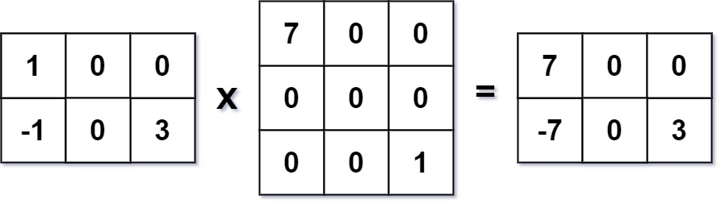

# [311. Sparse Matrix Multiplication](https://leetcode.com/problems/sparse-matrix-multiplication/)

| Category | Difficulty | Likes | Dislikes |
| :------: | :--------: | :---: | :------: |
| Algorithms | Medium | 1120 | 373 |

**Tags:** [`array`](https://leetcode.com/tag/array), [`hash-table`](https://leetcode.com/tag/hash-table), [`matrix`](https://leetcode.com/tag/matrix)

**Companies:** `bloomberg`, `facebook`, `linkedin`, `oracle`, `pinterest`

## Description

Given two sparse matrices `mat1` of size `m x k` and `mat2` of size `k x n`, return the result of `mat1 x mat2`. You may assume that multiplication is always possible.

 

**Example 1:**


```

Input: mat1 = [[1,0,0],[-1,0,3]], mat2 = [[7,0,0],[0,0,0],[0,0,1]]
Output: [[7,0,0],[-7,0,3]]

```

**Example 2:**

```

Input: mat1 = [[0]], mat2 = [[0]]
Output: [[0]]

```

 

**Constraints:**

	- `m == mat1.length`

	- `k == mat1[i].length == mat2.length`

	- `n == mat2[i].length`

	- `1 <= m, n, k <= 100`

	- `-100 <= mat1[i][j], mat2[i][j] <= 100`

---

**Links:** [Submissions](https://leetcode.com/problems/sparse-matrix-multiplication/) | [Solutions](https://leetcode.com/problems/sparse-matrix-multiplication/)
