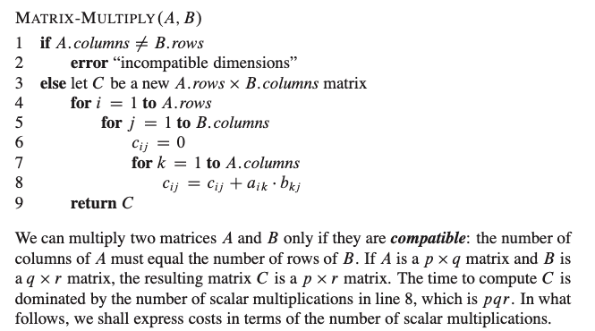

# From good to great.

**Author:** 2pac_shakur
**Votes:** 1
**Link:** [https://leetcode.com/problems/sparse-matrix-multiplication/solutions/1014185/](https://leetcode.com/problems/sparse-matrix-multiplication/solutions/1014185/)

---

Each problem teaches us something. 
Let's start with brute-force and move slowly towards efficient approach.

**Approach 1: Basic Matrix-multiplication,** - [Source: CLRS, page 171](https://bayanbox.ir/view/4177858657730907268/introduction-to-algorithms-3rd-edition.pdf)


```
To reiterate, compatibility conditions for matrix multipliication is:
    A : r1 * c1
        B :  r2 * c2
         
    where c1 should be equal to r2
    and the result would be of size r1 * c2
```
Having basics figured out, let's write code
```
    fun multiplyBruteForce(A: Array<IntArray>, B: Array<IntArray>): Array<IntArray> {
        val (r1, c1) = A.size to A[0].size
        val (r2, c2) = B.size to B[0].size
        val (ansR, ansC) = r1 to c2
        val ans = Array(ansR) { IntArray(ansC) }
        for (i in 0 until r1) {
            for (j in 0 until c2) {
                for (k in 0 until c1) {
                    ans[i][j] += A[i][k] * B[k][j]
                }
            }
        }
        return ans
    }
```

-------------------------------------------------------------------------------------------------------------------------------------------

**Approach 2: Utilise sparseness of the matrix**
What happens if we move the third inner for loop one level up, we can do eager exit based on the value of '0' in matrix A
```
    fun multiplyMoveKUp(A: Array<IntArray>, B: Array<IntArray>): Array<IntArray> {
        val (r1, c1) = A.size to A[0].size
        val (r2, c2) = B.size to B[0].size
        val (ansR, ansC) = r1 to c2
        val ans = Array(ansR) { IntArray(ansC) }
        for (i in 0 until r1) {
            for (k in 0 until c1) {
                if (A[i][k] == 0) continue
                for (j in 0 until c2) {
                    ans[i][j] += A[i][k] * B[k][j]
                }
            }
        }
        return ans
    }
```
[Source: Top voted solution](https://leetcode.com/problems/sparse-matrix-multiplication/discuss/76154/Easiest-JAVA-solution)

-------------------------------------------------------------------------------------------------------------------------------------------

**Approach 3: Utilise sparseness of the matrix EFFICIENTLY** [Interviewer expects this]
Consider matrix with size in millions, isn't it time-consuming to iterate through all of the elements?, yes!
So, let's store non-zero values in some space(HashMap)

```
fun multiply(A: Array<IntArray>, B: Array<IntArray>): Array<IntArray> {
        val (r1, c1) = A.size to A[0].size
        val (r2, c2) = B.size to B[0].size
        val (ansR, ansC) = r1 to c2
        val ans = Array(ansR) { IntArray(ansC) }
        val mapA = populateNonZeroValues(A)
        val mapB = populateNonZeroValues(B)
        for ((i, j) in mapA.keys) {
            for ((k, l) in mapB.keys) {
                if (j == k) {
                    ans[i][l] += mapA[i to j]!! * mapB[k to l]!!
                }
            }
        }
        return ans
    }
    
    private fun populateNonZeroValues(A: Array<IntArray>): Map<Pair<Int, Int>, Int> {
        val map: MutableMap<Pair<Int, Int>, Int> = HashMap()
        val (r, c) = A.size to A[0].size
        for (i in 0 until r) {
            for (j in 0 until c) {
                if (A[i][j] != 0) {
                    map[i to j] = A[i][j]
                }
            }
        }
        return map
    }
```
[Source](https://leetcode.com/problems/sparse-matrix-multiplication/discuss/76164/In-interview-code-the-solution-with-two-tables-NOT-the-easiest-one)