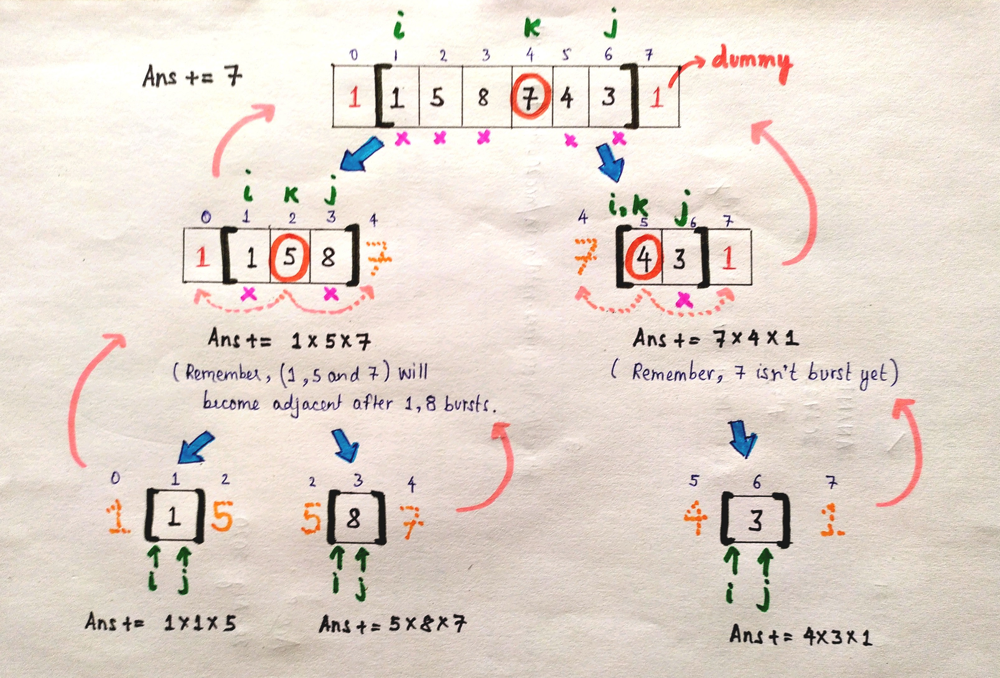

# For those who are not able to understand any solution [WITH DIAGRAM]

**Author:** anandthegreat
**Votes:** 1526
**Link:** [https://leetcode.com/problems/burst-balloons/solutions/892552/](https://leetcode.com/problems/burst-balloons/solutions/892552/)

---

I saw multiple solutions on the discussions forum and was not able to figure out what they were trying to explain. So, I came up with solution myself and will try to explain it in the simplest way. If you are clear with the subproblems and are just confused with the implementation, you can jump directly to the diagram below.
<BR>

**Bruteforce:** Generate all permutations for the ordering of balloons and check which permutation yields the best profit. But it will take O(n!) time.
<br>

**DP Solution:** For a DP solution to exist, we need to define the subproblems. Let's define the problem first as:

	solve(nums, i, j)

by which I mean that we need to burst balloons starting from index i to index j. At the beginning, they'll be 0, nums.size()  -1 respectively. Let's suppose we burst the kth balloon in the first chance. We will get **nums[k-1] * nums[k] * nums[k+1]** coins. Now let's define the subproblems as:
```
solve(nums, i, k - 1) , solve(nums, k + 1, j)
```
As the balloon k is already burst, we solve the subproblems from i to k -1 and k + 1 to j. But wait, what's going wrong here? The subproblem **solve(nums, i, k - 1)** and **solve(nums, k + 1, j)** are not independent since after bursting **kth balloon**, balloon k - 1 and k + 1 have become adjacent and they will need each other in order to calculate the profit.

So, as we saw that if we choose the kth balloon to be the first one to be burst, we can't make the subproblems independent. Let's try the other way round. We choose the kth balloon as the **last one to be burst**. Now the subproblems will become independent since **(k - 1)th balloon** and **(k + 1)th balloon** won't need each other in order to calculate the answer.  (Try it out using pen and paper). 

Now for each **k** starting from i to j, we choose the kth balloon to be the last one to be burst and calculate the profit by solving the subproblems recursively. Whichever choice of k gives us the best answer, we store it and return. 
Important point to be noted here is that the balloons in the range **(i, k - 1) and (k + 1, j)** will be burst **BEFORE** kth balloon. So, when we burst the kth balloon, the profit will be ***nums[i - 1] * nums[k] * nums[j + 1]*** PROVIDED that index i - 1 and j + 1 are valid. 
<br>

**STILL CONFUSED?**
---
Don't worry, the example given in the diagram below will make things SUPER CLEAR! 2 dummy balloons each with value 1 are inserted to handle the corner balloons in the original array. 
***[Choices of **k** in the below diagram are random and don't necessarily yield the optimal solution.]***



<br>

CODE
---

```
class Solution {
public:
    int n;
    int t[501][501]; // For memoization
    int solve(vector<int> &nums, int i, int j){
		// BASE CASES
		if(i > j)
			return 0;
        if(i == j){    // Only one element exists
            int temp = nums[i];
            if(i - 1 >= 0)  
                temp *= nums[i - 1];
            if(i + 1 < n)
                temp *= nums[i + 1];
            return temp;
        }
		if(t[i][j] != -1)  // Check if the solution is already stored for this subproblem
			return t[i][j];
        int ans = 0;
		
		// For all elements in the range i to j, we choose all of them one by one 
		// to make them the last balloon to be burst. 
        for(int k = i; k <= j; k++){
		
		    // Burst the kth balloon after bursting (i, k - 1) and (k + 1, j) balloons
            int temp = nums[k];
			
            if(j + 1 < n)  // As balloon j + 1 will become adjacent to k after bursting  k + 1 to j balloons
                temp *= nums[j + 1];
				
            if(i - 1 >= 0) // As balloon i- 1 will become adjacent to k after bursting  i  to k -1 balloons
                temp *= nums[i - 1];
				
			// Recursively solve the left and right subproblems and add their contribution
            temp += (solve(nums, i, k - 1) + solve(nums, k + 1, j));
			
			// If this choice of k yields a better answer
            ans = max(ans, temp);
        }
        return t[i][j] = ans;
    }
    
    int maxCoins(vector<int>& nums) {
        memset(t, -1, sizeof(t));
		
        // Insert two dummy balloons of value 1 to handle the balloons on the corner.
		vector<int> arr = {1};
        for(int x: nums) 
			arr.push_back(x);
        arr.push_back(1);
        n = arr.size();
		
		//Start from i = 1 and j = arr.size() - 2 since first and last balloons are dummy.
        return solve(arr, 1, arr.size() - 2);
    }
};
```
Please don't go without upvoting if it helped you!