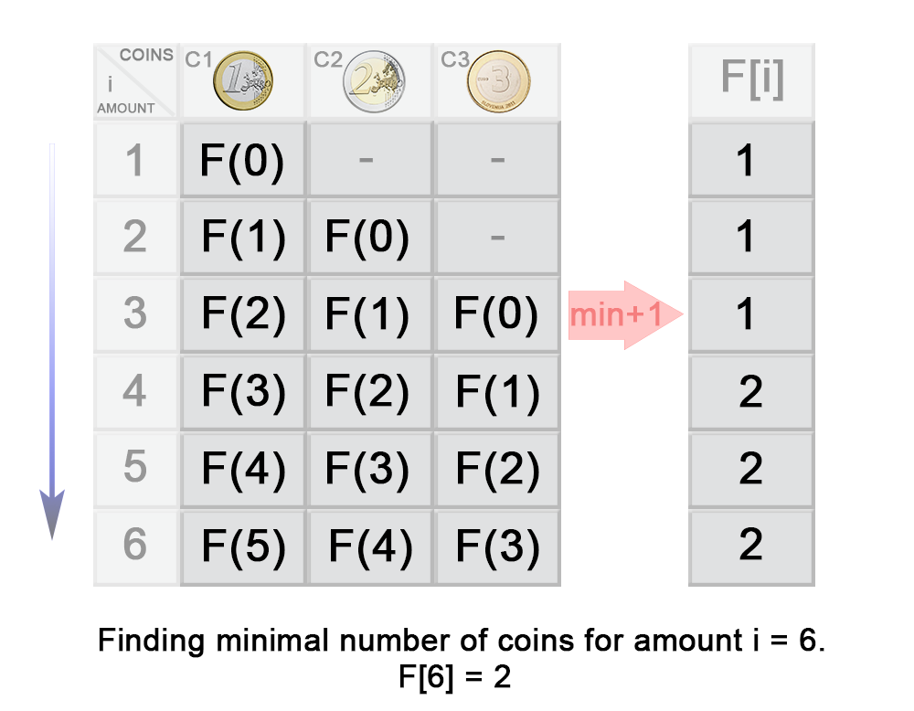

# Official Solution

**Link:** [https://leetcode.com/problems/coin-change/solution/](https://leetcode.com/problems/coin-change/solution/)

---

[TOC]

## Video Solution

---

    

        <iframe src="https://player.vimeo.com/video/521622597?texttrack=en" width="640" height="360" frameborder="0" allow="autoplay; fullscreen" allowfullscreen></iframe>
    

&nbsp;

## Solution Article

---

### Approach 1 (Brute force) [Time Limit Exceeded]

#### Intuition

The problem could be modeled as the following optimization problem :
$$
\min_{x} \sum_{i=0}^{n - 1} x_i \\
\text{subject to} \sum_{i=0}^{n - 1} x_i*c_i = S
$$

, where $S$ is the amount,    $c_i$ is the coin denominations, $x_i$  is the number of coins with denominations $c_i$ used in change of amount $S$. We could easily see that $x_i = [{0, \frac{S}{c_i}}]$.

A trivial solution is to enumerate all subsets of coin frequencies $[x_0\dots\ x_{n - 1}]$  that satisfy the constraints above, compute their sums and return the minimum among them.

#### Algorithm

To apply this idea, the algorithm uses backtracking technique 
to generate all combinations of coin frequencies $[x_0\dots\ x_{n-1}]$ 
in the range $([{0, \frac{S}{c_i}}])$ which satisfy the constraints above. It makes a sum of the combinations and returns their minimum or $-1$ in case there is no acceptable combination.

#### Implementation

<iframe src="https://leetcode.com/playground/NgoiQD5G/shared" frameBorder="0" width="100%" height="497" name="NgoiQD5G"></iframe>

#### Complexity Analysis

* Time complexity : $O(S^n)$. In the worst case, complexity is exponential in the number of the coins $n$. The reason is that every coin denomination $c_i$ could have at most $\frac{S}{c_i}$ values. Therefore the number of possible combinations is :

$$
\frac{S}{c_1}*\frac{S}{c_2}*\frac{S}{c_3}\ldots\frac{S}{c_n} = \frac{S^{n}}{{c_1}*{c_2}*{c_3}\ldots{c_n}}
$$

* Space complexity : $O(n)$.
In the worst case the maximum depth of recursion is $n$. Therefore we need $O( n)$ space used by the system recursive stack.

---

### Approach 2 (Dynamic programming - Top down) [Accepted]

#### Intuition

Could we improve the exponential solution above? Definitely! The problem could be solved with polynomial time using Dynamic programming technique. First, let's define:
> $F(S)$ - minimum number of coins needed to make change for amount $S$ using coin denominations $[{c_0\ldots c_{n-1}}]$

We note that this problem has an optimal substructure property, which is the key piece in solving any Dynamic Programming problems. In other words, the optimal solution can be constructed from optimal solutions of its subproblems.
How to split the problem into subproblems? Let's assume that we know $F(S)$ where some change $val_1, val_2, \ldots$ for $S$ which is optimal and the last coin's denomination is $C$.
Then the following equation should be true because of optimal substructure of the problem:

$$
F(S) = F(S - C) + 1
$$

But we don't know which is the denomination of the last coin $C$. We compute  $F(S - c_i)$ for each possible denomination $c_0, c_1, c_2 \ldots c_{n -1}$ and choose the minimum among them. The following recurrence relation holds:

$$
F(S) = \min_{i=0 ... n-1} { F(S - c_i) } + 1 \\
\text{subject to} \ \  S-c_i \geq 0 \\
$$

$$
F(S) = 0 \ , \text{when} \ S = 0 \\
F(S) = -1 \ , \text{when} \ n = 0
$$

In the recursion tree above, we could see that a lot of subproblems were calculated multiple times.  For example the problem $F(1)$ was calculated $13$ times. Therefore we should cache the solutions to the subproblems in a table and access them in constant time when necessary

#### Algorithm

The idea of the algorithm is to build the solution of the problem from top to bottom. It applies the idea described above. It use backtracking and cut the partial solutions in the recursive tree, which doesn't lead to a viable solution. Тhis happens when we try to make a change of a coin with a value greater than the amount *$S$*. To improve  time complexity we should store the solutions of the already calculated subproblems in a table.

#### Implementation

<iframe src="https://leetcode.com/playground/mEmTSw4K/shared" frameBorder="0" width="100%" height="412" name="mEmTSw4K"></iframe>

#### Complexity Analysis

* Time complexity : $O(S*n)$. where S is the amount, n is denomination count.
In the worst case the recursive tree of the algorithm has height of $S$ and the algorithm  solves only $S$ subproblems because it caches precalculated solutions in a table. Each subproblem is computed with  $n$ iterations, one by coin denomination. Therefore there is $O(S*n)$ time complexity.

* Space complexity : $O(S)$, where $S$ is the amount to change
We use extra space for the memoization table.

---

### Approach 3 (Dynamic programming - Bottom up) [Accepted]

#### Algorithm

For the iterative solution, we think in bottom-up manner. Before calculating *$F(i)$*, we have to compute all minimum counts for amounts up to $i$. On each iteration $i$ of the algorithm *$F(i)$* is computed as $\min_{j=0 \ldots n-1}{F(i -c_j)} + 1$

{:width="539px"}

In the example above you can see that:

$$
\begin{aligned}
F(3) &= \min\{{F(3- c_1), F(3-c_2), F(3-c_3)}\} + 1 \\
&= \min\{{F(3- 1), F(3-2), F(3-3)}\} + 1 \\
&= \min\{{F(2), F(1), F(0)}\} + 1 \\
&= \min\{{1, 1, 0}\} + 1 \\
&= 1
\end{aligned}
$$

#### Implementation

<iframe src="https://leetcode.com/playground/225NpE5u/shared" frameBorder="0" width="100%" height="327" name="225NpE5u"></iframe>

#### Complexity Analysis

* Time complexity : $O(S*n)$.
On each step the algorithm finds the next *$F(i)$* in $n$ iterations, where $1\leq i \leq S$. Therefore in total the iterations are $S*n$.
* Space complexity : $O(S)$.
We use extra space for the memoization table.