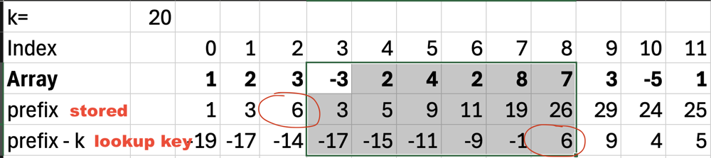

# Prefix Sum and dictionary

**Author:** digitalintruder
**Votes:** 0
**Link:** [https://leetcode.com/problems/maximum-size-subarray-sum-equals-k/solutions/5647915/](https://leetcode.com/problems/maximum-size-subarray-sum-equals-k/solutions/5647915/)

---

# Intuition
If you want to find the length of a sum in an array of max length, it generally screams prefix sum. You need to track the values to find the lengths.

This will work for min with a modification to how we store the indices as well.

# Approach
1. Track the prefix sum
2. Check to see if the key (prefixsum - k) where k is the value we are looking for.
3. If exists check the max length



The image shows that K = 20 and we want the longest substring (in this case it's 7). On index 2 the prefix sum is 6 (sums up to). This means if we hit the prefix sum of 26 we know that 26-20 = 6 and there exists a sub array that adds up to 20.

This means 2 things (my two lessons)
- We should use a dictionary to store the first index where we found a prefix sum. Later elements would make it the shortest distance.
- Since the dictionary is storing the prefix sum, we shouldn't create the array as in typical prefix sum problems and just keep the running total.

# Complexity
- Time complexity:
$$O(n)$$

- Space complexity:
$$O(n)$$ (the dictionary)

# Code
```
public class Solution {
    public int MaxSubArrayLen(int[] nums, int k) {
        Dictionary<int, int> d = new(); // value, index
        int prefixSum = 0;
        int result = 0;

        for (int i = 0; i < nums.Length; ++i) {
            prefixSum += nums[i];
            if (prefixSum == k) {
                result = i + 1;
            }

            // If the key exists (a previously seen prefix), we have a match. We should find out the sub-array length.
            int key = prefixSum - k;
            if (d.TryGetValue(key, out int index)) {
                result = Math.Max(i - index, result);
            }

            // we want to store the prefix sum's index if it doesn't exist
            // note: we want to store the earliest version
            if (!d.ContainsKey(prefixSum)) {
                d[prefixSum] = i;
            }
        }

        return result;
    }
}
```