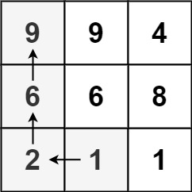
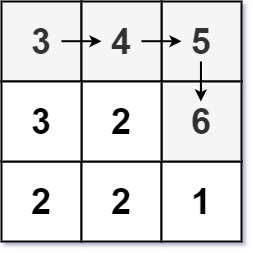

# [329. Longest Increasing Path in a Matrix](https://leetcode.com/problems/longest-increasing-path-in-a-matrix/)

| Category | Difficulty | Likes | Dislikes |
| :------: | :--------: | :---: | :------: |
| Algorithms | Hard | 9420 | 145 |

**Tags:** [`array`](https://leetcode.com/tag/array), [`dynamic-programming`](https://leetcode.com/tag/dynamic-programming), [`depth-first-search`](https://leetcode.com/tag/depth-first-search), [`breadth-first-search`](https://leetcode.com/tag/breadth-first-search), [`graph`](https://leetcode.com/tag/graph), [`topological-sort`](https://leetcode.com/tag/topological-sort), [`memoization`](https://leetcode.com/tag/memoization), [`matrix`](https://leetcode.com/tag/matrix)

**Companies:** `doordash`, `facebook`, `duolingo`, `google`, `nutanix`, `microsoft`, `salesforce`, `amazon`, `adobe`, `tiktok`, `uber`, `weride`, `snapchat`, `citadel`

## Description

Given an `m x n` integers `matrix`, return *the length of the longest increasing path in *`matrix`.

From each cell, you can either move in four directions: left, right, up, or down. You **may not** move **diagonally** or move **outside the boundary** (i.e., wrap-around is not allowed).

 

**Example 1:**


```

Input: matrix = [[9,9,4],[6,6,8],[2,1,1]]
Output: 4
Explanation: The longest increasing path is [1, 2, 6, 9].

```

**Example 2:**


```

Input: matrix = [[3,4,5],[3,2,6],[2,2,1]]
Output: 4
Explanation: The longest increasing path is [3, 4, 5, 6]. Moving diagonally is not allowed.

```

**Example 3:**

```

Input: matrix = [[1]]
Output: 1

```

 

**Constraints:**

	- `m == matrix.length`

	- `n == matrix[i].length`

	- `1 <= m, n <= 200`

	- `0 <= matrix[i][j] <= 2^31 - 1`

---

**Links:** [Submissions](https://leetcode.com/problems/longest-increasing-path-in-a-matrix/) | [Solutions](https://leetcode.com/problems/longest-increasing-path-in-a-matrix/)
