# Kotlin DFS explained with illustrations

**Author:** awawa
**Votes:** 1
**Link:** [https://leetcode.com/problems/longest-increasing-path-in-a-matrix/solutions/2052990/](https://leetcode.com/problems/longest-increasing-path-in-a-matrix/solutions/2052990/)

---

## Naive DFS
The solution idea is pretty simple. Basically we just choose starting position `(x, y)` and search for longest increasing path (LIP) from it. We try every possible position and choose the longest found path. This is totally working approach, however consider the following example
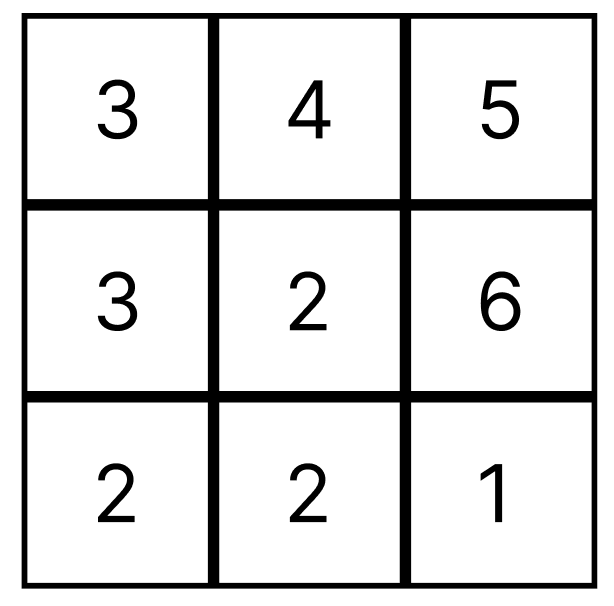

For this matrix, we would have to move through a single cell multiple times. 

First, we start at cell `(0, 0)`. We move to `(0, 1)`, then `(0, 2)`, then to `(1, 2)`. Finally, there is no increasing path from cell `(1, 2)`, so we stop. For cell `(0, 0)` we found the longest path of length `4`:
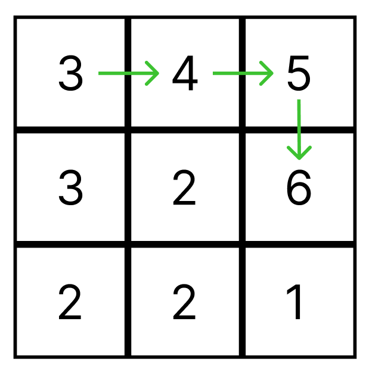

Next, we start at cell `(0, 1)`. And again we move to `(0, 2)`, then to `(1, 2)`. We walked the same path as for cell `(0, 0)` but 1 step shorter:
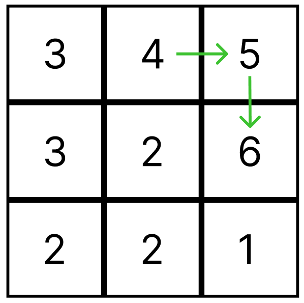

Same will happen for cell `(0, 2)`:
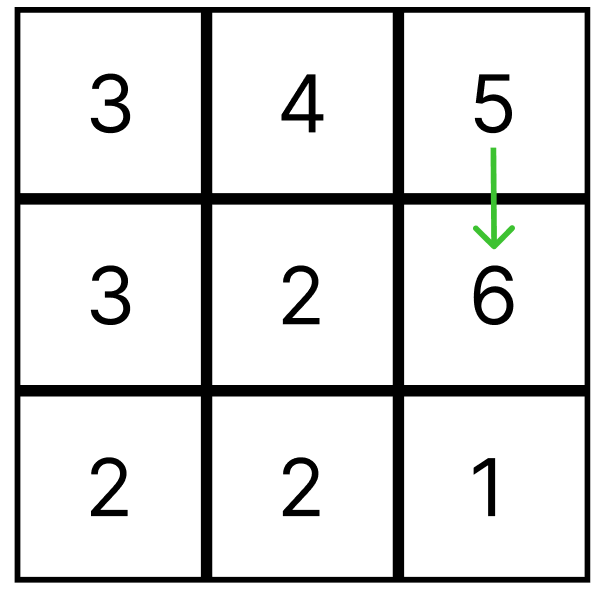

And we will have to walk almost the same path when we start from cell `(1, 1)`:
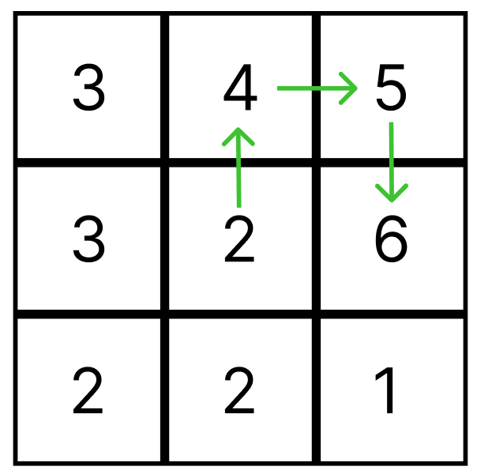

In this example we traverse almost identical paths 4 times. For bigger matrices and longer paths we would have to traverse the same path over and over again until we hit the time limit.

## Better DFS
To eliminate walking the same paths multiple times we will apply dynamic programming with memoziation. We use `longestPath` matrix to hold the longnest found path for each cell `(x, y)` in `matrix`. We use `-1` value to indicate that the cell has not been visited yet. So initially we have this:
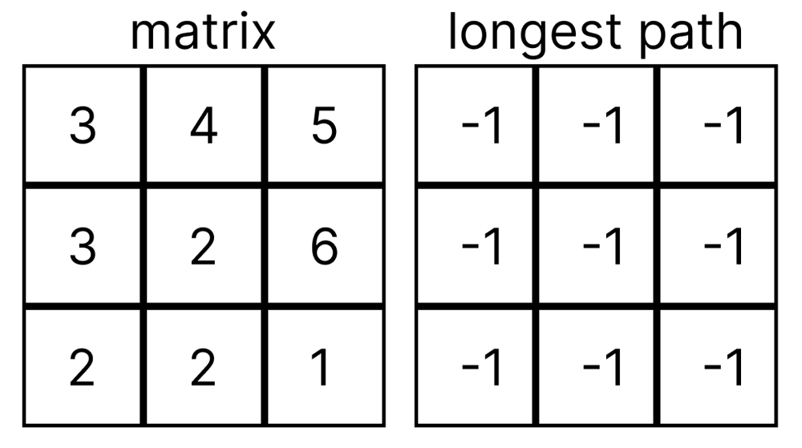

Now we perform already familiar procedure. We start at `(0, 0)` and recursively follow path `(0, 1) -> (0, 2) -> (1, 2)`:
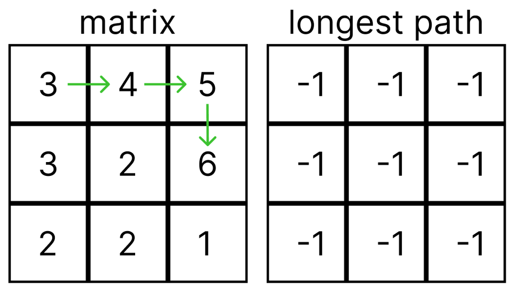

When we enter cell `(1, 2)` there is nowhere we can go, so for cell `(1, 2)` we know the longest path will be of length `1`. We set `longestPath[1][2]` to `1` and return this value:
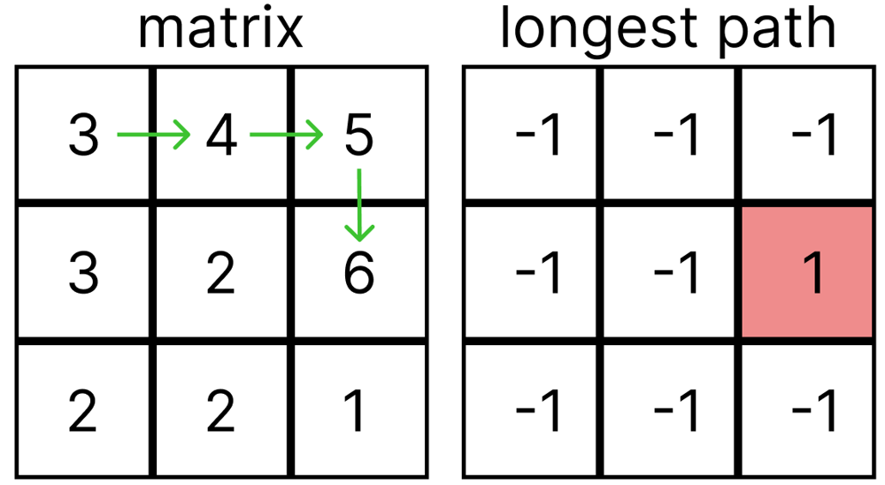

Returning from recursive call we get back to cell `(0, 2)`. For cell `(0, 2)` we now can determine the longest possible path as `1 + longestPath[1][2] = 2`, so we set `longestPath[0][2]` to `2` and return value `2`:
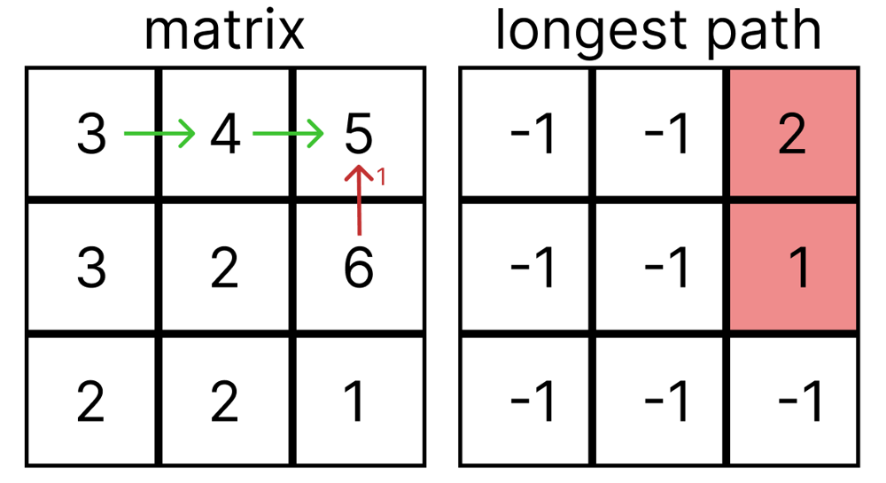

Same goes for cells `(0, 1)` and `(0, 0)`:
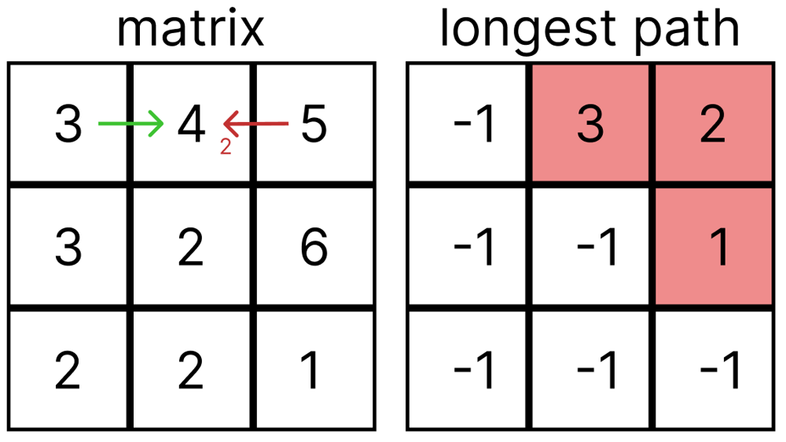
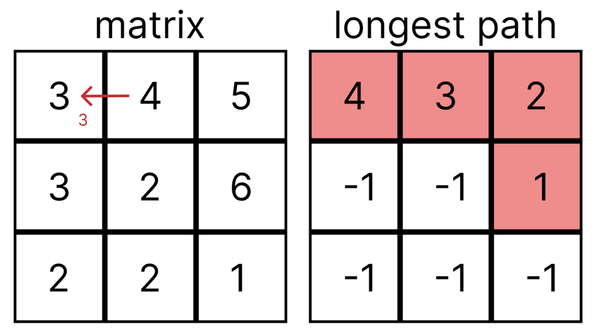

When we choose `(0, 1)` as a starting point, we don't have to search for the path, we already know that the longest possible one has length `3`. Same for `(0, 2)`. For cell `(1, 0)` there is nowhere to go, so the longest path will be `1`.

Now when we choose cell `(1, 1)` as a starting position, there are three paths we can go:
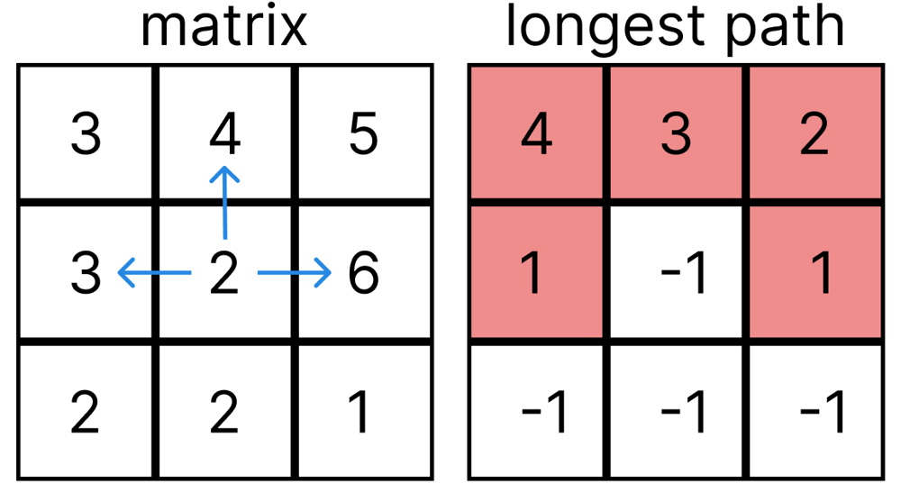

But we don't have to traverse none of them again, we just pick the longest one and add `1`:
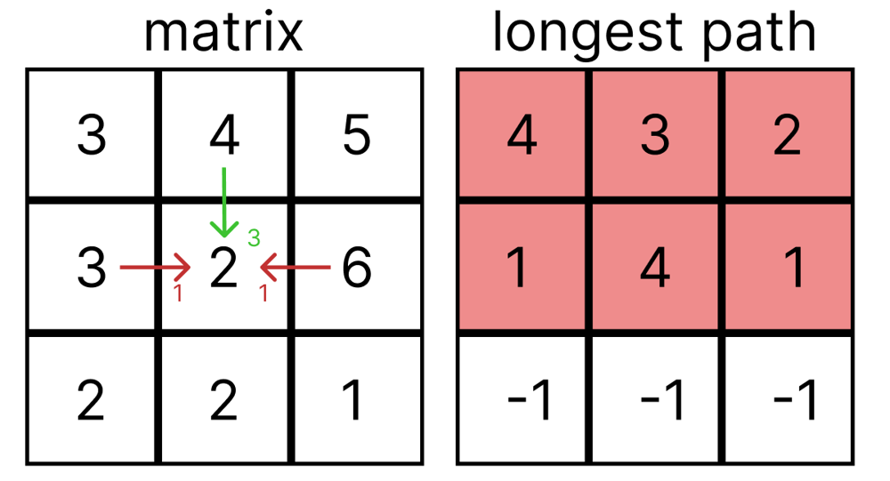

With similar approach we search paths for `(2, 0)`, `(2, 1)` and `(2, 2)`
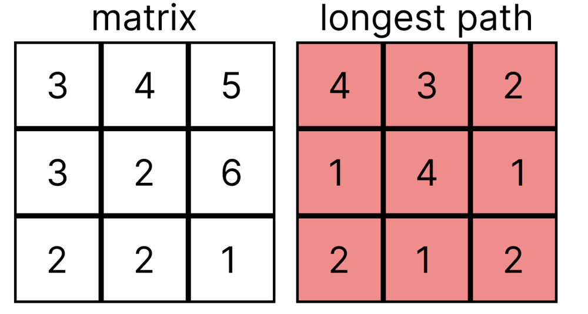

And finally we just need to pick the maximum value from `longestPath` matrix, which is `4`.

The solution code:
```
class Solution {
    fun longestIncreasingPath(matrix: Array<IntArray>): Int {
        val longestPath = Array<IntArray>(matrix.size) { IntArray(matrix[it].size) { -1 } }
        
        fun dfs(x: Int, y: Int): Int {
            if (longestPath[x][y] != -1) return longestPath[x][y]
            
            val currElem = matrix[x][y]
            val topElem = if (x > 0) matrix[x - 1][y] else -1
            val botElem = if (x < matrix.lastIndex) matrix[x + 1][y] else -1
            val leftElem = if (y > 0) matrix[x][y - 1] else -1
            val rightElem = if (y < matrix[x].lastIndex) matrix[x][y + 1] else -1
            
            val topPath = if (currElem < topElem) 1 + dfs(x - 1, y) else 1
            val botPath = if (currElem < botElem) 1 + dfs(x + 1, y) else 1
            val leftPath = if (currElem < leftElem) 1 + dfs(x, y - 1) else 1
            val rightPath = if (currElem < rightElem) 1 + dfs(x, y + 1) else 1
            
            longestPath[x][y] = maxOf(maxOf(topPath, botPath), maxOf(leftPath, rightPath))
            return longestPath[x][y]
        }
        
        var result = 0
        for (i in matrix.indices)
            for (j in matrix[i].indices) 
                result = maxOf(result, dfs(i, j))
        return result
    }
}
```