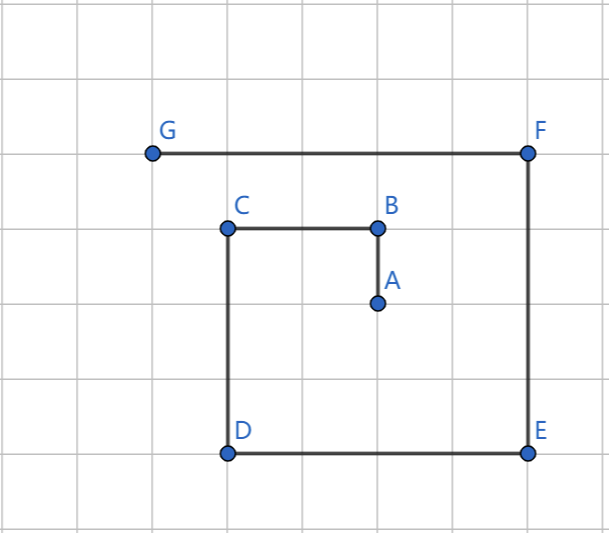
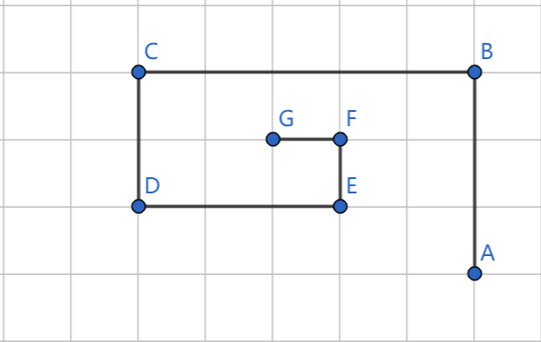
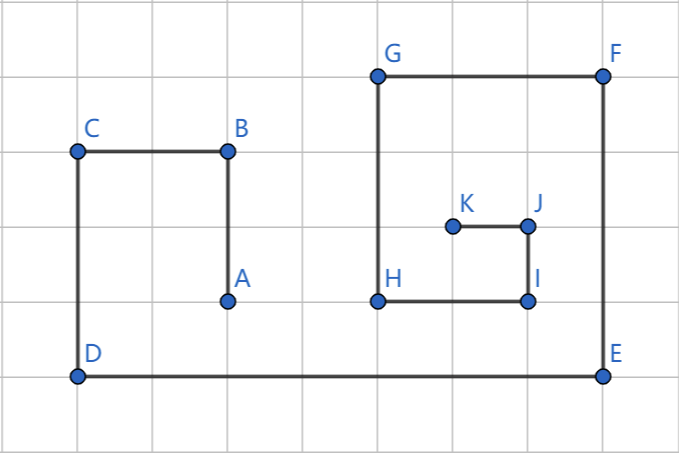

# C++ code with explanation

**Author:** Jeffrey_2020
**Votes:** 10
**Link:** [https://leetcode.com/problems/self-crossing/solutions/1806502/](https://leetcode.com/problems/self-crossing/solutions/1806502/)

---

This problem looks like how to check the crossing line, so the naive way is maintaining the existing lines, and checking if there are any intersections from the current line. Unfortunately, this approach needs O(n^2) query in the worst case.

The key point of the problem is for each line i, we only need to check 2 lines: line i-3 and line i-5. 

Here is the reason. 
* Firstly, the vertical line can only intersect with horizon line(except one special case: two vertical line may intersect at (0, 0)). 
* Then we note that we move to the next position following the fixed pattern: up, left, down, right, and so on, in other words, counterclockwise. Thus, there are 3 possible outputs:
	1. expansion case (line i has a possible intersection with line i-5):


	2. contraction case (line i has a possible intersection with line i-3):

	
	3. expansion+contraction case (line i has a possible intersection with line i-3 and line i-5):


Here is my code:
```
class Solution {
public:
    bool isSelfCrossing(vector<int>& distance) {
        if (distance.size() <= 3) return false; //only can have intersection with more than 4 lines

        distance.insert(distance.begin(), 0); //for the edge case: line i intersect with line i-4 at (0, 0)
        for (int i = 3; i < distance.size(); i++) {
            //check line i-3
            if (distance[i - 2] <= distance[i] && distance[i - 1] <= distance[i - 3]) return true;

            //check line i-5
            if (i >= 5) {
                if (distance[i - 1] <= distance[i - 3] && distance[i - 1] >= distance[i - 3] - distance[i - 5] 
                    && distance[i - 2] >= distance[i - 4] && distance[i - 2] <= distance[i - 4] + distance[i])
                    return true;
            }
        }
        return false;
    }
};
```