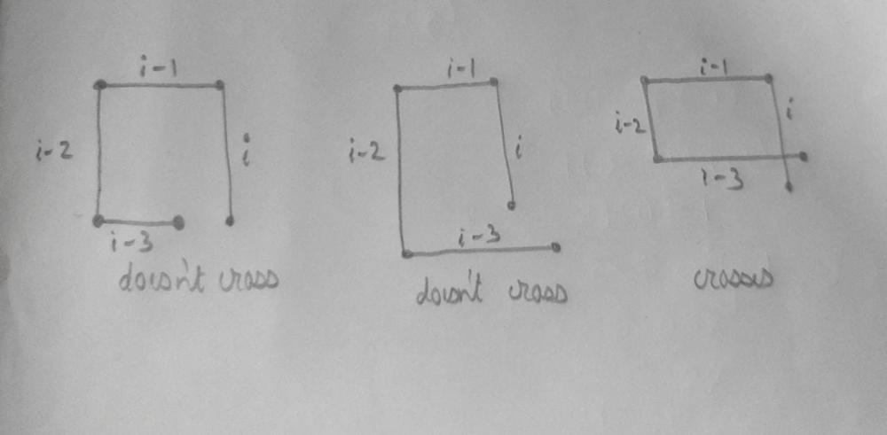
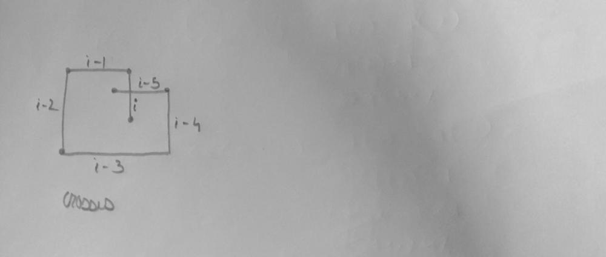

# C++ Solution || O(n) Time complexity || Pure Maths

**Author:** tikitecha
**Votes:** 29
**Link:** [https://leetcode.com/problems/self-crossing/solutions/3089493/](https://leetcode.com/problems/self-crossing/solutions/3089493/)

---

# Approach
 We observe that the point rotates in counter clockwise format.If the no of elements in distance is less than 4 then it cant even complete a full circle so it always returns False.
We apply for loop from 4 to the last line
 Next it can cross only in two ways :


### **When the 4th line meets the 1st line**


In the image above we notice when the 4th line meets the 1st line..It occurs only when two conditions satisfy:
1. The 4th line(i-3) should be longer than 2nd line(i-1)
2. The 3rd line(i-2) should be shorter than 1st line(i)

So we return True.

### **When the 6th line meets the 1st line**
 Only when length is longer than 5


In the image above we notice that the 6th line should cross the 1st line..The conditions for it to occur are:
1. The 3rd line(i-2) must be longer than 1st line(i) 
2. The 2nd line(i-1) must be shorter than 4th line(i-3)
3. The sum of 2nd line(i-1) and 6th line(i-5) must be greater than the 4th line(i-3)
4. The 1st line(i) and the 5th line(i-4) must be greater than the 3rd line(i-2)

So we return True.


# Complexity
- Time complexity:
O(n)

# Code
```
class Solution {
public:
    bool isSelfCrossing(vector<int>& distance) {
        if(distance.size()<4) return false;
        distance.insert(distance.begin(),0);
        for(int i=3;i<distance.size();i++){
            if(distance[i]>=distance[i-2] && distance[i-1]<=distance[i-3]) return true;
            if(i>=5){
                if(distance[i-1]<=distance[i-3] && distance[i-2]>=distance[i-4]&& distance[i-5]>=distance[i-3]-distance[i-1] && distance[i]>=distance[i-2]-distance[i-4])
                return true;
            }
        }
        return false;
    }
};

//UPVOTE IF YOU LIKED THE ANSWER..THANK YOU
```