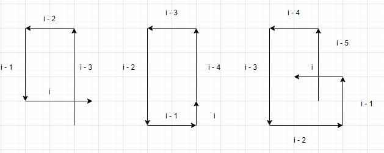

# Rust/Python linear solution with images and explanation

**Author:** SalvadorDali
**Votes:** 2
**Link:** [https://leetcode.com/problems/self-crossing/solutions/5339997/](https://leetcode.com/problems/self-crossing/solutions/5339997/)

---

# Intuition

Very interesting math problem, but not as interesting programming problem. To gain intuition try drawing for a few times random plots and see what is needed for an intersection. After a few plots you will seee that you do not need the whole history and you need to remember only last 5 interactions. There are 3 cases for intersection (ignoring rotations)



For each of the case you can write conditions which lead to this phase. The harderst is the last one but divide it into X and Y axis and it will become clear.

# Complexity
- Time complexity: $O(n)$
- Space complexity: $O(1)$

# Code
```Python []
class Solution:
  def isSelfCrossing(self, arr: List[int]) -> bool:
    for i in range(3, len(arr)):
      if arr[i - 3] >= arr[i - 1] and arr[i] >= arr[i - 2]:
        return True

      if i > 3 and arr[i - 3] == arr[i - 1] and arr[i - 2] <= arr[i] + arr[i - 4]:
        return True

      if i > 4 and arr[i - 3] >= arr[i - 5] and arr[i - 3] >= arr[i - 1] and arr[i - 3]<= arr[i - 5] + arr[i - 1] and arr[i - 2] >= arr[i - 4] and arr[i - 2] >= arr[i] and arr[i - 2] <= arr[i - 4] + arr[i]:
        return True
    
    return False
```
```Rust []
impl Solution {
  pub fn is_self_crossing(arr: Vec<i32>) -> bool {
    for i in 3..arr.len() {
      if arr[i - 3] >= arr[i - 1] && arr[i] >= arr[i - 2] {
        return true;
      }

      if i > 3 && arr[i - 3] == arr[i - 1] && arr[i - 2] <= arr[i] + arr[i - 4] {
        return true;
      }

      if i > 4 && arr[i - 3] >= arr[i - 5] && arr[i - 3] >= arr[i - 1] && arr[i - 3] <= arr[i - 5] + arr[i - 1] && arr[i - 2] >= arr[i - 4] && arr[i - 2] >= arr[i] && arr[i - 2] <= arr[i - 4] + arr[i] {
        return true;
      }
    }
    return false;
  }
}
```