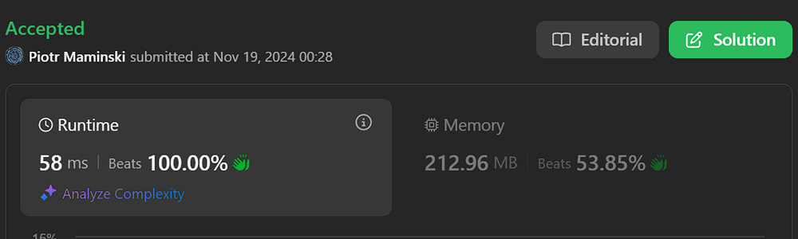

# Video | Beats 100% | O(1)

**Author:** Piotr_Maminski
**Votes:** 0
**Link:** [https://leetcode.com/problems/design-tic-tac-toe/solutions/6060108/](https://leetcode.com/problems/design-tic-tac-toe/solutions/6060108/)

---




```python3 []
class TicTacToe:
    """A Tic-tac-toe game board that tracks winning conditions for n x n board."""
    
    def __init__(self, n: int):
        """Initialize an n x n game board.
        
        Args:
            n: Size of the board (n x n)
        """
        # Track moves for each player (0 and 1) in rows and columns
        self.board_size = n
        self.player_rows = [[0] * n for _ in range(2)]  # Count of moves in each row
        self.player_cols = [[0] * n for _ in range(2)]  # Count of moves in each column
        
        # Track diagonal moves for each player
        self.player_diagonal = [0, 0]      # Top-left to bottom-right diagonal
        self.player_antidiagonal = [0, 0]  # Top-right to bottom-left diagonal

    def move(self, row: int, col: int, player: int) -> int:
        """Make a move on the board and check for a win.
        
        Args:
            row: Row position (0-based)
            col: Column position (0-based)
            player: Player number (1 or 2)
            
        Returns:
            int: Player number if they won, 0 if no win
        """
        player_idx = player - 1  # Convert to 0-based index
        
        # Update move counts
        self.player_rows[player_idx][row] += 1
        self.player_cols[player_idx][col] += 1
        
        # Check diagonal moves
        if row == col:
            self.player_diagonal[player_idx] += 1
            
        if row + col == self.board_size - 1:
            self.player_antidiagonal[player_idx] += 1
            
        # Check winning conditions
        if any([
            self.player_rows[player_idx][row] == self.board_size,
            self.player_cols[player_idx][col] == self.board_size,
            self.player_diagonal[player_idx] == self.board_size,
            self.player_antidiagonal[player_idx] == self.board_size
        ]):
            return player
            
        return 0
```
```cpp []
#include <vector>

class TicTacToe {
private:
    int board_size;
    std::vector<std::vector<int>> player_rows;
    std::vector<std::vector<int>> player_cols;
    std::vector<int> player_diagonal;
    std::vector<int> player_antidiagonal;

public:
    TicTacToe(int n) : board_size(n) {
        // Initialize vectors for 2 players (0 and 1)
        player_rows = std::vector<std::vector<int>>(2, std::vector<int>(n, 0));
        player_cols = std::vector<std::vector<int>>(2, std::vector<int>(n, 0));
        player_diagonal = std::vector<int>(2, 0);
        player_antidiagonal = std::vector<int>(2, 0);
    }

    int move(int row, int col, int player) {
        int player_idx = player - 1;  // Convert to 0-based index

        // Update move counts
        player_rows[player_idx][row]++;
        player_cols[player_idx][col]++;

        // Check diagonal moves
        if (row == col) {
            player_diagonal[player_idx]++;
        }

        if (row + col == board_size - 1) {
            player_antidiagonal[player_idx]++;
        }

        // Check winning conditions
        if (player_rows[player_idx][row] == board_size ||
            player_cols[player_idx][col] == board_size ||
            player_diagonal[player_idx] == board_size ||
            player_antidiagonal[player_idx] == board_size) {
            return player;
        }

        return 0;
    }
};
```
```java []
public class TicTacToe {
    private final int boardSize;
    private final int[][] playerRows;    // Count of moves in each row
    private final int[][] playerCols;    // Count of moves in each column
    private final int[] playerDiagonal;  // Top-left to bottom-right diagonal
    private final int[] playerAntidiagonal;  // Top-right to bottom-left diagonal

    /**
     * Initialize an n x n game board.
     *
     * @param n Size of the board (n x n)
     */
    public TicTacToe(int n) {
        this.boardSize = n;
        this.playerRows = new int[2][n];
        this.playerCols = new int[2][n];
        this.playerDiagonal = new int[2];
        this.playerAntidiagonal = new int[2];
    }

    /**
     * Make a move on the board and check for a win.
     *
     * @param row    Row position (0-based)
     * @param col    Column position (0-based)
     * @param player Player number (1 or 2)
     * @return Player number if they won, 0 if no win
     */
    public int move(int row, int col, int player) {
        int playerIdx = player - 1;  // Convert to 0-based index

        // Update move counts
        playerRows[playerIdx][row]++;
        playerCols[playerIdx][col]++;

        // Check diagonal moves
        if (row == col) {
            playerDiagonal[playerIdx]++;
        }

        if (row + col == boardSize - 1) {
            playerAntidiagonal[playerIdx]++;
        }

        // Check winning conditions
        if (playerRows[playerIdx][row] == boardSize ||
            playerCols[playerIdx][col] == boardSize ||
            playerDiagonal[playerIdx] == boardSize ||
            playerAntidiagonal[playerIdx] == boardSize) {
            return player;
        }

        return 0;
    }
}
```
```csharp []
public class TicTacToe {
    private readonly int boardSize;
    private readonly int[][] playerRows;
    private readonly int[][] playerCols;
    private readonly int[] playerDiagonal;
    private readonly int[] playerAntidiagonal;

    public TicTacToe(int n) {
        boardSize = n;
        playerRows = new int[2][] { new int[n], new int[n] };
        playerCols = new int[2][] { new int[n], new int[n] };
        playerDiagonal = new int[2];
        playerAntidiagonal = new int[2];
    }

    public int Move(int row, int col, int player) {
        int playerIdx = player - 1;

        playerRows[playerIdx][row]++;
        playerCols[playerIdx][col]++;

        if (row == col) {
            playerDiagonal[playerIdx]++;
        }

        if (row + col == boardSize - 1) {
            playerAntidiagonal[playerIdx]++;
        }

        if (playerRows[playerIdx][row] == boardSize ||
            playerCols[playerIdx][col] == boardSize ||
            playerDiagonal[playerIdx] == boardSize ||
            playerAntidiagonal[playerIdx] == boardSize) {
            return player;
        }

        return 0;
    }
}
```
```golang []
type TicTacToe struct {
    boardSize        int
    playerRows      [][]int
    playerCols      [][]int
    playerDiagonal  []int
    playerAntidiagonal []int
}

func Constructor(n int) TicTacToe {
    playerRows := make([][]int, 2)
    playerCols := make([][]int, 2)
    for i := range playerRows {
        playerRows[i] = make([]int, n)
        playerCols[i] = make([]int, n)
    }
    
    return TicTacToe{
        boardSize:        n,
        playerRows:      playerRows,
        playerCols:      playerCols,
        playerDiagonal:  make([]int, 2),
        playerAntidiagonal: make([]int, 2),
    }
}

func (t *TicTacToe) Move(row, col, player int) int {
    playerIdx := player - 1

    t.playerRows[playerIdx][row]++
    t.playerCols[playerIdx][col]++

    if row == col {
        t.playerDiagonal[playerIdx]++
    }

    if row+col == t.boardSize-1 {
        t.playerAntidiagonal[playerIdx]++
    }

    if t.playerRows[playerIdx][row] == t.boardSize ||
        t.playerCols[playerIdx][col] == t.boardSize ||
        t.playerDiagonal[playerIdx] == t.boardSize ||
        t.playerAntidiagonal[playerIdx] == t.boardSize {
        return player
    }

    return 0
}
```
```swift []
class TicTacToe {
    private let boardSize: Int
    private var playerRows: [[Int]]
    private var playerCols: [[Int]]
    private var playerDiagonal: [Int]
    private var playerAntidiagonal: [Int]
    
    init(_ n: Int) {
        boardSize = n
        playerRows = Array(repeating: Array(repeating: 0, count: n), count: 2)
        playerCols = Array(repeating: Array(repeating: 0, count: n), count: 2)
        playerDiagonal = Array(repeating: 0, count: 2)
        playerAntidiagonal = Array(repeating: 0, count: 2)
    }
    
    func move(_ row: Int, _ col: Int, _ player: Int) -> Int {
        let playerIdx = player - 1
        
        playerRows[playerIdx][row] += 1
        playerCols[playerIdx][col] += 1
        
        if row == col {
            playerDiagonal[playerIdx] += 1
        }
        
        if row + col == boardSize - 1 {
            playerAntidiagonal[playerIdx] += 1
        }
        
        if playerRows[playerIdx][row] == boardSize ||
            playerCols[playerIdx][col] == boardSize ||
            playerDiagonal[playerIdx] == boardSize ||
            playerAntidiagonal[playerIdx] == boardSize {
            return player
        }
        
        return 0
    }
}
```
```javascript [JS]
// JavaScript

class TicTacToe {
    constructor(n) {
        this.boardSize = n;
        this.playerRows = Array(2).fill().map(() => Array(n).fill(0));
        this.playerCols = Array(2).fill().map(() => Array(n).fill(0));
        this.playerDiagonal = Array(2).fill(0);
        this.playerAntidiagonal = Array(2).fill(0);
    }
    
    move(row, col, player) {
        const playerIdx = player - 1;
        
        this.playerRows[playerIdx][row]++;
        this.playerCols[playerIdx][col]++;
        
        if (row === col) {
            this.playerDiagonal[playerIdx]++;
        }
        
        if (row + col === this.boardSize - 1) {
            this.playerAntidiagonal[playerIdx]++;
        }
        
        if (this.playerRows[playerIdx][row] === this.boardSize ||
            this.playerCols[playerIdx][col] === this.boardSize ||
            this.playerDiagonal[playerIdx] === this.boardSize ||
            this.playerAntidiagonal[playerIdx] === this.boardSize) {
            return player;
        }
        
        return 0;
    }
}
```
```typescript [TS]
// TypeScript

class TicTacToe {
    private boardSize: number;
    private playerRows: number[][];
    private playerCols: number[][];
    private playerDiagonal: number[];
    private playerAntidiagonal: number[];

    constructor(n: number) {
        this.boardSize = n;
        this.playerRows = Array(2).fill(null).map(() => Array(n).fill(0));
        this.playerCols = Array(2).fill(null).map(() => Array(n).fill(0));
        this.playerDiagonal = Array(2).fill(0);
        this.playerAntidiagonal = Array(2).fill(0);
    }

    move(row: number, col: number, player: number): number {
        const playerIdx = player - 1;

        this.playerRows[playerIdx][row]++;
        this.playerCols[playerIdx][col]++;

        if (row === col) {
            this.playerDiagonal[playerIdx]++;
        }

        if (row + col === this.boardSize - 1) {
            this.playerAntidiagonal[playerIdx]++;
        }

        if (this.playerRows[playerIdx][row] === this.boardSize ||
            this.playerCols[playerIdx][col] === this.boardSize ||
            this.playerDiagonal[playerIdx] === this.boardSize ||
            this.playerAntidiagonal[playerIdx] === this.boardSize) {
            return player;
        }

        return 0;
    }
}
```
```rust []
struct TicTacToe {
    n: i32,
    rows: Vec<i32>,
    cols: Vec<i32>,
    diagonal: i32,
    anti_diagonal: i32,
}

impl TicTacToe {
    fn new(n: i32) -> Self {
        TicTacToe {
            n,
            rows: vec![0; n as usize],
            cols: vec![0; n as usize],
            diagonal: 0,
            anti_diagonal: 0,
        }
    }
    
    fn make_a_move(&mut self, row: i32, col: i32, player: i32) -> i32 {
        let increment = if player == 1 { 1 } else { -1 };
        
        self.rows[row as usize] += increment;
        self.cols[col as usize] += increment;
        
        if row == col {
            self.diagonal += increment;
        }
        
        if row + col == self.n - 1 {
            self.anti_diagonal += increment;
        }
        
        if self.rows[row as usize].abs() == self.n ||
           self.cols[col as usize].abs() == self.n ||
           self.diagonal.abs() == self.n ||
           self.anti_diagonal.abs() == self.n {
            return player;
        }
        
        0
    }
}
```
```ruby []
class TicTacToe
    def initialize(n)
        @board_size = n
        @player_rows = Array.new(2) { Array.new(n, 0) }
        @player_cols = Array.new(2) { Array.new(n, 0) }
        @player_diagonal = Array.new(2, 0)
        @player_antidiagonal = Array.new(2, 0)
    end

    def move(row, col, player)
        player_idx = player - 1
        
        @player_rows[player_idx][row] += 1
        @player_cols[player_idx][col] += 1
        
        @player_diagonal[player_idx] += 1 if row == col
        @player_antidiagonal[player_idx] += 1 if row + col == @board_size - 1
        
        if @player_rows[player_idx][row] == @board_size ||
           @player_cols[player_idx][col] == @board_size ||
           @player_diagonal[player_idx] == @board_size ||
           @player_antidiagonal[player_idx] == @board_size
            return player
        end
        
        0
    end
end
```

- Complexity: Time O(1) & Space O(n)

