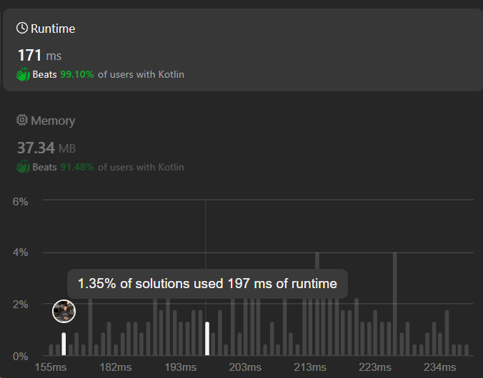

# 99% Beats | | Hashmap | | Easy Explanation Dry Run | | C++ | | C | |  Java | | Kotlin | | Python3 ✅✅

**Author:** Hunter_0718
**Votes:** 34
**Link:** [https://leetcode.com/problems/intersection-of-two-arrays/solutions/4850780/](https://leetcode.com/problems/intersection-of-two-arrays/solutions/4850780/)

---



**Intuition:**
When looking for the intersection of two arrays, a hash map can be quite efficient. We can iterate through one array and store the counts of each element in a hash map. Then, we iterate through the second array and check if each element exists in the hash map. If it does, we add it to the result vector and remove it from the hash map.

**Approach:**
1. Create a hash map to store the counts of each element in `nums1`.
2. Iterate through `nums2`.
3. If the current element exists in the hash map, add it to the result vector and remove it from the hash map.

**Complexity:**
- Time complexity: Since we iterate through both arrays once, the time complexity is O(n1 + n2), where n1 is the size of `nums1` and n2 is the size of `nums2`.
- Space complexity: We use extra space to store the counts of elements from `nums1`, so the space complexity is O(n1), where n1 is the size of `nums1`.


```C++ []
class Solution {
public:
    vector<int> intersection(vector<int>& nums1, vector<int>& nums2) {
        int m = nums2.size();
        vector<int>result;
        unordered_map<int,int>mp;
        for(auto &num : nums1){
            mp[num]++;
        }
        for(auto & num : nums2){
            if(mp.find(num) != mp.end()){
                result.push_back(num);
                mp.erase(num);
            }
        }
        return result;
    }
};
```
```C []
int* intersection(int* nums1, int nums1Size, int* nums2, int nums2Size, int* returnSize) {
    int* result = (int*)malloc(sizeof(int) * (nums1Size < nums2Size ? nums1Size : nums2Size));
    int resultIdx = 0;
    
    int* mp = (int*)calloc(1001, sizeof(int));
    
    for (int i = 0; i < nums1Size; i++) {
        mp[nums1[i]] = 1;
    }
    
    for (int i = 0; i < nums2Size; i++) {
        if (mp[nums2[i]]) {
            result[resultIdx++] = nums2[i];
            mp[nums2[i]] = 0;
        }
    }
    
    *returnSize = resultIdx;
    
    free(mp);
    return result;
}

```
```java []
class Solution {
    public int[] intersection(int[] nums1, int[] nums2) {
        Map<Integer, Integer> map = new HashMap<>();
        for (int num : nums1) {
            map.put(num, map.getOrDefault(num, 0) + 1);
        }
        
        List<Integer> resultList = new ArrayList<>();
        for (int num : nums2) {
            if (map.containsKey(num)) {
                resultList.add(num);
                map.remove(num);
            }
        }
        
        int[] result = new int[resultList.size()];
        for (int i = 0; i < resultList.size(); i++) {
            result[i] = resultList.get(i);
        }
        return result;
    }
}    


```
```python3 []
class Solution:
    def intersection(self, nums1: List[int], nums2: List[int]) -> List[int]:
        mp = {}
        for num in nums1:
            mp[num] = mp.get(num, 0) + 1
        
        result = []
        for num in nums2:
            if num in mp:
                result.append(num)
                del mp[num]
        
        return result


```
```javascript []
/**
 * @param {number[]} nums1
 * @param {number[]} nums2
 * @return {number[]}
 */
var intersection = function(nums1, nums2) {
    const mp = {};
    for (const num of nums1) {
        mp[num] = (mp[num] || 0) + 1;
    }
    
    const result = [];
    for (const num of nums2) {
        if (mp[num]) {
            result.push(num);
            delete mp[num];
        }
    }
    
    return result;
};

```
```kotlin []
import java.util.HashMap

class Solution {
    fun intersection(nums1: IntArray, nums2: IntArray): IntArray {
        val map = HashMap<Int, Int>()
        for (num in nums1) {
            map[num] = map.getOrDefault(num, 0) + 1
        }
        
        val resultList = mutableListOf<Int>()
        for (num in nums2) {
            if (map.containsKey(num)) {
                resultList.add(num)
                map.remove(num)
            }
        }
        
        return resultList.toIntArray()
    }
}


```


**Dry Run:**
Let's dry run the code with `nums1 = [4,9,5]` and `nums2 = [9,4,9,8,4]`.

1. Initialize `mp` as an empty hash map.
2. Iterate through `nums1`:
   - num = 4: Add 4 to `mp` with count 1.
   - num = 9: Add 9 to `mp` with count 1.
   - num = 5: Add 5 to `mp` with count 1.
3. Iterate through `nums2`:
   - num = 9: Exists in `mp`, so add 9 to result and remove from `mp`.
   - num = 4: Exists in `mp`, so add 4 to result and remove from `mp`.
   - num = 9: Doesn't exist in `mp`.
   - num = 8: Doesn't exist in `mp`.
   - num = 4: Doesn't exist in `mp`.
4. Return the result vector: [9, 4].