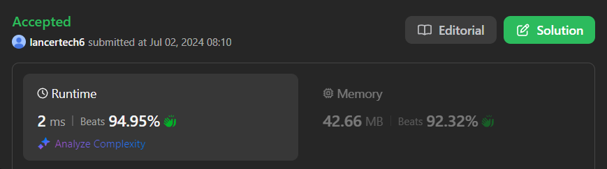

# ✅Beats 100% -Explained with [ Video ] -C++/Java/Python/JS - Two Pointers - Sorting

**Author:** lancertech6
**Votes:** 189
**Link:** [https://leetcode.com/problems/intersection-of-two-arrays-ii/solutions/5400128/](https://leetcode.com/problems/intersection-of-two-arrays-ii/solutions/5400128/)

---




# YouTube Video Explanation:

### To watch the video please click on "Watch On Youtube" option  available the left bottom corner of the thumbnail.

<!-- **If you want a video for this question please write in the comments** -->


https://youtu.be/Ur-c0l0NiaU


**\uD83D\uDD25 Please like, share, and subscribe to support our channel's mission of making complex concepts easy to understand.**

Subscribe Link: https://www.youtube.com/@leetlogics/?sub_confirmation=1

*Subscribe Goal: 2500 Subscribers*
*Current Subscribers: 2440*

Follow me on Instagram : https://www.instagram.com/divyansh.nishad/

---


# Intuition
<!-- Describe your first thoughts on how to solve this problem. -->
To find the intersection of two arrays where each element in the result must appear as many times as it shows in both arrays, we can take advantage of sorting and two-pointer techniques. Sorting helps in efficiently finding common elements by scanning through both arrays in a linear fashion. Using two pointers, one for each array, allows us to traverse both arrays and find common elements without having to repeatedly search through the arrays.

# Approach
<!-- Describe your approach to solving the problem. -->
1. **Sort Both Arrays**: Sorting helps in comparing elements of both arrays efficiently. By sorting both arrays, we can then use a two-pointer approach to find common elements.

2. **Initialize Pointers**: Use two pointers `i` and `j` to traverse through `nums1` and `nums2` respectively. Also, use a pointer `k` to keep track of the position in `nums1` where we store the result.

3. **Traverse Both Arrays**:
    - Compare the elements at the current positions of both pointers.
    - If the element in `nums1` is less than the element in `nums2`, increment pointer `i`.
    - If the element in `nums1` is greater than the element in `nums2`, increment pointer `j`.
    - If the elements are equal, it means we have found a common element. Store this element in `nums1[k]`, increment `i`, `j`, and `k`.

4. **Return the Result**: The result is stored in the first `k` positions of `nums1`. Use `Arrays.copyOfRange` to return this part of the array.

# Complexity
- **Time Complexity**: Sorting both arrays takes \\(O(n log n + m log m)\\), where \\(n\\) is the length of `nums1` and \\(m\\) is the length of `nums2`. The two-pointer traversal takes \\(O(n + m)\\). Thus, the overall time complexity is \\(O(n log n + m log m + n + m) = `O(n log n + m log m))`.
- **Space Complexity**: The space complexity is \\(O(1)\\) if we ignore the space used for sorting, as we are not using any extra space apart from the input arrays.


# Step by Step Explanation

**Example Input:**
```text
nums1 = [4, 9, 5]
nums2 = [9, 4, 9, 8, 4]
```

**Sorted Arrays:**
```text
nums1: [4, 5, 9]
nums2: [4, 4, 8, 9, 9]
```

| Step | nums1[i] | nums2[j] | Action                      | Result     |
|------|----------|----------|-----------------------------|------------|
| 1    | 4        | 4        | Append 4 to result          | [4]        |
| 2    | 5        | 4        | Increment j (nums2[j] < nums1[i]) | [4]        |
| 3    | 5        | 8        | Increment i (nums1[i] < nums2[j]) | [4]        |
| 4    | 9        | 8        | Increment j (nums2[j] < nums1[i]) | [4]        |
| 5    | 9        | 9        | Append 9 to result          | [4, 9]     |
| 6    | end      | end      | End of iteration            | [4, 9]     |

**Final Result:**
```text
[4, 9]
```


## Follow-up Questions

1. **What if the given array is already sorted? How would you optimize your algorithm?**
   - If the arrays are already sorted, the sorting step can be skipped. This reduces the time complexity to \\(O(n + m)\\) for the two-pointer traversal.

2. **What if nums1's size is small compared to nums2's size? Which algorithm is better?**
   - If `nums1` is much smaller than `nums2`, using a hash map to count elements in `nums1` and then iterating through `nums2` to find common elements can be more efficient. This avoids the overhead of sorting the larger array.

3. **What if elements of nums2 are stored on disk, and the memory is limited such that you cannot load all elements into the memory at once?**
   - If elements of `nums2` are stored on disk, a multi-pass approach might be necessary. First, load chunks of `nums2` into memory, compare with `nums1` (which can be fully loaded if it is small enough), and keep track of the intersection. This can be done using external sorting or streaming techniques.

# Code
```java []
class Solution {
    public int[] intersect(int[] nums1, int[] nums2) {
        int l1 = nums1.length;
        int l2 = nums2.length;
        int i = 0, j = 0, k = 0;
        Arrays.sort(nums1);
        Arrays.sort(nums2);
        while( i < l1 && j < l2)
        {
            if(nums1[i] < nums2[j])
            {
                i++;
            }
            else if(nums1[i] > nums2[j])
            {
                j++;
            }
            else
            {
                nums1[k++] = nums1[i++];
                j++;
            }
        }
        return Arrays.copyOfRange(nums1,0,k);
    }
}
```
```C++ []
class Solution {
public:
    vector<int> intersect(vector<int>& nums1, vector<int>& nums2) {
        sort(nums1.begin(), nums1.end());
        sort(nums2.begin(), nums2.end());
        
        int i = 0, j = 0;
        vector<int> result;
        
        while (i < nums1.size() && j < nums2.size()) {
            if (nums1[i] < nums2[j]) {
                i++;
            } else if (nums1[i] > nums2[j]) {
                j++;
            } else {
                result.push_back(nums1[i]);
                i++;
                j++;
            }
        }
        
        return result;
    }
};
```
```Python []
class Solution(object):
    def intersect(self, nums1, nums2):
        nums1.sort()
        nums2.sort()
        
        i, j = 0, 0
        result = []
        
        while i < len(nums1) and j < len(nums2):
            if nums1[i] < nums2[j]:
                i += 1
            elif nums1[i] > nums2[j]:
                j += 1
            else:
                result.append(nums1[i])
                i += 1
                j += 1
                
        return result
        
```
```Javascript []
/**
 * @param {number[]} nums1
 * @param {number[]} nums2
 * @return {number[]}
 */
var intersect = function(nums1, nums2) {
    nums1.sort((a, b) => a - b);
    nums2.sort((a, b) => a - b);
    
    let i = 0, j = 0;
    const result = [];
    
    while (i < nums1.length && j < nums2.length) {
        if (nums1[i] < nums2[j]) {
            i++;
        } else if (nums1[i] > nums2[j]) {
            j++;
        } else {
            result.push(nums1[i]);
            i++;
            j++;
        }
    }
    
    return result;
};
```

