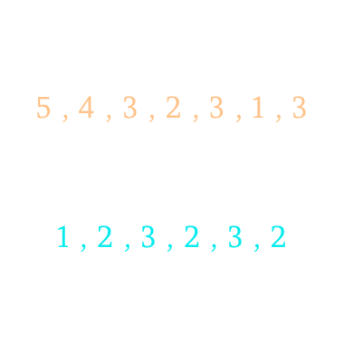

# Swift Two Pointers solution with illustration

**Author:** windsuzu
**Votes:** 68
**Link:** [https://leetcode.com/problems/intersection-of-two-arrays-ii/solutions/82257/](https://leetcode.com/problems/intersection-of-two-arrays-ii/solutions/82257/)

---

```
func intersect(_ nums1: [Int], _ nums2: [Int]) -> [Int] {
    var nums1 = nums1.sorted()
    var nums2 = nums2.sorted()
    var res = [Int]()
    var i = 0, j = 0
    
    while i < nums1.count && j < nums2.count {
        if nums1[i] == nums2[j] {
            res.append(nums1[i])
            i += 1 ; j += 1
        } else if nums1[i] < nums2[j] {
            i += 1
        } else {
            j += 1
        }
    }
    return res
}
```
