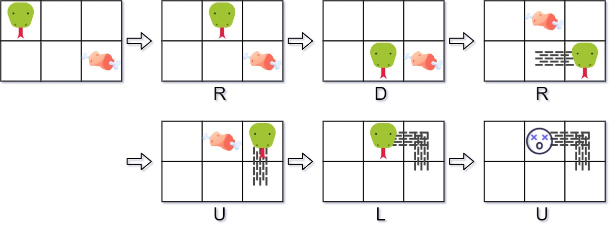

# [353. Design Snake Game](https://leetcode.com/problems/design-snake-game/)

| Category | Difficulty | Likes | Dislikes |
| :------: | :--------: | :---: | :------: |
| Algorithms | Medium | 1009 | 353 |

**Tags:** [`array`](https://leetcode.com/tag/array), [`hash-table`](https://leetcode.com/tag/hash-table), [`design`](https://leetcode.com/tag/design), [`queue`](https://leetcode.com/tag/queue), [`simulation`](https://leetcode.com/tag/simulation)

**Companies:** `atlassian`, `weride`, `amazon`, `microsoft`, `ixl`, `google`

## Description

Design a Snake game that is played on a device with screen size `height x width`. Play the game online if you are not familiar with the game.

The snake is initially positioned at the top left corner `(0, 0)` with a length of `1` unit.

You are given an array `food` where `food[i] = (r_i, c_i)` is the row and column position of a piece of food that the snake can eat. When a snake eats a piece of food, its length and the game's score both increase by `1`.

Each piece of food appears one by one on the screen, meaning the second piece of food will not appear until the snake eats the first piece of food.

When a piece of food appears on the screen, it is **guaranteed** that it will not appear on a block occupied by the snake.

The game is over if the snake goes out of bounds (hits a wall) or if its head occupies a space that its body occupies **after** moving (i.e. a snake of length 4 cannot run into itself).

Implement the `SnakeGame` class:

	- `SnakeGame(int width, int height, int[][] food)` Initializes the object with a screen of size `height x width` and the positions of the `food`.

	- `int move(String direction)` Returns the score of the game after applying one `direction` move by the snake. If the game is over, return `-1`.

 

**Example 1:**


```

Input
[&quot;SnakeGame&quot;, &quot;move&quot;, &quot;move&quot;, &quot;move&quot;, &quot;move&quot;, &quot;move&quot;, &quot;move&quot;]
[[3, 2, [[1, 2], [0, 1]]], [&quot;R&quot;], [&quot;D&quot;], [&quot;R&quot;], [&quot;U&quot;], [&quot;L&quot;], [&quot;U&quot;]]
Output
[null, 0, 0, 1, 1, 2, -1]

Explanation
SnakeGame snakeGame = new SnakeGame(3, 2, [[1, 2], [0, 1]]);
snakeGame.move(&quot;R&quot;); // return 0
snakeGame.move(&quot;D&quot;); // return 0
snakeGame.move(&quot;R&quot;); // return 1, snake eats the first piece of food. The second piece of food appears at (0, 1).
snakeGame.move(&quot;U&quot;); // return 1
snakeGame.move(&quot;L&quot;); // return 2, snake eats the second food. No more food appears.
snakeGame.move(&quot;U&quot;); // return -1, game over because snake collides with border

```

 

**Constraints:**

	- `1 <= width, height <= 10^4`

	- `1 <= food.length <= 50`

	- `food[i].length == 2`

	- `0 <= r_i < height`

	- `0 <= c_i < width`

	- `direction.length == 1`

	- `direction` is `'U'`, `'D'`, `'L'`, or `'R'`.

	- At most `10^4` calls will be made to `move`.

---

**Links:** [Submissions](https://leetcode.com/problems/design-snake-game/) | [Solutions](https://leetcode.com/problems/design-snake-game/)
