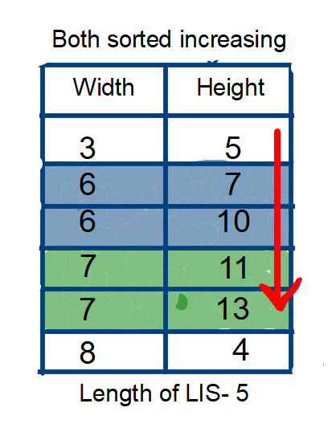
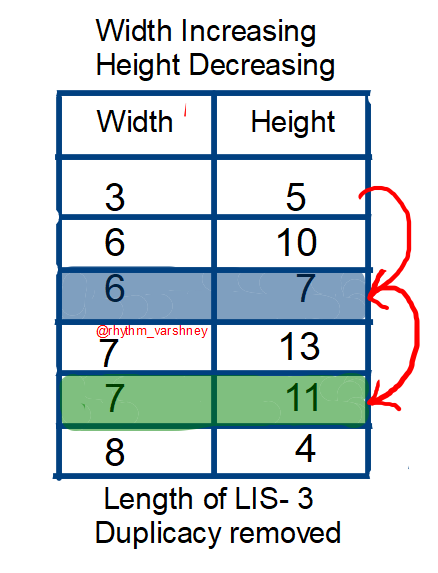

# [C++,Java, Python]Best Explanation with Pictures

**Author:** rhythm_varshney
**Votes:** 397
**Link:** [https://leetcode.com/problems/russian-doll-envelopes/solutions/2071477/](https://leetcode.com/problems/russian-doll-envelopes/solutions/2071477/)

---

**If you like this solution or find it useful, please upvote this post.**
<details>
	<summary>Prerequisite</summary>
	<br>
	Before moving on to the solution, you should know how can we find the length of <strong>Longest Increasing Subsequence</strong> unsing <strong>Binary Search</strong>. You can find the detailed explanation of the logic on the below link.                                        
	</br>
	<br></br>
	<a href="https://leetcode.com/problems/longest-increasing-subsequence/discuss/1636162/java-binary-search-stepwise-explanation">Longest Increasing Subsequence Using Binary Search</a>
</details>
<br></br>

#### Why we need to sort?
* In these types of problem when we are dealing with two dimensions, we need to reduce the problem from two-dimensional array into a one-dimensional array in order to improve time complexity. 
* **"Sort first when things are undecided"**, sorting can make the data orderly, reduce the degree of confusion, and often help us to sort out our thinking. the same is true with this question. Now, after doing the correct sorting, we just need to find Longest Increasing Subsequence of that one dimensional array.
**Now, you may be wondered what correct sorting actually is?**
It is the sorting which we do to order to achieve the answer. Like, increasing, non-increasing sorting. Without any further discussion, let's dig into Intuition followed by algorithm.

##### Algorithm
* We sort the array in increasing order of width. And if two widths are same, we need to sort height in decreasing order. 
* Now why we need to sort in decreasing order if two widths are same. By this practice, we're assuring that no width will get counted more than one time. Let's take an example
envelopes=`[[3, 5], [6, 7], [7, 13], [6, 10], [8, 4], [7, 11]]`

Now, if you see for a while, **6 and 7** is counted twice while we're calculating the length of LIS, which will give the wrong ans. As question is asking, if any width/height are less than or equal, then, it is not possible to russian doll these envelopes. 
Now, we know the problem. So, how can we tackle these conditions when two width are same, so that it won't affect our answer. We can simple **reverse sort the height if two width are equal, to remove duplicacy.**
Now, you may question, how reverse sorting the height would remove duplicacy? As the name itself says, Longest Increasing Subsequnce, the next coming height would be less than the previous one. Hence, forbidding it to increase length count.

If you don't understand how LIS is calculated here, I strongly refer you to follow the prerequisite.
Now, we have **sucessfully reduced the problem to LIS!** All you need to apply classical LIS on heights, to calculate the ans. This would be the maximum number of envelopes can be russian doll.

**Code**

```
class Solution {
    public int binarySearch(int[] dp, int val){
        int lo=0,hi=dp.length-1,res=0;
        while(lo<=hi){
            int mid=(lo+hi)/2;
            if(dp[mid]<val){
                res=mid;
                lo=mid+1;
            }else{
                hi=mid-1;
            }
        }
        return res+1;
    }
    public int maxEnvelopes(int[][] envelopes) {
        Arrays.sort(envelopes,(a,b)->a[0]==b[0]?b[1]-a[1]:a[0]-b[0]);
        int[] LIS=new int[envelopes.length+1];
        Arrays.fill(LIS,Integer.MAX_VALUE);
        LIS[0]=Integer.MIN_VALUE;
        int ans=0;
        for(int i=0;i<envelopes.length;i++){
            int val=envelopes[i][1];
            int insertIndex=binarySearch(LIS,val);
            ans=Math.max(ans,insertIndex);
            if(LIS[insertIndex]>=val){
                LIS[insertIndex]=val;
            }
        }
        return ans;
    }
}
```

Now, if you compare the code of this problem with the classical LIS, it is very similar. Infact, we have added only one line to get the maximum Russian Doll.

`Arrays.sort(envelopes,(a,b)->a[0]==b[0]?b[1]-a[1]:a[0]-b[0]);`

Language Used- **JAVA**
Time Complexity- **O(nlogn)**
Space Complexity- **O(n)**

**Python Solution-**
```class Solution:
    def maxEnvelopes(self, envelopes: List[List[int]]) -> int:
        envelopes.sort(key=lambda x: (x[0], -x[1]))
        LIS = []
        size = 0
        for (w, h) in envelopes:
            if not LIS or h > LIS[-1]:
                LIS.append(h)
                size += 1
            else:
                l, r = 0, size
                while l < r:
                    m = l + (r - l) // 2
                    if LIS[m] < h:
                        l = m + 1
                    else:
                        r = m
                LIS[l] = h
        return size
```
by @bettercoder168

C++ Code
```
class Solution {
public:
    static bool comp(vector<int> &a, vector<int> &b){
        if(a[0]==b[0]){
            return a[1]>b[1];
        }
        return a[0]<b[0];
    }
        
    int maxEnvelopes(vector<vector<int>>& envelopes) {
        sort(envelopes.begin(), envelopes.end(), comp);
        int i, j, n=envelopes.size();
        vector<int>lis;
        
        for(i=0; i<n; i++){
            auto it = lower_bound(lis.begin(), lis.end(), envelopes[i][1]);
            if(it==lis.end()){lis.push_back(envelopes[i][1]);}
            else{
                *it = envelopes[i][1];
            }
        }
        return lis.size();
    }
};
```
by @uttarandas501
		
##### If you like this solution or find it useful, please upvote this post.
