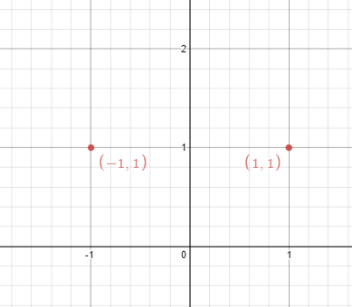
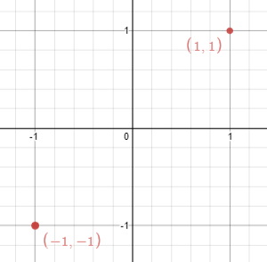

# [356. Line Reflection](https://leetcode.com/problems/line-reflection/)

| Category | Difficulty | Likes | Dislikes |
| :------: | :--------: | :---: | :------: |
| Algorithms | Medium | 315 | 637 |

**Tags:** [`array`](https://leetcode.com/tag/array), [`hash-table`](https://leetcode.com/tag/hash-table), [`math`](https://leetcode.com/tag/math)

**Companies:** `yandex`, `google`

## Description

Given `n` points on a 2D plane, find if there is such a line parallel to the y-axis that reflects the given points symmetrically.

In other words, answer whether or not if there exists a line that after reflecting all points over the given line, the original points' set is the same as the reflected ones.

**Note** that there can be repeated points.

 

**Example 1:**


```

Input: points = [[1,1],[-1,1]]
Output: true
Explanation: We can choose the line x = 0.

```

**Example 2:**


```

Input: points = [[1,1],[-1,-1]]
Output: false
Explanation: We can&#39;t choose a line.

```

 

**Constraints:**

	- `n == points.length`

	- `1 <= n <= 10^4`

	- `-10^8 <= points[i][j] <= 10^8`

 

**Follow up:** Could you do better than `O(n^2)`?

---

**Links:** [Submissions](https://leetcode.com/problems/line-reflection/) | [Solutions](https://leetcode.com/problems/line-reflection/)
