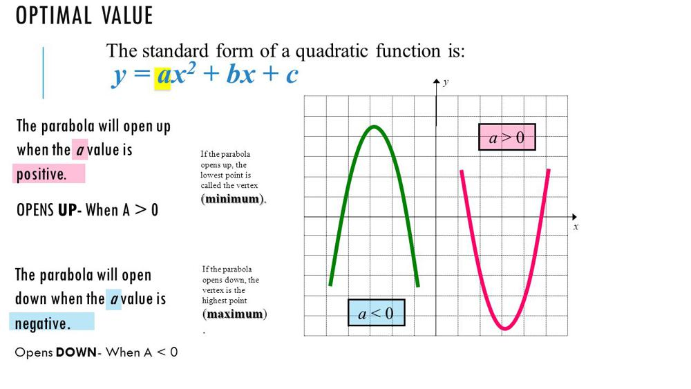

# Explained Easy Javascript O(n) T, Pointers Solution

**Author:** aunsh
**Votes:** 1
**Link:** [https://leetcode.com/problems/sort-transformed-array/solutions/2945404/](https://leetcode.com/problems/sort-transformed-array/solutions/2945404/)

---

# Intuition
A quadratic is the equation of a parabola. There are just two conditions to keep in mind when solving. 
1. a > 0. This means that the a has the minimum value.
2. a < 0. This means that a has the maximum value.


 $$Image$$ $$credits$$ $$-$$ **[$$Cynthia$$ $$Owen$$](https://slideplayer.com/slide/7060642/)**


Hence, by taking in consideration the value of a, we will either start adding the quadratic values at the start and iterate forwards or the end of the array and iterate backwards.

# Approach
1. Initialize left = 0, right = nums.length - 1. Create a new result array with length = nums.length
2. Initialize an index pointer to store the values in the result array. The initial value of index will be nums.length - 1 if > 0 or else 0. 
3. While left <= right, calculate the quadratic values of elements at the left (leftVal) and right (rightVal) pointers. 
4. If a>=0, if leftVal >= rightVal, add leftVal at the index value in result array, decrement index and increment left. Else, add rightVal at the index value, decrement index and decrement right.
5. If a<0 and if leftVal >= rightVal then add rightVal at index of result array, right-- and index++ or else add leftVal at index of result array, left++, index++.
6. After the while loop return the result array.


# Complexity
- Time complexity:
O(n)

- Space complexity:
O(n)

# Code
```
/**
 * @param {number[]} nums
 * @param {number} a
 * @param {number} b
 * @param {number} c
 * @return {number[]}
 */
var sortTransformedArray = function(nums, a, b, c) {
    // Function to evaluate quadratic expression
    const quadratic = (x) => {
        return (a * Math.pow(x, 2)) + (b * x) + c
    }

    // Initialize two pointers left and right and create a new result array
    let left = 0, right = nums.length - 1, res = new Array(nums.length)

    // If a>=0 then we will add values from the end of array or else start of the array 
    let idx = a >=0 ? nums.length -1 : 0

    while(left<=right){
        // Calculate the quadratic values of two elements which the pointers point at
        let leftVal = quadratic(nums[left]), rightVal = quadratic(nums[right])
        // If a>=0 and if leftVal > rightVal then add leftVal to array and if a < 0 and if left > rightVal add rightVal to array
        if(a>=0){
            if(leftVal >= rightVal){
                res[idx] = leftVal, left++, idx--
            } else {
                res[idx] = rightVal, right--, idx--
            }
        } else {
            if(leftVal >= rightVal){
                res[idx] = rightVal, right--, idx++
            } else {
                res[idx] = leftVal, left++, idx++
            }
        }
    }

    return res
};
```