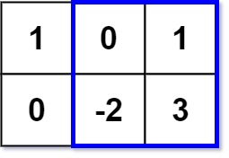

# [363. Max Sum of Rectangle No Larger Than K](https://leetcode.com/problems/max-sum-of-rectangle-no-larger-than-k/)

| Category | Difficulty | Likes | Dislikes |
| :------: | :--------: | :---: | :------: |
| Algorithms | Hard | 3549 | 176 |

**Tags:** [`array`](https://leetcode.com/tag/array), [`binary-search`](https://leetcode.com/tag/binary-search), [`matrix`](https://leetcode.com/tag/matrix), [`prefix-sum`](https://leetcode.com/tag/prefix-sum), [`ordered-set`](https://leetcode.com/tag/ordered-set)

**Companies:** `google`

## Description

Given an `m x n` matrix `matrix` and an integer `k`, return *the max sum of a rectangle in the matrix such that its sum is no larger than* `k`.

It is **guaranteed** that there will be a rectangle with a sum no larger than `k`.

 

**Example 1:**


```

Input: matrix = [[1,0,1],[0,-2,3]], k = 2
Output: 2
Explanation: Because the sum of the blue rectangle [[0, 1], [-2, 3]] is 2, and 2 is the max number no larger than k (k = 2).

```

**Example 2:**

```

Input: matrix = [[2,2,-1]], k = 3
Output: 3

```

 

**Constraints:**

	- `m == matrix.length`

	- `n == matrix[i].length`

	- `1 <= m, n <= 100`

	- `-100 <= matrix[i][j] <= 100`

	- `-10^5 <= k <= 10^5`

 

**Follow up:** What if the number of rows is much larger than the number of columns?

---

**Links:** [Submissions](https://leetcode.com/problems/max-sum-of-rectangle-no-larger-than-k/) | [Solutions](https://leetcode.com/problems/max-sum-of-rectangle-no-larger-than-k/)
