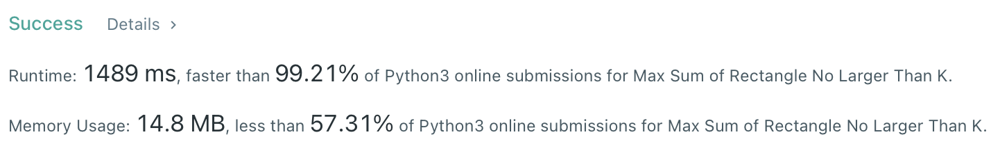

# ✔️Python🔥99.2%✅using Kadane's algorithm & bisect

**Author:** luluboy168
**Votes:** 28
**Link:** [https://leetcode.com/problems/max-sum-of-rectangle-no-larger-than-k/solutions/2491014/](https://leetcode.com/problems/max-sum-of-rectangle-no-larger-than-k/solutions/2491014/)

---

```
class Solution:
    def maxSumSubmatrix(self, matrix: List[List[int]], k: int) -> int:
        m, n = len(matrix), len(matrix[0])
        res = -inf
        
        for l in range(n):
            rowSums = [0] * m
            for r in range(l, n):
                colSums = [0]
                colSum = 0
                for i in range(m):
                    rowSums[i] += matrix[i][r]
                    colSum += rowSums[i]
                    diff = colSum - k
                    idx = bisect_left(colSums, diff)
                    if idx < len(colSums):
                        if colSums[idx] == diff:
                            return k
                        else:
                            res = max(res, colSum - colSums[idx])
                    insort(colSums, colSum)
        return res
```


**Please UPVOTE if you LIKE!!**