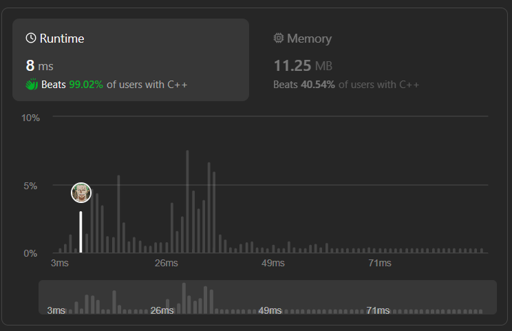

# ✅☑Beats 99%  Users || [C++/Java/Python/JavaScript] || EXPLAINED🔥

**Author:** MarkSPhilip31
**Votes:** 155
**Link:** [https://leetcode.com/problems/largest-divisible-subset/solutions/4699685/](https://leetcode.com/problems/largest-divisible-subset/solutions/4699685/)

---

# PLEASE UPVOTE IF IT HELPED

---


---

# Approaches
(Also explained in the code)

1. **Sort the Numbers:** The first step is to sort the input array nums in ascending order. This is done to ensure that we only consider elements that come before the current element during the iteration.

1. **Dynamic Programming (DP) Approach:** We use dynamic programming to find the length of the largest divisible subset ending at each index. We maintain a dp array where dp[i] represents the length of the largest divisible subset ending at index i.

1. **Finding Divisible Subsets:** For each element nums[i], we iterate through all elements before it (nums[j], where j < i) and check if nums[i] is divisible by nums[j]. If it is divisible and adding nums[i] to the subset results in a larger subset, we update the dp[i] value.

1. **Track Maximum Length:** During the DP process, we keep track of the maximum subset length (maxi). This helps us identify the size of the largest divisible subset.

1. **Backtracking to Generate Subset:** Once we have the maximum subset length, we iterate through the dp array from the end to reconstruct the largest divisible subset. We start from the element that corresponds to the maximum subset length and backtrack by adding elements to the result vector (v) while ensuring that each element divides the next element in the subset.


# Complexity
- Time complexity:
   $$O(n^2)$$
    

- Space complexity:
   $$O(n)$$
    


# Code
```C++ []

class Solution {
public:
    vector<int> largestDivisibleSubset(vector<int>& nums) {
        int n=nums.size(), maxi=1, num=-1;
        vector<int>v;
        sort(nums.begin(), nums.end());
        vector<int>dp(n, 1);
        for(int i=1; i<n; i++){
            for(int j=0; j<i; j++){
                if(!(nums[i]%nums[j]) && dp[i]<dp[j]+1){
                    dp[i]=dp[j]+1;
                    if(maxi<dp[i]){
                        maxi=dp[i];
                    }
                }
            }
        }
        for(int i=n-1; i>=0; i--){
            if(maxi==dp[i] && (num==-1 || !(num%nums[i]))){
                v.push_back(nums[i]);
                maxi--;
                num=nums[i];
            }
        }
        return v;
    }
};


```
```Java []
class Solution {
    public List<Integer> largestDivisibleSubset(int[] nums) {
        int n = nums.length;
        int[] dp = new int[n];
        Arrays.fill(dp, 1);
        Arrays.sort(nums);
        
        int maxSize = 1, maxIndex = 0;
        for (int i = 1; i < n; i++) {
            for (int j = 0; j < i; j++) {
                if (nums[i] % nums[j] == 0) {
                    dp[i] = Math.max(dp[i], dp[j] + 1);
                    if (dp[i] > maxSize) {
                        maxSize = dp[i];
                        maxIndex = i;
                    }
                }
            }
        }
        
        List<Integer> result = new ArrayList<>();
        int num = nums[maxIndex];
        for (int i = maxIndex; i >= 0; i--) {
            if (num % nums[i] == 0 && dp[i] == maxSize) {
                result.add(nums[i]);
                num = nums[i];
                maxSize--;
            }
        }
        
        return result;
    }
}


```
```python3 []
class Solution:
    def largestDivisibleSubset(self, nums: List[int]) -> List[int]:
        nums.sort()
        n = len(nums)
        dp = [1] * n
        max_size, max_index = 1, 0

        for i in range(1, n):
            for j in range(i):
                if nums[i] % nums[j] == 0:
                    dp[i] = max(dp[i], dp[j] + 1)
                    if dp[i] > max_size:
                        max_size = dp[i]
                        max_index = i

        result = []
        num = nums[max_index]
        for i in range(max_index, -1, -1):
            if num % nums[i] == 0 and dp[i] == max_size:
                result.append(nums[i])
                num = nums[i]
                max_size -= 1

        return result


```
```javascript []
var largestDivisibleSubset = function(nums) {
    nums.sort((a, b) => a - b);
    const n = nums.length;
    const dp = new Array(n).fill(1);
    let maxSize = 1, maxIndex = 0;

    for (let i = 1; i < n; i++) {
        for (let j = 0; j < i; j++) {
            if (nums[i] % nums[j] === 0) {
                dp[i] = Math.max(dp[i], dp[j] + 1);
                if (dp[i] > maxSize) {
                    maxSize = dp[i];
                    maxIndex = i;
                }
            }
        }
    }

    const result = [];
    let num = nums[maxIndex];
    for (let i = maxIndex; i >= 0; i--) {
        if (num % nums[i] === 0 && dp[i] === maxSize) {
            result.push(nums[i]);
            num = nums[i];
            maxSize--;
        }
    }

    return result;
};


```
---


# PLEASE UPVOTE IF IT HELPED

---
---


---