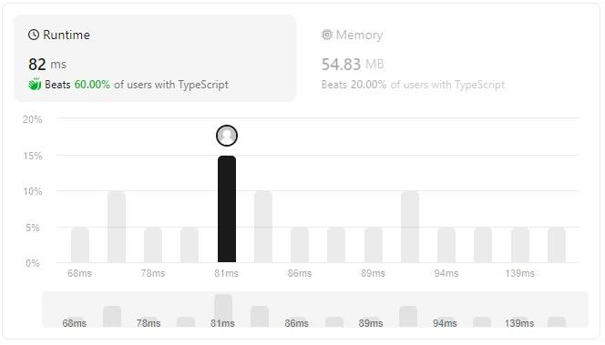

# Easy understand, 82ms (Beats 60%), 54.83MB (Beats 20%)

**Author:** morris367
**Votes:** 1
**Link:** [https://leetcode.com/problems/largest-divisible-subset/solutions/4700104/](https://leetcode.com/problems/largest-divisible-subset/solutions/4700104/)

---

# Intuition
1. sort
2. reversing the order => %
3. find the largest

# Approach
<!-- Describe your approach to solving the problem. -->

# Complexity
- Time complexity:
<!-- Add your time complexity here, e.g. $$O(n)$$ -->

- Space complexity:
<!-- Add your space complexity here, e.g. $$O(n)$$ -->

# Code
```
function largestDivisibleSubset(nums: number[]): number[] {
    nums.sort((a,b)=>a-b)
    let ans: number[] = new Array()
    let largest: number = 0

    //store array
    let dp: number[][] = Array.from({ length: nums.length }, () => []);
    //store array length
    let arr: number[] = new Array(nums.length).fill(0)


    let search = (idx): number => {
        let temp: number = 0
        let tempArr: number[] = new Array()

        //search the largest in subset
        for (let i: number = idx + 1; i < nums.length; i++) 
            if (nums[i] % nums[idx] == 0)
                if (arr[i] > temp) {
                    temp = arr[i]
                    tempArr = [...dp[i]]
                }

        //put back value
        arr[idx] = temp + 1
        dp[idx] = [nums[idx]].concat(tempArr)

        return arr[idx]
    }

    for (let i: number = nums.length - 1; i >= 0; i--) {
        let temp: number = search(i)

        //store the largest record
        if (temp > largest) {
            largest = temp
            ans = dp[i]
        }
    }

    return ans
};
```

