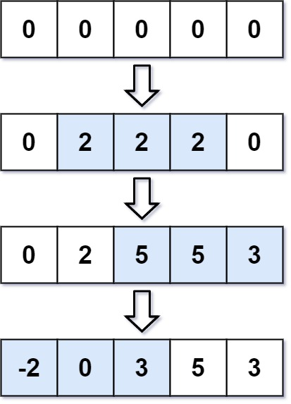

# [370. Range Addition](https://leetcode.com/problems/range-addition/)

| Category | Difficulty | Likes | Dislikes |
| :------: | :--------: | :---: | :------: |
| Algorithms | Medium | 1680 | 86 |

**Tags:** [`array`](https://leetcode.com/tag/array), [`prefix-sum`](https://leetcode.com/tag/prefix-sum)

**Companies:** `google`

## Description

You are given an integer `length` and an array `updates` where `updates[i] = [startIdx_i, endIdx_i, inc_i]`.

You have an array `arr` of length `length` with all zeros, and you have some operation to apply on `arr`. In the `i^th` operation, you should increment all the elements `arr[startIdx_i], arr[startIdx_i + 1], ..., arr[endIdx_i]` by `inc_i`.

Return `arr` *after applying all the* `updates`.

 

**Example 1:**


```

Input: length = 5, updates = [[1,3,2],[2,4,3],[0,2,-2]]
Output: [-2,0,3,5,3]

```

**Example 2:**

```

Input: length = 10, updates = [[2,4,6],[5,6,8],[1,9,-4]]
Output: [0,-4,2,2,2,4,4,-4,-4,-4]

```

 

**Constraints:**

	- `1 <= length <= 10^5`

	- `0 <= updates.length <= 10^4`

	- `0 <= startIdx_i <= endIdx_i < length`

	- `-1000 <= inc_i <= 1000`

---

**Links:** [Submissions](https://leetcode.com/problems/range-addition/) | [Solutions](https://leetcode.com/problems/range-addition/)
