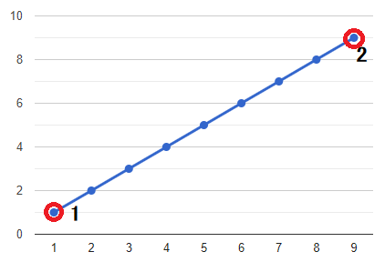

# ✔️ C++ O ( N ) || EXPLAINED || ; ]

**Author:** karan_8082
**Votes:** 392
**Link:** [https://leetcode.com/problems/wiggle-subsequence/solutions/2229495/](https://leetcode.com/problems/wiggle-subsequence/solutions/2229495/)

---

**UPVOTE IF HELPFuuL**

The demand of the question is to get **INCREASING** and **DECREASING** sequences alternating.
Now re-arranging of array is not possible, Hence **NUMBER OF TIMES ARRAY CHANGES** from increasing to decreasing & vice versa **REMAINS CONSTANT**.

The question can now reduced to find number of times array changes pattern.
Further , it can be deduced that we have to **COUNT THE NUMBER OF PEAKS AND VALLEY POINTS.**
EXAMPLE 1 => ```nums = [1, 2, 3, 4, 5, 6, 7, 8, 9 ]```

EXAMPLE 2 => ```nums = [1, 17, 5, 10, 13, 15, 10, 5, 16, 8 ]```


There are multiple ways to do so. Chose any.
**UPVOTE IF HELPFuuL**

```
class Solution {
public:
    int wiggleMaxLength(vector<int>& nums) {
        int size=nums.size(), peak=1, valley=1;
        for(int i=1; i<size; ++i){
                 if(nums[i]>nums[i-1]) peak = valley + 1;
            else if(nums[i]<nums[i-1]) valley = peak + 1;
        }
        return max(peak , valley );
    }
};
```

