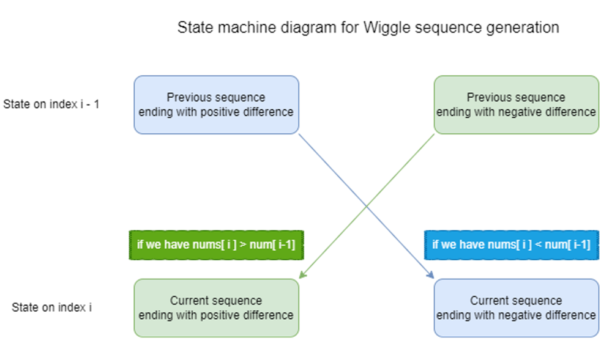

# Python/JS/Java/Go/C++ O(n) DP [w/ State machine diagram]

**Author:** brianchiang_tw
**Votes:** 11
**Link:** [https://leetcode.com/problems/wiggle-subsequence/solutions/1115202/](https://leetcode.com/problems/wiggle-subsequence/solutions/1115202/)

---

**State machine diagram**




---

Python:

```
class Solution(object):
    def wiggleMaxLength(self, nums):
        """
        :type nums: List[int]
        :rtype: int
        """
        
        n = len( nums )
        
		## Base case
        # length of wiggle sequence, ending in positive difference, negative difference
        positive, negative = 1, 1
        
        ## General cases:
        # scan from secnond number to last number
        for i in range(1, n):
        
            if nums[i] > nums[i-1]:
                
                # difference is positive, concatenated with negative prefix wiggle subsequence
                positive = negative + 1
                
            elif nums[i] < nums[i-1]:
                
                # differnce is negative, concatenated with positive prefix wiggle subsequence
                negative = positive + 1
                
        # compute the longest length of wiggle sequence                
        return max(positive, negative)
```

---

Java:

```
class Solution {
    public int wiggleMaxLength(int[] nums) {
        
        final int n = nums.length;
        
        // Base case
        // length of wiggle sequence, ending in positive difference, negative difference
        int positive=1, negative = 1;
        
        // General cases:
        // scan from second number to last number
        for( int i = 1 ; i < n ; i++){
            
            if( nums[i] > nums[i-1] ){
                
                // difference is positive, concatednated with negative prefix wiggle subsequence
                positive = negative + 1;
                
            }else if( nums[i] < nums[i-1] ){
                
                // difference is negative, concatednated with positive prefix wiggle subsequence
                negative = positive + 1;
            }       
        }
        
        // compute the longest length of wiggle sequence     
        return Math.max(positive, negative);
    }
}
```

---

Javascript:

```
var wiggleMaxLength = function(nums) {
  
    let n = nums.length;
    
    // Base case:
    // length of wiggle sequence, ending in positive difference, negative difference
    let [positive, negative] = [1, 1];
    
    
    // General cases:
    // scan from second number to last number
    for( let i = 1 ; i < n ; i++){
        
        if( nums[i] > nums[i-1] ){
            
            // difference is positive, concatenated with negative prefix wiggle sequence
            positive = negative + 1;
            
        }else if ( nums[i] < nums[i-1] ){
            
            // difference is negative, concatenated with positive prefix wiggle sequence
            negative = positive + 1;
        }
        
    }
    
    // compute the longest length of wiggle sequence         
    return Math.max( positive, negative);
    
};
```

---

Go:

```
func max(x, y int) int {
    if x > y{
        return x
    }else{
        return y
    }
}


func wiggleMaxLength(nums []int) int {
    
    
    n := len( nums )
    
	// Base case:
    // length of wiggle sequence, ending in positive difference, negative difference
    positive, negative := 1, 1
    
    // General cases:
    // scan from second number to last number
    for i := 1; i < n; i++ {
        
        if nums[i] > nums[i-1]{
        
            // difference is positive, concatenated with negative prefix wiggle subsequence
            positive = negative + 1
        
        }else if nums[i] < nums[i-1]{
            
            // difference is negative, concatenated with positive prefix wiggle subsequence
            negative = positive + 1
        }
        
    }
    
	//  compute the longest length of wiggle sequence   
    return max(positive, negative)
}
```

---

C++


```
class Solution {
public:
    int wiggleMaxLength(vector<int>& nums) {
        
        const int n = nums.size();
        
        // Base case
        // length of wiggle sequence, ending in positive difference, negative difference
        int positive=1, negative = 1;
        
        // General cases:
        // scan from second number to last number
        for( int i = 1 ; i < n ; i++){
            
            if( nums[i] > nums[i-1] ){
                
                // difference is positive, concatednated with negative prefix wiggle subsequence
                positive = negative + 1;
                
            }else if( nums[i] < nums[i-1] ){
                
                // difference is negative, concatednated with positive prefix wiggle subsequence
                negative = positive + 1;
            }       
        }
        
        // compute the longest length of wiggle sequence     
        return max(positive, negative);
    }
};
```

---

**Implementation** by Top-down DP

```
class Solution:
    def wiggleMaxLength(self, nums: List[int]) -> int:
        
        def dp( i ):
            
            if i == 0:
                
                ##  Bacse case:
                # Single number
                return 1, 1, nums[0]
            
            else:
                
                ## General cases:
                prev_positive, prev_negative, prev_num = dp(i-1)
                
                cur_positive, cur_negative = prev_positive, prev_negative
                diff = nums[i] - prev_num
                
                if diff> 0:
                    cur_positive = prev_negative + 1
                
                elif diff < 0:
                    cur_negative = prev_positive + 1
                
                return cur_positive, cur_negative, nums[i]
        
        # -----------------------------------------------------
        pos, neg, _ = dp( i = len(nums)-1)
        
        return max(pos, neg)
```