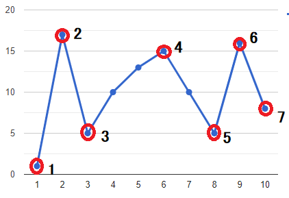

# ✔️ PYTHON O ( N ) || EXPLAINED || ; ]

**Author:** karan_8082
**Votes:** 128
**Link:** [https://leetcode.com/problems/wiggle-subsequence/solutions/2229487/](https://leetcode.com/problems/wiggle-subsequence/solutions/2229487/)

---

**UPVOTE IF HELPFuuL**

The demand of the question is to get **INCREASING** and **DECREASING** sequences alternating.
Now re-arranging of array is not possible, Hence **NUMBER OF TIMES ARRAY CHANGES** from increasing to decreasing & vice versa **REMAINS CONSTANT**.

The question can now reduced to find number of times array changes pattern.
Further , it can be deduced that we have to **COUNT THE NUMBER OF PEAKS AND VALLEY POINTS.**
EXAMPLE 1 => ```nums = [1, 2, 3, 4, 5, 6, 7, 8, 9 ]```

EXAMPLE 2 => ```nums = [1, 17, 5, 10, 13, 15, 10, 5, 16, 8 ]```



There are multiple ways to do so. Chose any.
**UPVOTE IF HELPFuuL**

**CODE 1**
```
class Solution:
    def wiggleMaxLength(self, nums: List[int]) -> int:
        f = 1
        d = 1
        for i in range(1, len(nums)):
            if nums[i]>nums[i-1]:
                f = d+1
            elif nums[i] < nums[i-1]:
                d = f+1
        res = max(f, d)
        return res
```

**CODE 2**
```
class Solution:
    def wiggleMaxLength(self, nums: List[int]) -> int:
        res=[nums[0]]
        i=1
        while i<len(nums) and nums[i]==nums[i-1]:
            i+=1
        if i<len(nums):
            res.append(nums[i])
        
        while i<len(nums):
            if (res[-1] > res[-2]):  # last sequence was incresing
                while i<len(nums) and nums[i]>=nums[i-1]:
                    res[-1] = nums[i]
                    i+=1
                if i<len(nums):
                    res.append(nums[i])
                    i+=1
            else:
                while i<len(nums) and nums[i]<=nums[i-1]:
                    res[-1]=nums[i]
                    i+=1
                if i<len(nums):
                    res.append(nums[i])
                    i+=1
        return len(res)
```

