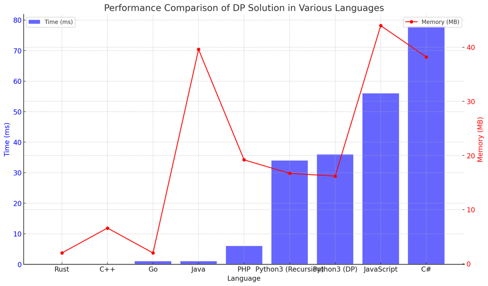

# ✅ 98.22% Dynamic Programming & Recursion with Memoization

**Author:** vanAmsen
**Votes:** 136
**Link:** [https://leetcode.com/problems/combination-sum-iv/solutions/4020218/](https://leetcode.com/problems/combination-sum-iv/solutions/4020218/)

---

# Comprehensive Guide to Solving "Combination Sum IV": Dynamic Programming and Memoization Approaches

## Introduction & Problem Statement

Welcome, fellow coders! Today, we'll dive deep into solving an intriguing combinatorial problem\u2014**Combination Sum IV**. This problem serves as a fantastic playground to explore some powerful algorithmic paradigms. Imagine you have an array of unique integers called `nums` and a `target` integer. Your mission, should you choose to accept it, is to find out how many distinct combinations of numbers from `nums` add up to `target`.

## Key Concepts and Constraints

### What Makes this Problem Unique?

1. **Combination**:  
   A combination here is a group of numbers taken from `nums` that, when summed up, equal `target`.

2. **Order Matters**:  
   Yes, you read that right! This isn't your typical combination problem where `[1, 2]` and `[2, 1]` would be considered the same. Here, the sequence matters, making each a distinct combination.

3. **Constraints**:  
   - The length of `nums` will be between 1 and 200.
   - Each integer in `nums` will be between 1 and 1000.
   - The `target` is also between 1 and 1000.

---

# Strategies to Tackle the Problem: A Two-Pronged Approach

## Live Coding, Dynamic Programming & More
https://youtu.be/BP09eTYEb64?si=NCbe-s7hT4Mha9Tj

## Method 1: Dynamic Programming

### The Ingenuity of Dynamic Programming

Dynamic Programming (DP) is a magical methodology that builds solutions from the ground up, much like constructing a pyramid. In this scenario, think of the `target` as the peak of your pyramid. You start with the foundational layer, which is your base case, and then build upon it, layer by layer, until you reach the apex. Each layer or block symbolizes a sub-problem that contributes to the solution of the overarching problem.

### An In-Depth, Step-by-Step Guide

1. **Initialization and Base Case**:  
   - Create an array `dp` with `target + 1` slots, each initialized to zero.  
   - This array will serve as our memory storage where `dp[i]` represents the number of combinations that can sum up to `i`.
   - Now, set `dp[0]` to 1. This serves as the base case, representing that there is one way to reach the target sum of zero: by using zero itself.

2. **Filling up the DP Array (Iterative Computation)**:  
   - Start iterating from 1 up to `target`. For each `i`, the aim is to fill `dp[i]` with the number of combinations that can make up that sum.
   - To find `dp[i]`, you need to look at the previously calculated `dp` values. How? For every number `num` in `nums`, you add `dp[i - num]` to `dp[i]` (given that `i - num >= 0`).
   - In simpler terms, for each `i`, you're summing up the number of ways to form `i` by looking at how you could have arrived at that sum using smaller numbers. 

3. **Reaching the Summit (Return the Result)**:  
   - After the loop concludes, you've successfully built your pyramid. At its peak, `dp[target]` will hold the total number of combinations that make up the target sum.

### Nuances of Time and Space Complexity

- **Time Complexity**: `O(N * target)`. The outer loop runs `target` times, and for each iteration, we potentially check all `N` numbers in `nums`.
- **Space Complexity**: `O(target)`. The array `dp` will have `target + 1` elements, each requiring constant space. So the overall space complexity is linear in terms of the target value.

## Code Dynamic Programming
``` Python []
class Solution:
    def combinationSum4(self, nums: List[int], target: int) -> int:
        dp = [0] * (target + 1)
        dp[0] = 1
        
        for i in range(1, target + 1):
            for num in nums:
                if i - num >= 0:
                    dp[i] += dp[i - num]
                    
        return dp[target]
```
``` Go []
func combinationSum4(nums []int, target int) int {
    dp := make([]int, target+1)
    dp[0] = 1
    
    for i := 1; i <= target; i++ {
        for _, num := range nums {
            if i - num >= 0 {
                dp[i] += dp[i - num]
            }
        }
    }
    
    return dp[target]
}
```
``` Rust []
impl Solution {
    pub fn combination_sum4(nums: Vec<i32>, target: i32) -> i32 {
        let mut dp = vec![0; (target + 1) as usize];
        dp[0] = 1;
        
        for i in 1..=target as usize {
            for &num in &nums {
                if i as i32 - num >= 0 {
                    dp[i] += dp[(i as i32 - num) as usize];
                }
            }
        }
        
        dp[target as usize]
    }
}
```
``` C++ []
class Solution {
public:
    int combinationSum4(std::vector<int>& nums, int target) {
        std::vector<unsigned int> dp(target + 1, 0);
        dp[0] = 1;
        
        for (int i = 1; i <= target; ++i) {
            for (int num : nums) {
                if (i - num >= 0) {
                    dp[i] += dp[i - num];
                }
            }
        }
        
        return dp[target];
    }
};
```
``` Java []
public class Solution {
    public int combinationSum4(int[] nums, int target) {
        int[] dp = new int[target + 1];
        dp[0] = 1;
        
        for (int i = 1; i <= target; i++) {
            for (int num : nums) {
                if (i - num >= 0) {
                    dp[i] += dp[i - num];
                }
            }
        }
        
        return dp[target];
    }
}
```
``` JavaScript []
/**
 * @param {number[]} nums
 * @param {number} target
 * @return {number}
 */
var combinationSum4 = function(nums, target) {
    const dp = Array(target + 1).fill(0);
    dp[0] = 1;
    
    for (let i = 1; i <= target; i++) {
        for (const num of nums) {
            if (i - num >= 0) {
                dp[i] += dp[i - num];
            }
        }
    }
    
    return dp[target];
};
```
``` PHP []
class Solution {

    /**
     * @param Integer[] $nums
     * @param Integer $target
     * @return Integer
     */
    function combinationSum4($nums, $target) {
        $dp = array_fill(0, $target + 1, 0);
        $dp[0] = 1;
        
        for ($i = 1; $i <= $target; $i++) {
            foreach ($nums as $num) {
                if ($i - $num >= 0) {
                    $dp[$i] += $dp[$i - $num];
                }
            }
        }
        
        return $dp[$target];
    }
}
```
``` C# []
public class Solution {
    public int CombinationSum4(int[] nums, int target) {
        int[] dp = new int[target + 1];
        dp[0] = 1;
        
        for (int i = 1; i <= target; i++) {
            foreach (int num in nums) {
                if (i - num >= 0) {
                    dp[i] += dp[i - num];
                }
            }
        }
        
        return dp[target];
    }
}
```
## Method 2: Memoization with Recursion

### The Art of Memoization

Memoization is an optimization technique that stores the results of expensive function calls and returns the cached result when the same inputs occur again. Think of it as a wise elder who recalls past tales to shed light on current challenges. In this context, we utilize memoization to remember the number of combinations for smaller targets, preventing the need for redundant, time-consuming recalculations.

### A Detailed Walkthrough

1. **Preprocessing**:  
   - First and foremost, we sort the `nums` array. Why do we do this? Sorting allows us to iterate over the numbers in an ascending order. This order plays a crucial role in our early exit strategy during the recursive calls, ensuring we don't waste time on numbers that won't contribute to our solution.

2. **Base Case and Early Exit**:  
   - If `n = 0`, this means we've successfully found a combination that sums up to the target. Hence, we return 1.
   - If `n < nums[0]`, given that `nums` is sorted, this means no combination can be formed to achieve the current `n`. So, we immediately return 0, optimizing our recursion.

3. **The Recursive Magic**:  
   - For each value of `n`, we delve into its past (i.e., make recursive calls) to uncover the pathways that led to `n`.
   - As we iterate over the sorted `nums`, if `n - num < 0`, we hit a break. This is because, with a sorted array, if the current number causes the difference to be negative, all subsequent numbers will do the same, making them irrelevant for the current `n`. Thus, we break out early, optimizing our process.

4. **Memoization in Action**:  
   - After calculating the number of combinations for a particular `n`, we store this value in a dictionary. This ensures that if we encounter the same `n` again, we can instantly retrieve its result rather than recalculating, saving precious time.

5. **Returning the Final Verdict**:  
   - Once all recursive calls are settled, the answer for our primary `target` will be waiting in our memoization dictionary, ready to be unveiled.

### Delving into the Time and Space

- **Time Complexity**: `O(N * target)`. Each unique `target` value is calculated once. For each calculation, we might iterate over all `N` numbers in `nums`.
- **Space Complexity**: `O(target)`. This space is primarily used for our memoization dictionary, which can store up to `target` unique values.

## Code Memoization with Recursion
``` Python []
class Solution:
    def combinationSum4(self, nums: List[int], target: int) -> int:
        nums.sort() 
        memo = {}
        
        def helper(n):
            if n in memo:
                return memo[n]
            if n == 0:
                return 1
            if n < nums[0]:
                return 0
            
            count = 0
            for num in nums:
                if n - num < 0:
                    break 
                count += helper(n - num)
                
            memo[n] = count
            return count
        
        return helper(target)
```
``` Go []
import "sort"

func helper(nums []int, n int, memo map[int]int) int {
    if val, found := memo[n]; found {
        return val
    }
    if n == 0 {
        return 1
    }
    if n < nums[0] {
        return 0
    }
    
    count := 0
    for _, num := range nums {
        if n - num < 0 {
            break
        }
        count += helper(nums, n - num, memo)
    }
    
    memo[n] = count
    return count
}

func combinationSum4(nums []int, target int) int {
    sort.Ints(nums)
    memo := make(map[int]int)
    return helper(nums, target, memo)
}
```
``` Rust []
use std::collections::HashMap;

impl Solution {
    pub fn combination_sum4(nums: Vec<i32>, target: i32) -> i32 {
        let mut nums = nums;
        nums.sort();
        let mut memo = HashMap::new();
        
        Self::helper(&nums, target, &mut memo)
    }
    
    fn helper(nums: &Vec<i32>, n: i32, memo: &mut HashMap<i32, i32>) -> i32 {
        if let Some(&count) = memo.get(&n) {
            return count;
        }
        if n == 0 {
            return 1;
        }
        if n < nums[0] {
            return 0;
        }
        
        let mut count = 0;
        for &num in nums {
            if n - num < 0 {
                break;
            }
            count += Self::helper(nums, n - num, memo);
        }
        
        memo.insert(n, count);
        count
    }
}
```

## Performance

| Language   | Time (ms) | Memory (MB) | Solution Type |
|------------|-----------|-------------|---------------|
| Rust       | 0 ms      | 2 MB        | DP            |
| C++        | 0 ms      | 6.6 MB      | DP            |
| Go         | 1 ms      | 2 MB        | DP            |
| Java       | 1 ms      | 39.6 MB     | DP            |
| PHP        | 6 ms      | 19.2 MB     | DP            |
| Python3    | 34 ms     | 16.7 MB     | Recursion     |
| Python3    | 36 ms     | 16.2 MB     | DP            |
| JavaScript | 56 ms     | 44 MB       | DP            |
| C#         | 78 ms     | 38.2 MB     | DP            |



## Live Coding Memoization
https://youtu.be/oHhmd5-IoM8?si=0yjXY02re64FJLaG

## Code Highlights and Best Practices

- Both Dynamic Programming and Memoization approaches build upon previous solutions, making them intuitive and efficient.
- Dynamic Programming is more straightforward but iterates through the entire `nums` array for each `target`, making it slightly slower in practice.
- Memoization with Recursion avoids redundant work, making it more efficient in practice.

By mastering these two approaches, you will be well-prepared to tackle similar combinatorial problems that involve finding the number of ways to reach a target sum.