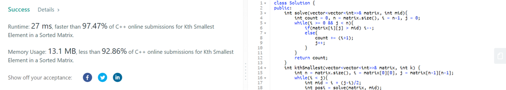

# C++ , JAVA | Full Explanation | Using 6 Method

**Author:** nitin23rathod
**Votes:** 114
**Link:** [https://leetcode.com/problems/kth-smallest-element-in-a-sorted-matrix/solutions/2366981/](https://leetcode.com/problems/kth-smallest-element-in-a-sorted-matrix/solutions/2366981/)

---

**Brutforce**

**Time Complexity:** `O(n*m lon(n*m))`
**Space Complexity:** `O(n*m)`
```
class Solution {
public:
    int kthSmallest(vector<vector<int>>& matrix, int z) {
        int n = matrix.size(), m = matrix[0].size();
        int a[n*m], k=0;
        for(int i=0; i<n; i++){
            for(int j=0; j<m; j++){
                a[k] = matrix[i][j];
                k++;
            }
        }
        sort(a, a+(n*m));
        return a[z-1];
    }
};
```

**Using Unordered Map 
It's give TLE \u274C**

```
class Solution {
public:
    int kthSmallest(vector<vector<int>>& matrix, int k) {
        int n = matrix.size(), start = matrix[0][0], end = matrix[n-1][n-1];
        unordered_map<int, int>mp;
        for(int i = 0; i < n; i++)
            for(int j = 0; j < n; j++)
                mp[matrix[i][j]]++;
        
        for(int i = start; i <= end; i++)
            if(mp.find(i) != mp.end()){
                for(int j = 0; j < mp[i]; j++){
                    k--;
                    if(k == 0) return i;
                }
            }
          return -1;  
    }
};
```

***PLEASE UPVOTE IF YOU LIKE.***
**Optimal:
Using Binary Search**

```
class Solution {
public:
    int solve(vector<vector<int>>& matrix, int mid){
        int count = 0, n = matrix.size(), i = n-1, j = 0;
        while(i >= 0 && j < n){
            if(matrix[i][j] > mid) i--;
            else{
                count += (i+1);
                j++;
            }
        }
        return count;
    }
    int kthSmallest(vector<vector<int>>& matrix, int k) {
        int n = matrix.size(), i = matrix[0][0], j = matrix[n-1][n-1];
        while(i < j){
            int mid = i + (j-i)/2;
            int posi = solve(matrix, mid);
            if(posi < k) i = mid+1;
            else j = mid;
        }
        return i;
    }  
};
```


***PLEASE UPVOTE IF YOU LIKE.***
**Optimal 2:
Using Priority Queue**
```
class Solution {
public:
    int kthSmallest(vector<vector<int>>& matrix, int k) {
        priority_queue<int>pq; int n = matrix.size();
        for(int i = 0; i < n; i++)
            for(int j = 0; j < n; j++){
                pq.push(matrix[i][j]);
                if(pq.size() > k) pq.pop();
            }
        return pq.top();   
    }
};
```
# PLEASE UPVOTE IF YOU LIKE.

# Java
@NarutoBaryonMode

**Using PriorityQueue - This soultion is preferred if K < Length of one side of the matrix**
```
/**
 * Using PriorityQueue
 *
 * Time Complexity:
 *      O(min(N,K)*log(min(N,K))) -> To add initial min(N,K) elements, as we are adding the elements individually.
 *                                   If we were adding all elements in one go, then the complexity would be O(min(N,K))
 *                                   Refer: https://stackoverflow.com/a/34697891
 *      O(2*(K-1)*log(min(N,K)) -> To poll K-1 elements and add next K-1 elements.
 * Total Time Complexity: O((min(N,K) + 2*(K-1)) * log(min(N,K)) = O(K * log(min(N,K))
 *
 * Space Complexity: O(min(N, K))
 *
 * N = Length of one side of the matrix. K = input value k.
 */
class Solution {
    public int kthSmallest(int[][] matrix, int k) {
        if (matrix == null || k <= 0) {
            throw new IllegalArgumentException("Input is invalid");
        }

        int n = matrix.length;
        if (k > n * n) {
            throw new NoSuchElementException("k is greater than number of elements in matrix");
        }
        if (k == 1) {
            return matrix[0][0];
        }
        if (k == n * n) {
            return matrix[n - 1][n - 1];
        }

        PriorityQueue<int[]> queue = new PriorityQueue<>((a, b) -> (matrix[a[0]][a[1]] - matrix[b[0]][b[1]]));

        for (int i = 0; i < Math.min(n, k); i++) {
            queue.offer(new int[] { i, 0 });
        }
        while (k > 1) {
            int[] cur = queue.poll();
            if (cur[1] < n - 1) {
                cur[1]++;
                queue.offer(cur);
            }
            k--;
        }

        return matrix[queue.peek()[0]][queue.peek()[1]];
    }
}
```

**Using Binary Search - This soultion is preferred if K > Length of one side of the matrix**

```
/**
 * Using Binary Search on the range of Min and Max values in the matrix
 *
 * Time Complexity: O(2*N * log(Max-Min))
 *
 * Space Complexity: O(1)
 *
 * N = Length of one side of the matrix. Max = Maximum value in Matrix. Min = Minimum value in matrix.
 */
class Solution {
    public int kthSmallest(int[][] matrix, int k) {
        if (matrix == null || k <= 0) {
            throw new IllegalArgumentException("Input is invalid");
        }

        int n = matrix.length;
        if (k > n * n) {
            throw new NoSuchElementException("k is greater than number of elements in matrix");
        }
        if (k == 1) {
            return matrix[0][0];
        }
        if (k == n * n) {
            return matrix[n - 1][n - 1];
        }

        int start = matrix[0][0];
        int end = matrix[n - 1][n - 1];

        while (start < end) {
            int mid = start + (end - start) / 2;
            int[] smallLargePair = { start, end };
            int count = countLessThanAndEqual(matrix, mid, smallLargePair);
            if (count == k) {
                return smallLargePair[0];
            }
            if (count < k) {
                start = smallLargePair[1]; // search higher
            } else {
                end = smallLargePair[0]; // search lower
            }
        }

        return start;
    }

    private int countLessThanAndEqual(int[][] matrix, int mid, int[] smallLargePair) {
        int count = 0;
        int n = matrix.length;
        int row = 0;
        int col = n - 1;
        while (row < n && col >= 0) {
            if (matrix[row][col] > mid) {
                // as matrix[row][col] is bigger than the mid, let's keep track of the
                // smallest number greater than the mid
                smallLargePair[1] = Math.min(smallLargePair[1], matrix[row][col]);
                col--;
            } else {
                // as matrix[row][col] is less than or equal to the mid, let's keep track of the
                // biggest number less than or equal to the mid
                smallLargePair[0] = Math.max(smallLargePair[0], matrix[row][col]);
                row++;
                count += col + 1;
            }
        }
        return count;
    }
}
```

# PLEASE UPVOTE IF YOU LIKE.
```
PLEASE UPVOTE IF YOU LIKE.
```
*PLEASE UPVOTE IF YOU LIKE.*