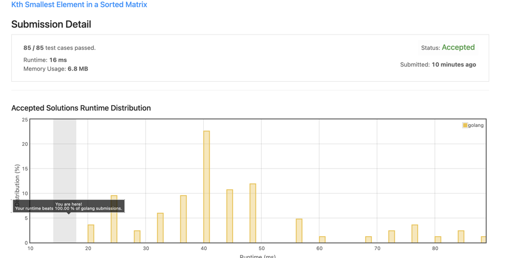

# [Go] Binary Search solution, 16ms (100%)

**Author:** akash__gupta
**Votes:** 3
**Link:** [https://leetcode.com/problems/kth-smallest-element-in-a-sorted-matrix/solutions/1321974/](https://leetcode.com/problems/kth-smallest-element-in-a-sorted-matrix/solutions/1321974/)

---





Binary search solution:

```
func kthSmallest(matrix [][]int, k int) int {
    n := len(matrix)
    start, end, mid := matrix[0][0], matrix[n-1][n-1], 0
    count := 0
    for start < end {
        mid = start + (end-start)/2
        count = countLessEqual(matrix, mid)
        if count < k {
            start = mid + 1
            continue
        }
        
        end = mid
    }
    return start
}

func countLessEqual(matrix [][]int, mid int) int {
    count := 0
    n := len(matrix)
    for r, c := n-1, 0; r >= 0 && c < n; {
        if matrix[r][c] > mid {
            r--
            continue
        }
        
        count += r+1
        c++
    }
    
    return count
}

