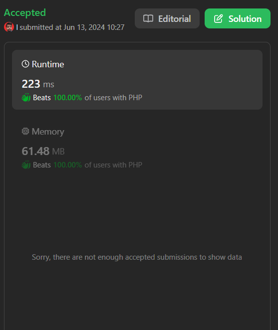

# Insert Delete GetRandom O(1) - Duplicates allowed || Beats 100.00% of users with PHP

**Author:** logusivam
**Votes:** 0
**Link:** [https://leetcode.com/problems/insert-delete-getrandom-o1-duplicates-allowed/solutions/5305173/](https://leetcode.com/problems/insert-delete-getrandom-o1-duplicates-allowed/solutions/5305173/)

---




# Explanation

- Insert: We add the value to the list and update the index map. If the value was not present before, we return `true`; otherwise, we return `false`.
- Remove: We find the index of the value to remove from the hash map, swap it with the last element, update the indices, and then remove the last element from the list. If the value was present and removed, we return `true`; otherwise, we return `false`.
- GetRandom: We randomly select an index from the list and return the corresponding value.
- This approach ensures that all operations (`insert`, `remove`, and `getRandom`) work in average O(1) time complexity.

# Code
```PHP []
class RandomizedCollection {
    private $nums;
    private $idxMap;

    function __construct() {
        $this->nums = [];
        $this->idxMap = [];
    }

    /**
     * @param Integer $val
     * @return Boolean
     */
    function insert($val) {
        $isPresent = isset($this->idxMap[$val]);
        if (!$isPresent) {
            $this->idxMap[$val] = [];
        }
        $this->idxMap[$val][] = count($this->nums);
        $this->nums[] = $val;
        return !$isPresent;
    }

    /**
     * @param Integer $val
     * @return Boolean
     */
    function remove($val) {
        if (!isset($this->idxMap[$val])) {
            return false;
        }
        $removeIdx = array_pop($this->idxMap[$val]);
        if (empty($this->idxMap[$val])) {
            unset($this->idxMap[$val]);
        }
        $lastIdx = count($this->nums) - 1;
        if ($removeIdx != $lastIdx) {
            $lastVal = $this->nums[$lastIdx];
            $this->nums[$removeIdx] = $lastVal;
            $this->idxMap[$lastVal][array_search($lastIdx, $this->idxMap[$lastVal])] = $removeIdx;
        }
        array_pop($this->nums);
        return true;
    }

    /**
     * @return Integer
     */
    function getRandom() {
        $randIdx = array_rand($this->nums);
        return $this->nums[$randIdx];
    }
}

// Example usage:
$collection = new RandomizedCollection();
echo $collection->insert(1) ? "true\
" : "false\
"; // true
echo $collection->insert(1) ? "true\
" : "false\
"; // false
echo $collection->insert(2) ? "true\
" : "false\
"; // true
echo $collection->getRandom() . "\
"; // 1 or 2
echo $collection->remove(1) ? "true\
" : "false\
"; // true
echo $collection->getRandom() . "\
"; // 1 or 2

```

