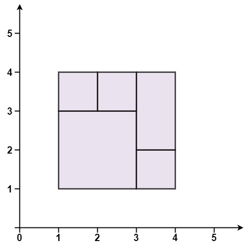
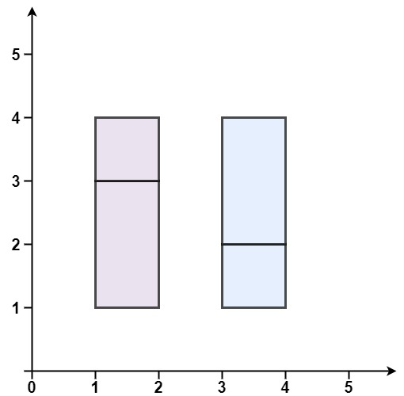
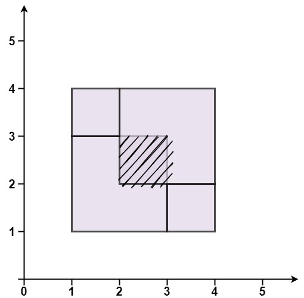

# [391. Perfect Rectangle](https://leetcode.com/problems/perfect-rectangle/)

| Category | Difficulty | Likes | Dislikes |
| :------: | :--------: | :---: | :------: |
| Algorithms | Hard | 941 | 120 |

**Tags:** [`array`](https://leetcode.com/tag/array), [`hash-table`](https://leetcode.com/tag/hash-table), [`math`](https://leetcode.com/tag/math), [`geometry`](https://leetcode.com/tag/geometry), [`line-sweep`](https://leetcode.com/tag/line-sweep)

**Companies:** `google`

## Description

Given an array `rectangles` where `rectangles[i] = [x_i, y_i, a_i, b_i]` represents an axis-aligned rectangle. The bottom-left point of the rectangle is `(x_i, y_i)` and the top-right point of it is `(a_i, b_i)`.

Return `true` *if all the rectangles together form an exact cover of a rectangular region*.

 

**Example 1:**


```

Input: rectangles = [[1,1,3,3],[3,1,4,2],[3,2,4,4],[1,3,2,4],[2,3,3,4]]
Output: true
Explanation: All 5 rectangles together form an exact cover of a rectangular region.

```

**Example 2:**


```

Input: rectangles = [[1,1,2,3],[1,3,2,4],[3,1,4,2],[3,2,4,4]]
Output: false
Explanation: Because there is a gap between the two rectangular regions.

```

**Example 3:**


```

Input: rectangles = [[1,1,3,3],[3,1,4,2],[1,3,2,4],[2,2,4,4]]
Output: false
Explanation: Because two of the rectangles overlap with each other.

```

 

**Constraints:**

	- `1 <= rectangles.length <= 2 * 10^4`

	- `rectangles[i].length == 4`

	- `-10^5 <= x_i < a_i <= 10^5`

	- `-10^5 <= y_i < b_i <= 10^5`

---

**Links:** [Submissions](https://leetcode.com/problems/perfect-rectangle/) | [Solutions](https://leetcode.com/problems/perfect-rectangle/)
