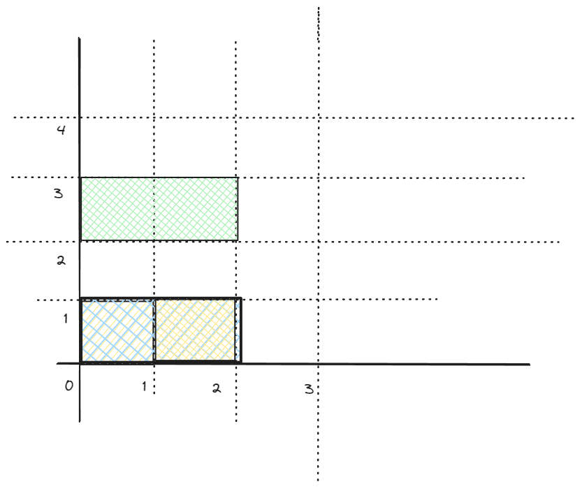
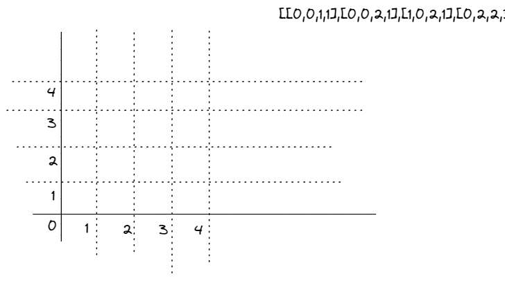

# Intuitive Solution Validating Rectangles for a Basic Enclosure with Moderate Performance

**Author:** tzrac119
**Votes:** 1
**Link:** [https://leetcode.com/problems/perfect-rectangle/solutions/4299149/](https://leetcode.com/problems/perfect-rectangle/solutions/4299149/)

---

# Intuition
To determine if a set of rectangles forms an exact cover of a rectangular region, we need to check two conditions. First, the total area covered by the rectangles should be equal to the area of the smallest rectangle that encloses them. Second, all the corner points of the enclosing rectangle should be covered by an odd number of rectangles.


# Approach
1. Initialize variables to keep track of the total area, corner points, and their counts.
2. Iterate through each rectangle and calculate the total area covered by adding up individual rectangle areas.
3. Keep track of the minimum and maximum coordinates to form the enclosing rectangle.
4. For each rectangle, add its four corner points to a set, updating the count of each point.
5. After processing all rectangles, check if the total area matches the area of the enclosing rectangle.
6. Iterate through the corner points, and count how many have an odd occurrence.
7. If there are exactly four corner points with an odd occurrence, and the total area is correct, return true. Otherwise, return false.
# Complexity
- Time Complexity: O(N), where N is the total number of rectangles. We iterate through each rectangle and each corner point once.
- Space Complexity: O(N), where N is the total number of corner points stored in the set.

# Code
```
use std::collections::{HashSet, HashMap};

impl Solution {
    pub fn is_rectangle_cover(rectangles: Vec<Vec<i32>>) -> bool {
        let mut total_area = 0;
        let mut corner_points = HashSet::new();
        let mut corner_count: HashMap<_, _> = HashMap::new();
        let mut min_x = i32::max_value();
        let mut min_y = i32::max_value();
        let mut max_x = i32::min_value();
        let mut max_y = i32::min_value();

        // Iterate through each rectangle
        for rect in rectangles.iter() {
            total_area += (rect[2] - rect[0]) * (rect[3] - rect[1]);

            // Update minimum and maximum coordinates
            min_x = min_x.min(rect[0]);
            min_y = min_y.min(rect[1]);
            max_x = max_x.max(rect[2]);
            max_y = max_y.max(rect[3]);

            // Add each corner point to the set
            for &point in &[
                (rect[0], rect[1]),
                (rect[0], rect[3]),
                (rect[2], rect[1]),
                (rect[2], rect[3]),
            ] {
                if corner_points.contains(&point) {
                    corner_count.insert(point, corner_count[&point] + 1);
                } else {
                    corner_points.insert(point);
                    corner_count.insert(point, 1);
                }
            }
        }

        // Check if total area matches the area of the enclosing rectangle
        if total_area != (max_x - min_x) * (max_y - min_y) {
            return false;
        }

        // Initialize variables for corner points with odd occurrence
        let mut min_x = i32::max_value();
        let mut min_y = i32::max_value();
        let mut max_x = i32::min_value();
        let mut max_y = i32::min_value();
        let mut corner_with_odd_count = 0;

        // Iterate through corner points
        for (&(x, y), &count) in corner_count.iter() {
            if count % 2 == 1 {
                corner_with_odd_count += 1;

                // Update minimum and maximum coordinates of corner points with odd occurrence
                min_x = min_x.min(x);
                min_y = min_y.min(y);
                max_x = max_x.max(x);
                max_y = max_y.max(y);
            }
        }

        // Check if there are exactly four corner points with odd occurrence
        // and the total area is correct
        corner_with_odd_count == 4 && total_area == (max_x - min_x) * (max_y - min_y)
    }
}


```



Wait.....

You don't need calculation area,and remember don't use `format!` macro, it is too slow.
[[]()]()

Speed Version: 
```
use std::collections::{HashSet, HashMap};
fn encode(y: i32, x: i32) -> i64 {
    (1_000_000i64 * (y as i64)) + (x as i64)
}
impl Solution {

    pub fn is_rectangle_cover(rectangles: Vec<Vec<i32>>) -> bool {
        let mut corner_points = HashMap::new();
        let mut min_x = i32::max_value();
        let mut min_y = i32::max_value();
        let mut max_x = i32::min_value();
        let mut max_y = i32::min_value();

        for rect in rectangles.iter() {
            min_x = min_x.min(rect[0]);
            min_y = min_y.min(rect[1]);
            max_x = max_x.max(rect[2]);
            max_y = max_y.max(rect[3]);

            let bottom_left = encode(rect[0], rect[1]);
            let bottom_right = encode(rect[0], rect[3]);
            let top_left = encode(rect[2], rect[1]);
            let top_right = encode(rect[2], rect[3]);
            *corner_points.entry(bottom_left).or_insert(0) += 1;
            *corner_points.entry(bottom_right).or_insert(0) -= 1;
            *corner_points.entry(top_left).or_insert(0) -= 1;
            *corner_points.entry(top_right).or_insert(0) += 1;
            // Add each corner point to the set
        }

        let mut corner_count = 0;
        for corner_point in corner_points.into_values() {
            match corner_point {
                -1 | 1 => corner_count += 1,
                0 => continue,
                _ => return false,
            };
        }
        corner_count == 4
    }   
}
```