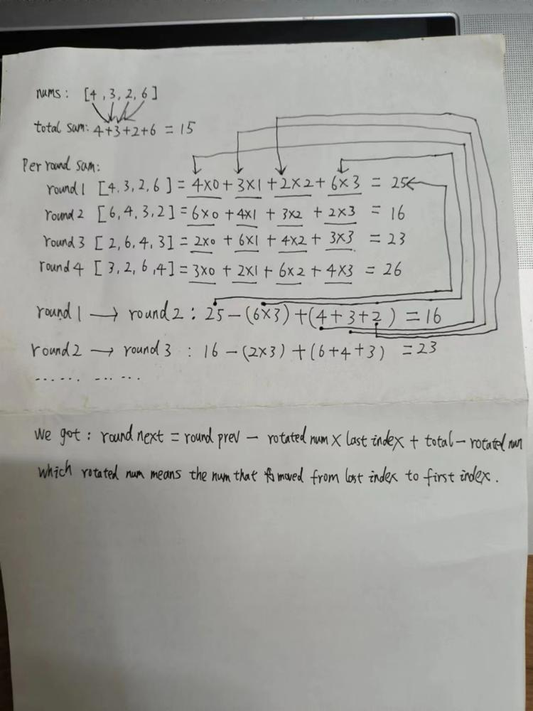

# ✅  Mathematics || Easy to understand || Javascript || Java || Python3 || Go

**Author:** jamais
**Votes:** 5
**Link:** [https://leetcode.com/problems/rotate-function/solutions/4175649/](https://leetcode.com/problems/rotate-function/solutions/4175649/)

---

# Intuition
<!-- Describe your first thoughts on how to solve this problem. -->
It's a math problem. I draw a graph to show the process. The code is concise. Hope it's helpful.

# Approach
<!-- Describe your approach to solving the problem. -->



# Complexity
- Time complexity: O(n)
<!-- Add your time complexity here, e.g. $$O(n)$$ -->

- Space complexity: O(1)
<!-- Add your space complexity here, e.g. $$O(n)$$ -->

# Javascript
```javascript
/**
 * @param {number[]} nums
 * @return {number}
 */
var maxRotateFunction = function(nums) {
    const n = nums.length;
    let totalSum = 0;
    let perRoundSum = 0;

    for (let i = 0; i < n; i++) {
        totalSum += nums[i];
        perRoundSum += i * nums[i];
    }

    let answer = perRoundSum;

    for (let i = 1; i < n; i++) {
        const rotatedNum = nums[n - i];
        perRoundSum = perRoundSum - (rotatedNum * (n - 1)) + (totalSum - rotatedNum);
        answer = Math.max(answer, perRoundSum);
    }

    return answer;
};
```

# Java
```java
class Solution {
    public int maxRotateFunction(int[] nums) {
        int n = nums.length;
        int totalSum = 0;
        int perRoundSum = 0;
        
        for (int i = 0; i < n; i++) {
            totalSum += nums[i];
            perRoundSum += i * nums[i];
        }

        int answer = perRoundSum;

        for (int i = 1; i < n; i++) {
            int rotatedNum = nums[n - i];
            perRoundSum = perRoundSum - (rotatedNum * (n - 1)) + (totalSum - rotatedNum);
            answer = Math.max(answer, perRoundSum);
        }

        return answer;
    }
}
```


# Python3
```python
class Solution:
    def maxRotateFunction(self, nums: List[int]) -> int:
        n: int = len(nums)
        total: int = 0
        per_round: int = 0

        for i in range(n):
            total += nums[i]
            per_round += i * nums[i]

        answer: int = per_round

        for i in range(1, n):
            rotated: int = nums[n - i]
            per_round = per_round - (rotated * (n - 1)) + (total - rotated)
            answer = max(answer, per_round)
        
        return answer
```

# Go
```golang
func maxRotateFunction(nums []int) int {
    n := len(nums)
    totalSum := 0
    perRoundSum := 0

    for i, v := range nums {
        totalSum += v
        perRoundSum += i * v
    }

    answer := perRoundSum

    for i := 1; i < n; i++ {
        rotatedNum := nums[n - i]
        perRoundSum = perRoundSum - (rotatedNum * (n - 1)) + (totalSum - rotatedNum)
        if perRoundSum > answer {
            answer = perRoundSum
        }
    }

    return answer
}
```