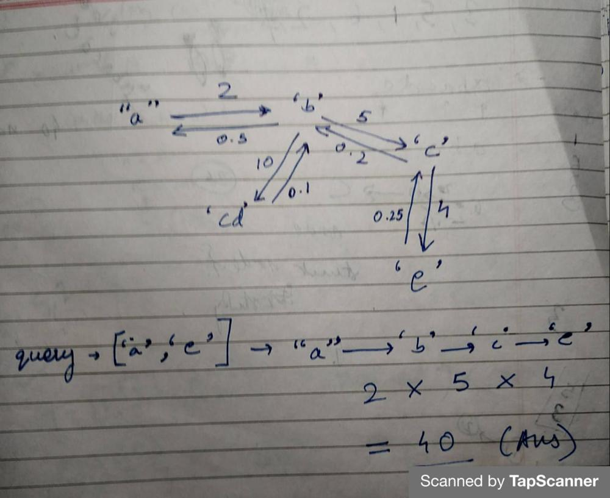

# C++ | Graph DFS | Easy Explanation

**Author:** persistentBeast
**Votes:** 199
**Link:** [https://leetcode.com/problems/evaluate-division/solutions/1993050/](https://leetcode.com/problems/evaluate-division/solutions/1993050/)

---



* Make a directed graph.
* If there is a/b = 2, then edge a->b has weight = 2 and edge b->a has weight 0.5.
* After forming a weighted directed graph process each query trying to find a path between startNode and endNode.
* If path found, running product kept during DFS will be your answer.
* ***TC = O(VQ), where V = Vertices on your graph and Q = No. of queries.***

```
class Solution {
    unordered_map<string, vector<pair<string, double>>> adjList;
    unordered_map<string, bool> visited;
    double queryAns;
public:
    
    bool dfs(string startNode, string endNode, double runningProduct){

        if(adjList.find(startNode) == adjList.end() || adjList.find (endNode) == adjList.end()) {
            return false;
        }
        
        if(startNode == endNode and adjList.find(startNode)!=adjList.end()) {
            queryAns = runningProduct;
            return true;
            
        }
        
        bool tempAns = false;
        visited[startNode] = true;
        
        for(int i = 0; i < adjList[startNode].size(); i++){
            if(!visited[adjList[startNode][i].first]){
                tempAns = dfs(adjList[startNode][i].first, endNode, runningProduct*adjList[startNode][i].second);
                if(tempAns){
                    break;
                }
            }
        }
        
        visited[startNode] = false;
        
        return tempAns;
        
    }
    
    vector<double> calcEquation(vector<vector<string>>& equations, vector<double>& values, vector<vector<string>>& queries) {
        
        
        int n = equations.size(), m = queries.size();
        vector<double> ans(m);
        
        for(int i = 0; i < n ; i++){
            
            adjList[equations[i][0]].push_back({equations[i][1], values[i]});
            adjList[equations[i][1]].push_back({equations[i][0], 1/values[i]});
            visited[equations[i][0]] = false;
            visited[equations[i][1]] = false;

        }
        
        for(int i = 0; i < m ; i++){
            
            queryAns = 1;
            bool pathFound = dfs(queries[i][0], queries[i][1], 1);            
            if(pathFound) ans[i] = queryAns;
            else ans[i] = -1;
            
        }
        
        return ans;
        
    }
};
```
