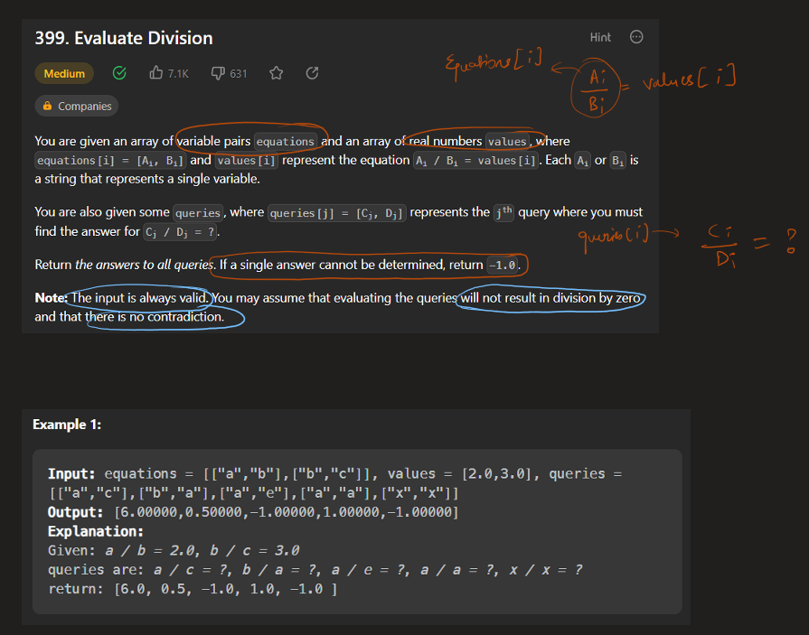
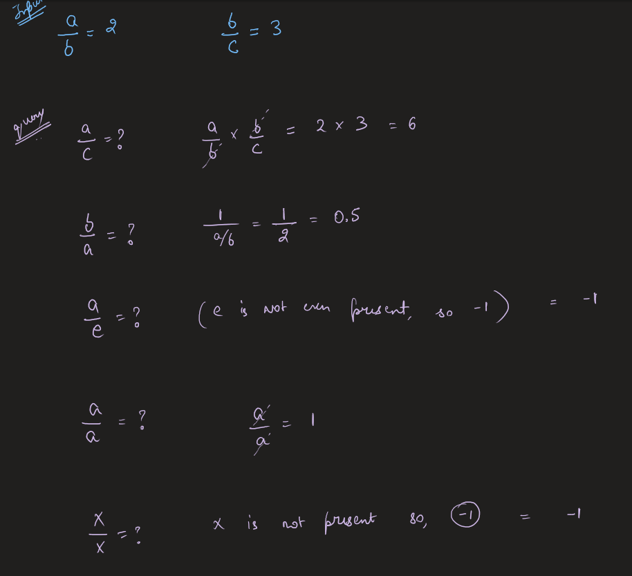
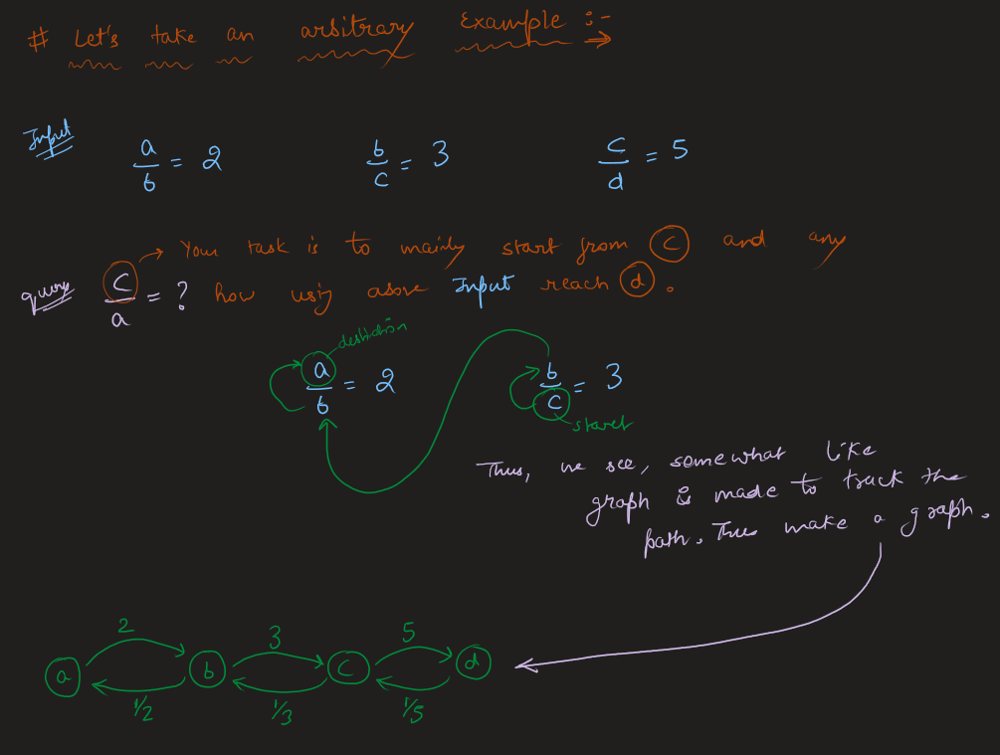
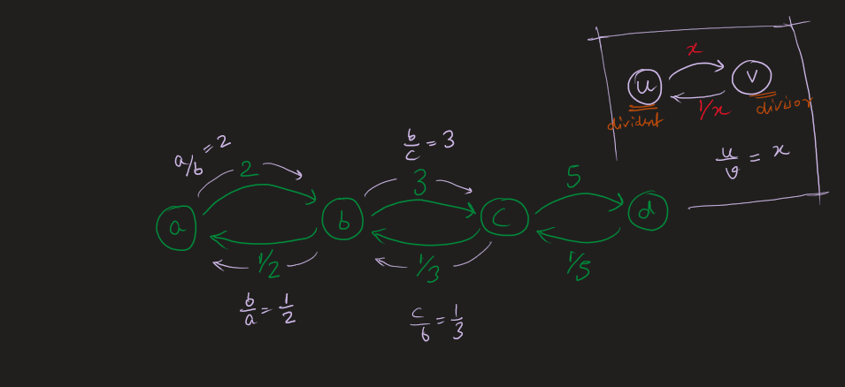
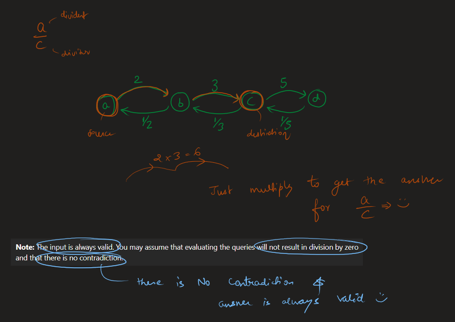
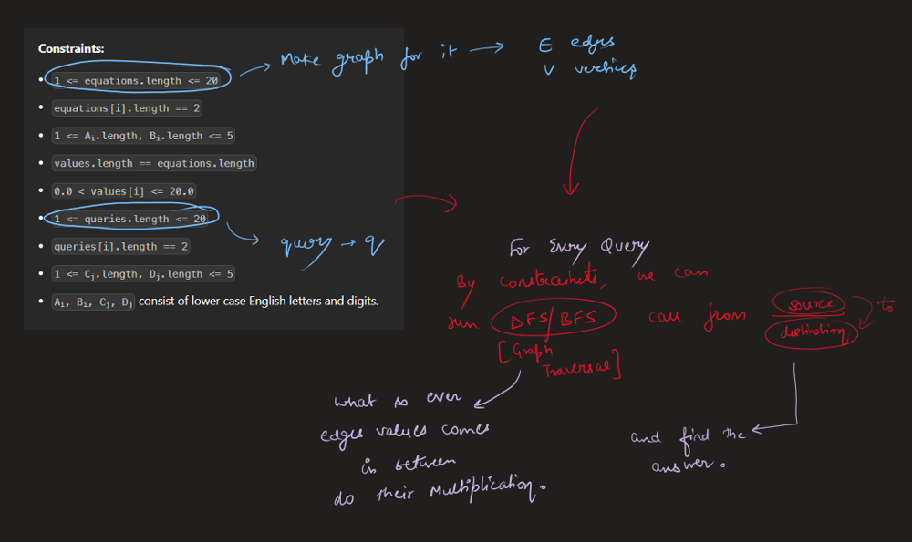
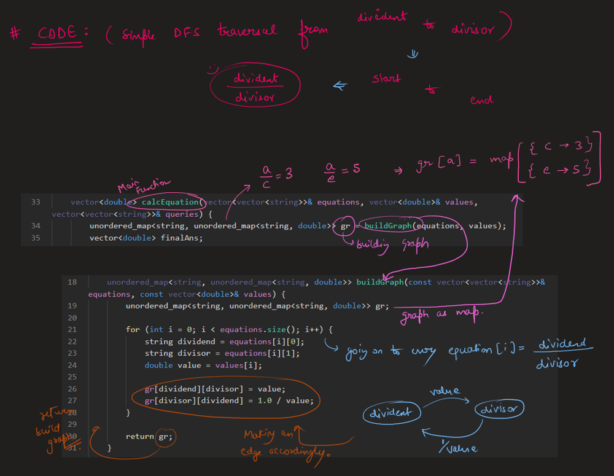
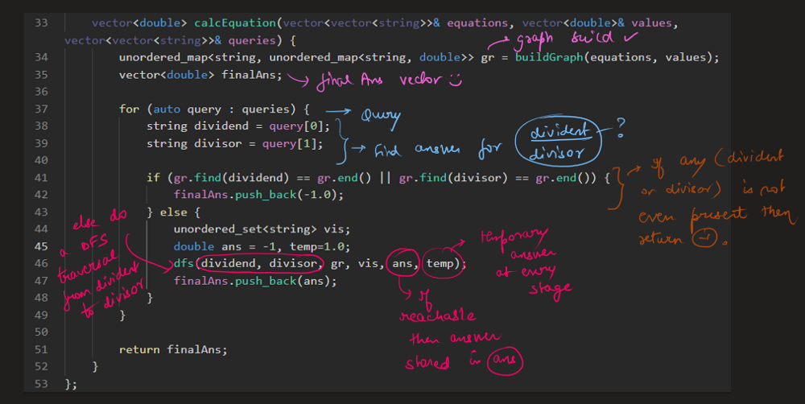
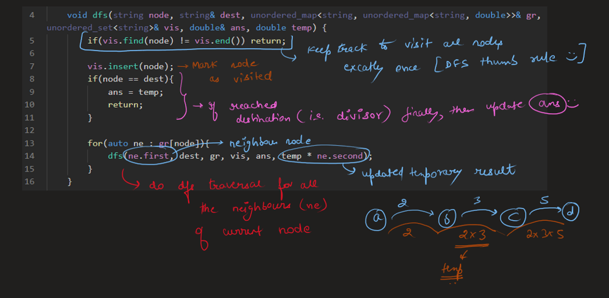
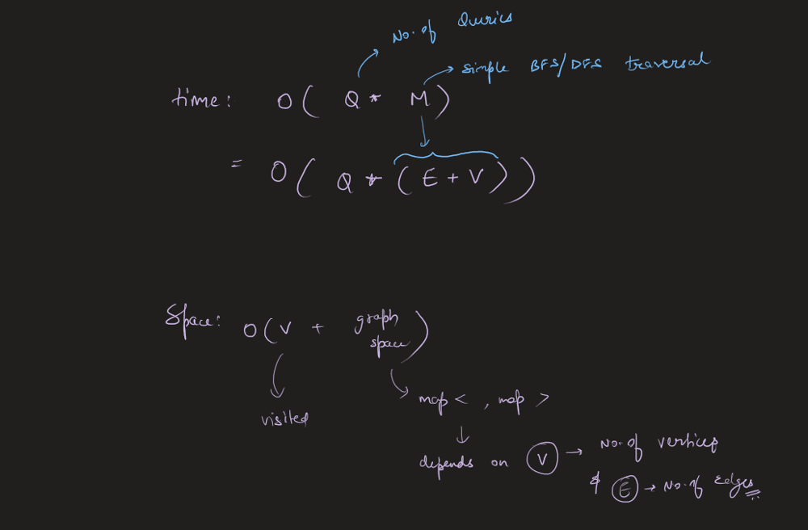

# Image Explanation🏆- [Easiest, Concise & Complete Intuition] - C++/Java/Python

**Author:** aryan_0077
**Votes:** 146
**Link:** [https://leetcode.com/problems/evaluate-division/solutions/3543256/](https://leetcode.com/problems/evaluate-division/solutions/3543256/)

---

# Video Solution (`Aryan Mittal`) - Link in LeetCode Profile
`Evaluate Division` by `Aryan Mittal`


# Approach & Intution












# Code
```C++ []
class Solution {
public:

    void dfs(string node, string& dest, unordered_map<string, unordered_map<string, double>>& gr, unordered_set<string>& vis, double& ans, double temp) {
        if(vis.find(node) != vis.end()) return;

        vis.insert(node);
        if(node == dest){
            ans = temp;
            return;
        }

        for(auto ne : gr[node]){
            dfs(ne.first, dest, gr, vis, ans, temp * ne.second);
        }
    }

    unordered_map<string, unordered_map<string, double>> buildGraph(const vector<vector<string>>& equations, const vector<double>& values) {
        unordered_map<string, unordered_map<string, double>> gr;

        for (int i = 0; i < equations.size(); i++) {
            string dividend = equations[i][0];
            string divisor = equations[i][1];
            double value = values[i];

            gr[dividend][divisor] = value;
            gr[divisor][dividend] = 1.0 / value;
        }

        return gr;
    }

    vector<double> calcEquation(vector<vector<string>>& equations, vector<double>& values, vector<vector<string>>& queries) {
        unordered_map<string, unordered_map<string, double>> gr = buildGraph(equations, values);
        vector<double> finalAns;

        for (auto query : queries) {
            string dividend = query[0];
            string divisor = query[1];

            if (gr.find(dividend) == gr.end() || gr.find(divisor) == gr.end()) {
                finalAns.push_back(-1.0);
            } else {
                unordered_set<string> vis;
                double ans = -1, temp=1.0;
                dfs(dividend, divisor, gr, vis, ans, temp);
                finalAns.push_back(ans);
            }
        }

        return finalAns;
    }
};
```
```Java []
class Solution {
    public void dfs(String node, String dest, HashMap<String, HashMap<String, Double>> gr, HashSet<String> vis, double[] ans, double temp) {
        if (vis.contains(node))
            return;

        vis.add(node);
        if (node.equals(dest)) {
            ans[0] = temp;
            return;
        }

        for (Map.Entry<String, Double> entry : gr.get(node).entrySet()) {
            String ne = entry.getKey();
            double val = entry.getValue();
            dfs(ne, dest, gr, vis, ans, temp * val);
        }
    }

    public HashMap<String, HashMap<String, Double>> buildGraph(List<List<String>> equations, double[] values) {
        HashMap<String, HashMap<String, Double>> gr = new HashMap<>();

        for (int i = 0; i < equations.size(); i++) {
            String dividend = equations.get(i).get(0);
            String divisor = equations.get(i).get(1);
            double value = values[i];

            gr.putIfAbsent(dividend, new HashMap<>());
            gr.putIfAbsent(divisor, new HashMap<>());

            gr.get(dividend).put(divisor, value);
            gr.get(divisor).put(dividend, 1.0 / value);
        }

        return gr;
    }

    public double[] calcEquation(List<List<String>> equations, double[] values, List<List<String>> queries) {
        HashMap<String, HashMap<String, Double>> gr = buildGraph(equations, values);
        double[] finalAns = new double[queries.size()];

        for (int i = 0; i < queries.size(); i++) {
            String dividend = queries.get(i).get(0);
            String divisor = queries.get(i).get(1);

            if (!gr.containsKey(dividend) || !gr.containsKey(divisor)) {
                finalAns[i] = -1.0;
            } else {
                HashSet<String> vis = new HashSet<>();
                double[] ans = {-1.0};
                double temp = 1.0;
                dfs(dividend, divisor, gr, vis, ans, temp);
                finalAns[i] = ans[0];
            }
        }

        return finalAns;
    }
}
```
```Python []
from typing import List

class Solution:
    def dfs(self, node: str, dest: str, gr: dict, vis: set, ans: List[float], temp: float) -> None:
        if node in vis:
            return

        vis.add(node)
        if node == dest:
            ans[0] = temp
            return

        for ne, val in gr[node].items():
            self.dfs(ne, dest, gr, vis, ans, temp * val)

    def buildGraph(self, equations: List[List[str]], values: List[float]) -> dict:
        gr = {}

        for i in range(len(equations)):
            dividend, divisor = equations[i]
            value = values[i]

            if dividend not in gr:
                gr[dividend] = {}
            if divisor not in gr:
                gr[divisor] = {}

            gr[dividend][divisor] = value
            gr[divisor][dividend] = 1.0 / value

        return gr

    def calcEquation(self, equations: List[List[str]], values: List[float], queries: List[List[str]]) -> List[float]:
        gr = self.buildGraph(equations, values)
        finalAns = []

        for query in queries:
            dividend, divisor = query

            if dividend not in gr or divisor not in gr:
                finalAns.append(-1.0)
            else:
                vis = set()
                ans = [-1.0]
                temp = 1.0
                self.dfs(dividend, divisor, gr, vis, ans, temp)
                finalAns.append(ans[0])

        return finalAns

```