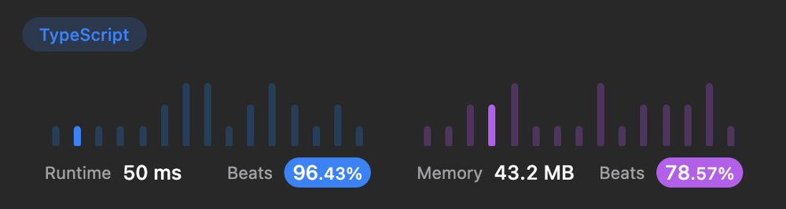

# 🚀 51ms, 96% Beats runtime. TypeScript, JavaScript

**Author:** ArtMe
**Votes:** 2
**Link:** [https://leetcode.com/problems/evaluate-division/solutions/3545079/](https://leetcode.com/problems/evaluate-division/solutions/3545079/)

---

# Code
``` typescript []
function calcEquation(equations: string[][], values: number[], queries: string[][]): number[] {
  const graph = {};
  for (let i = 0; i < equations.length; i++) {
    const [a, b] = equations[i];
    if (!graph[a]) {
        graph[a] = {};
    }
    if (!graph[b]) {
        graph[b] = {};
    }
    graph[b][a] = values[i];
    graph[a][b] = 1 / values[i];
  }

  function dfs(src: string, target: string, seen: Set<string>): number {
    if (!graph[src] || !graph[target]) {
        return -1;
    }
    if (src === target) {
        return 1;
    }
    for (const neighbor in graph[src]) {
      if (seen.has(neighbor)) {
          continue;
      }
      const result = dfs(neighbor, target, seen.add(neighbor)) * graph[neighbor][src];
      if (result > 0) {
          return result;
      }
    }
    return -1;
  }

  return queries.map(q => dfs(q[0], q[1], new Set<string>()));
};
```
``` javascript []
var calcEquation = function(equations, values, queries) {
  const graph = {};
  for (let i = 0; i < equations.length; i++) {
    const [a, b] = equations[i];
    if (!graph[a]) {
        graph[a] = {};
    }
    if (!graph[b]) {
        graph[b] = {};
    }
    graph[b][a] = values[i];
    graph[a][b] = 1 / values[i];
  }

  function dfs(src, target, seen) {
    if (!graph[src] || !graph[target]) {
        return -1;
    }
    if (src === target) {
        return 1;
    }
    for (const neighbor in graph[src]) {
      if (seen.has(neighbor)) {
          continue;
      }
      const result = dfs(neighbor, target, seen.add(neighbor)) * graph[neighbor][src];
      if (result > 0) {
          return result;
      }
    }
    return -1;
  }

  return queries.map(q => dfs(q[0], q[1], new Set()));
};
```

