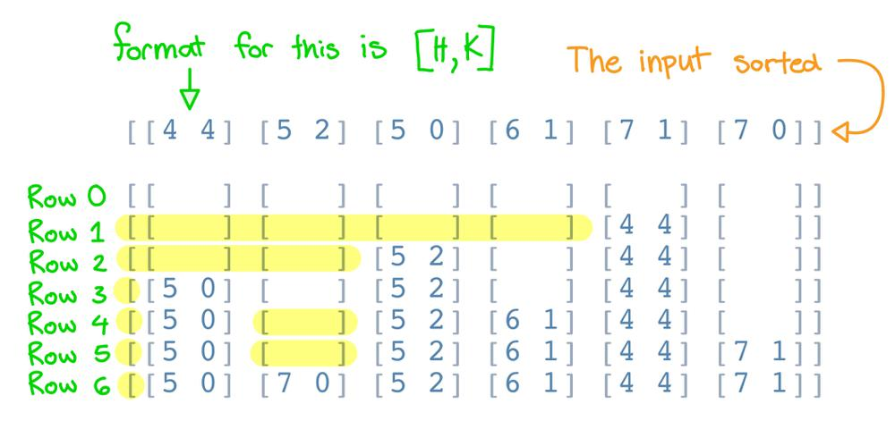

# Golang solution with explanation and images

**Author:** nathannaveen
**Votes:** 8
**Link:** [https://leetcode.com/problems/queue-reconstruction-by-height/solutions/1255835/](https://leetcode.com/problems/queue-reconstruction-by-height/solutions/1255835/)

---

[406. Queue Reconstruction by Height](https://leetcode.com/problems/queue-reconstruction-by-height/)

**The idea of this solution is to:**

* sort `people`'s height in non-decreasing order, and when two people have the same height, we sort their `k`th place in non-increasing order.
* And then we add the following person to the resulting array in the `kth` vacant position (zero-indexed), like in this image: 


	* As you can see in row `1`, `k = 4`, so we add the person of height `4` into res at position `4`.
	* Then we can see that in row `2` `k = 2`, so we add the second person to position `2`.
	* Then in the 3ed row, we can see that `k = 0`, so we add it to position `0`
	* In the `4`th row, we can see that person `4` has `k = 1`, but is in the `3`ed position. This is because in the empty spaces left, we had `empties = [1, 3, 5]`, and `empties[1] = 3`, adding person `4` to the `3`ed position.
	* In the `5`th row, we can see that `k = 1`, but the person is in the `5`th position. Just like in the `4`th row, we only have a limited amount of empty places, and `5`th is the `1`st one we find (zero-indexed).
	* In the sixth row, we can see that the last space available is at position `1`, but since it is the only empty and `k = 0`, we can add it to the position.

**Quick walkthrough on how this code works:**

* We sort `people`
* Then we make an array called empties to store all the empty values
* We fill up `empties` with the indexes of all the positions
* Then we loop through all the people that we have sorted and:
	* `res[empties[person[1]]] = person`, which is basically `res[the kth empty position] = person`
	* Then remove that position from empty because it is now filled.
* Then return res.

I am pretty sure that (correct me if I am wrong) the time complexity is: `O(nlogn + 2n)` because `O(nlogn)` is the time complexity of sort, and `2n` is for the other two loops.

**The Code:**

``` go
func reconstructQueue(people [][]int) [][]int {
	sort.Slice(people, func(i, j int) bool {
		if people[i][0] == people[j][0] {
			return people[i][1] > people[j][1]
		}
		return people[i][0] < people[j][0]
	})

	res := make([][]int, len(people))
	empties := make([]int, len(people))

	for i := 0; i < len(people); i++ {
		empties[i] = i
	}

	for _, person := range people {
		res[empties[person[1]]] = person
		empties = append(empties[:person[1]], empties[person[1]+1:]...)
	}

	return res
}
```