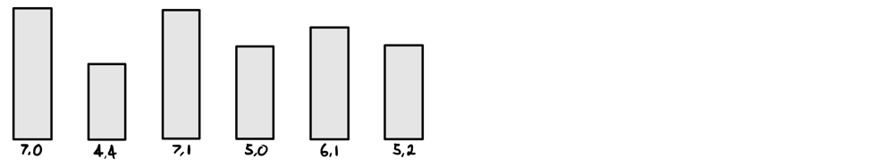
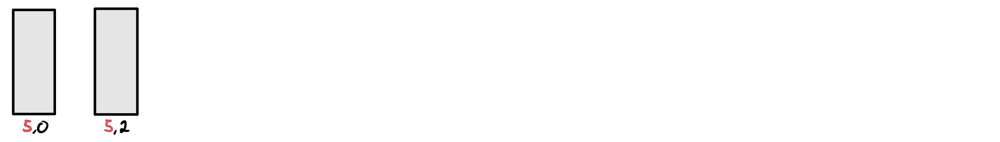
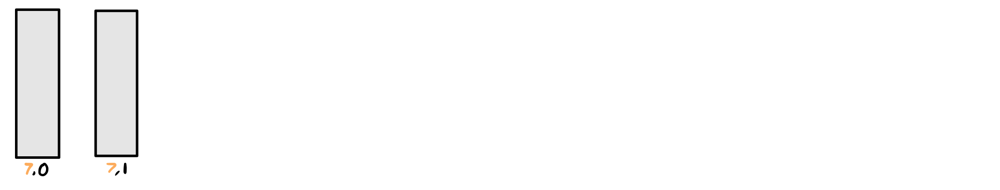
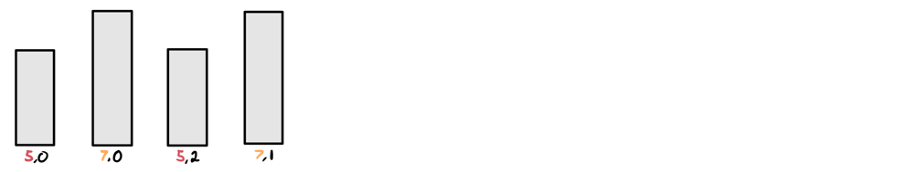
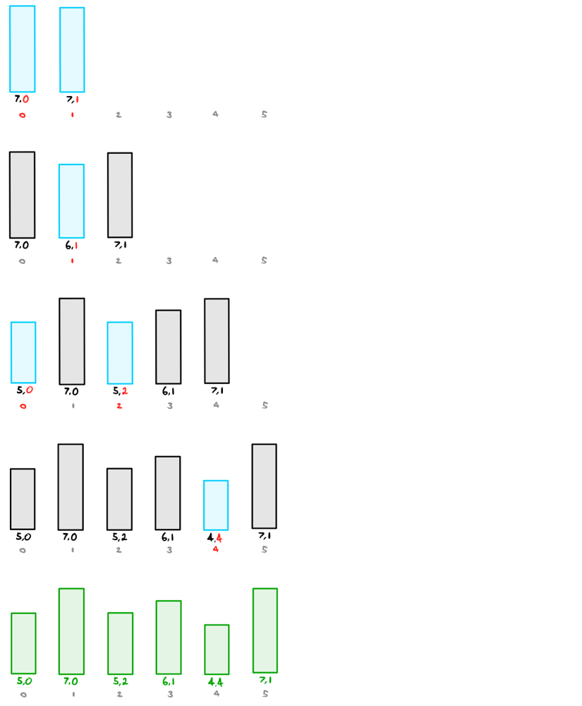

# Visual Explanation | JAVA Greedy

**Author:** ciote
**Votes:** 383
**Link:** [https://leetcode.com/problems/queue-reconstruction-by-height/solutions/2211641/](https://leetcode.com/problems/queue-reconstruction-by-height/solutions/2211641/)

---

### Introduction
In my opinion, this is quite a tricky question since it can be hard to understand why it works even after understanding the code for the algorithm. With that being said, I'll try my best to help you understand how to solve the question over an example and a series of illustrations! We'll use the below example with input `people = [[7,0],[4,4],[7,1],[5,0],[6,1],[5,2]]`:


___
### Logic
Before we understand how the problem is solved as a whole, we have to break down each relationship individually. 

Let's start with the simplest situation of two people who share the same height:

The key observation here is that **two people who share the same height must have their `k` values sorted in ascending order**. Since we're considering people with greater height and *equal* height, this is important to do. 

One major thing to keep in mind here is that these people need not be right next to each other. In fact, if you put someone shorter in between them, neither of them will notice. However, if you were to put someone taller than them in between, the people behind this person must have a `k` value that accommodates them. In this case, we need to put someone taller in between these two individuals since the second person requires a 2nd person taller than him in front. 
In fact, let's introduce two new taller people:


The same rule applies to these two people; `k` values sorted in ascending order. Now, what happens if we combine them?

As you can see, the people who share the same heights maintain their relative order. But now comes the question, how did we decide the order of people with *different* heights? Now is where things get a bit strange.

The trick here is this:
> We insert the tallest people into our output first. Then we insert the people of the next tallest height into the output **using their `k` value as their index**.
>> The reason this works is because <ins>people of taller heights don't care about the positions of those who are shorter than them</ins>. So we can do this height-by-height.

Let's follow this entire process with our example:
___
### Example:
As mentioned above, we insert the tallest first, and then the second-tallest, and so forth. The gray numbers below represent the indexes of the output array.


And there we have it; a completely reconstructed queue.
Just to be completely clear, this works because of two reasons:
1. Taller heights aren't affected by shorter heights
2. We can sort each individual height in ascending order by `k`

___
### How would this work in code:
Well, at least this is quite simple. We just need to sort our array in descending order by height and in ascending order by `k` for people that share the same height. Then, we quite literally just insert into an array based on the `k` value as the index. We'll use a linked list initially for insertion before converting to a 2D array.
___
### Code
If you have any questions, suggestions or improvements, feel free to let me know. Thanks for reading!
```java
public int[][] reconstructQueue(int[][] people) {
	Arrays.sort(people, (a,b) -> a[0] == b[0] ? a[1] - b[1] : b[0] - a[0]);

	List<int[]> ordered = new LinkedList<>();
	for (int[] p: people) ordered.add(p[1], p);

	return ordered.toArray(new int[people.length][2]);
}
```
**Time Complexity:** `O(nlogn + n^2) = O(n^2)`: We sort the array in `O(nlogn)` time and list insertion will take `O(n^2)` for `n` insertions at worst.
**Space Complexity:** `O(n)`