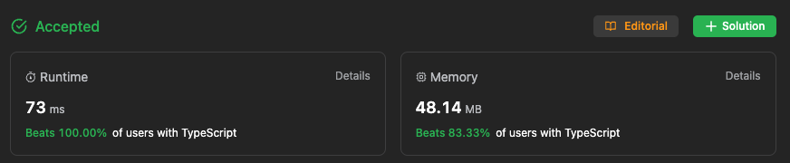

# Beats 100% of users with TypeScript

**Author:** ngoc23319952
**Votes:** 0
**Link:** [https://leetcode.com/problems/queue-reconstruction-by-height/solutions/4522723/](https://leetcode.com/problems/queue-reconstruction-by-height/solutions/4522723/)

---



# Approach
- First, sort the array by decreasing height.
- If the heights are equal, then sort by the increasing number of taller people in front.
- Iterate through the sorted array and insert each person into the new queue at the specified index. The index is determined by the number of taller people in front of them.

# Explain details
- After Sorting the Array:
Post sorting, each person is positioned in the array in such a way that if I place them sequentially into the result array at the index specified by their second element (the number of people taller in front of them), they will end up in a position that respects both their height and their relative position requirements.

- Inserting into the Result Array:
The key observation for optimization is that once the array is sorted, I don't need to recheck the entire result array each time I insert a new person. Here's why:

+   When I insert a person into the result array at the position specified by the second element of their array (the count of taller people in front of them), I'm not affecting the correctness of the positions of those already placed. This is because of the way I sorted the array: everyone already placed in the queue is taller or of the same height and positioned correctly relative to each other.

+   The elements that are inserted later do not affect those that were inserted earlier due to the sorted order. People inserted later are either shorter or have the same height and thus, their insertion doesn't invalidate the position of people inserted before them.
Therefore, I can directly insert each person into their specified position in the result array without needing to check the entire array again, significantly reducing the number of computations needed. This method ensures that everyone is placed in their correct position in an unfinished result array because their position is independent of the people placed after them.

In conclusion, this approach is a smart way to reduce the algorithm's execution time while ensuring that everyone ends up in a position that satisfies the conditions of their height and the number of people taller in front of them.

# Complexity
- Time complexity:
O(n^2)

- Space complexity:
O(n)

# Code
```
function reconstructQueue(people: number[][]): number[][] {
    people = people.sort((a, b) => {
        if (a[0] !== b[0]) {
            return b[0] - a[0]
        }
        else {
            return a[1] - b[1]
        }
    })
    let result: number[][] = [];
    for (let person of people) {
        result.splice(person[1], 0, person);
    }

    return result;
};
```