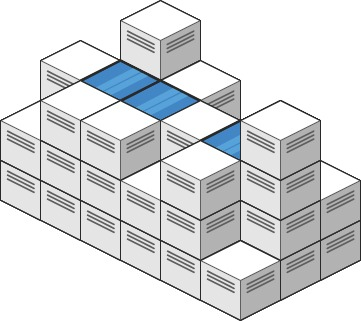
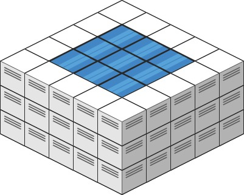

# [407. Trapping Rain Water II](https://leetcode.com/problems/trapping-rain-water-ii/)

| Category | Difficulty | Likes | Dislikes |
| :------: | :--------: | :---: | :------: |
| Algorithms | Hard | 4963 | 167 |

**Tags:** [`array`](https://leetcode.com/tag/array), [`breadth-first-search`](https://leetcode.com/tag/breadth-first-search), [`heap-priority-queue`](https://leetcode.com/tag/heap-priority-queue), [`matrix`](https://leetcode.com/tag/matrix)

**Companies:** `medianet`, `amazon`, `google`, `bloomberg`, `microsoft`, `samsung`, `flipkart`, `facebook`, `walmart-labs`, `oracle`, `bytedance`, `goldman-sachs`, `twitter`

## Description

Given an `m x n` integer matrix `heightMap` representing the height of each unit cell in a 2D elevation map, return *the volume of water it can trap after raining*.

 

**Example 1:**


```

Input: heightMap = [[1,4,3,1,3,2],[3,2,1,3,2,4],[2,3,3,2,3,1]]
Output: 4
Explanation: After the rain, water is trapped between the blocks.
We have two small ponds 1 and 3 units trapped.
The total volume of water trapped is 4.

```

**Example 2:**


```

Input: heightMap = [[3,3,3,3,3],[3,2,2,2,3],[3,2,1,2,3],[3,2,2,2,3],[3,3,3,3,3]]
Output: 10

```

 

**Constraints:**

	- `m == heightMap.length`

	- `n == heightMap[i].length`

	- `1 <= m, n <= 200`

	- `0 <= heightMap[i][j] <= 2 * 10^4`

---

**Links:** [Submissions](https://leetcode.com/problems/trapping-rain-water-ii/) | [Solutions](https://leetcode.com/problems/trapping-rain-water-ii/)
