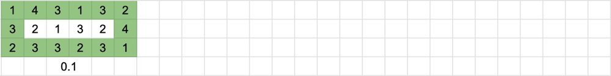
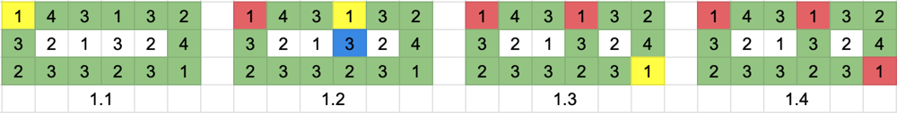
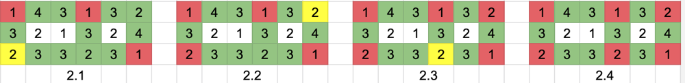
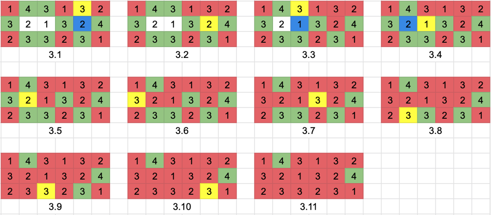
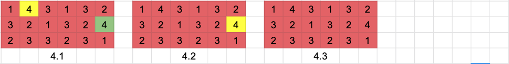

# [Python3][Visualization] BFS Solution With Explanation

**Author:** Picassos_Shoes
**Votes:** 381
**Link:** [https://leetcode.com/problems/trapping-rain-water-ii/solutions/1138028/](https://leetcode.com/problems/trapping-rain-water-ii/solutions/1138028/)

---

Cells which can trap the rain water, must be surrounded by cells with higher heights. We can maintain a `level` and increases1 by 1 from 0. At the same time, use BFS with a Min-Heap to iterate each cell. 
<br/>

# Graph
<ins>**Green**</ins>: The cell added in the heap
<ins>**Yellow**</ins>: The current cell
<ins>**Blue**</ins>: The cell is connecting to the current cell and is added to the heap
<ins>**Red**</ins>: The cell popped out from the heap
<ins>**White**</ins>: The cell has not been visited yet

<br/>

# Initial 


Cells which can trap the rain water, must be surrounded by cells with higher heights, so board cells cannot trap the water. Let's add those cells to the heap first (Sorted by height).

<br/>

# Level 1


Cells with the lowest height will be popped out. In this case, there are 3 cells with height 1 will be popped out. The Order doesn't matter. 

## Graph 1.1
Cell[0,0] is popped out from the heap, and there is no non-visited cells connecting to it.

## Graph 1.2
Cell[0,3] is popped out from the heap. Cell[1,3] height is larger than level(1). Added Cell[1,3] to the heap.

## Graph 1.3
Cell[2,5] is popped out from the heap, and there is no non-visited cells connecting to it.

<br/>

# Level 2


There is no level 1 cell in the heap, so set level = 2. There are 3 cells with height 2 will be popped out. The Order doesn't matter. 

## Graph 2.1
Cell[2,0] is popped out from the heap, and there is no non-visited cells connecting to it.

## Graph 2.2
Cell[0,5] is popped out from the heap, and there is no non-visited cells connecting to it.

## Graph 2.3
Cell[2,3] is popped out from the heap, and there is no non-visited cells connecting to it.

<br/>

# Level 3


There is no level 2 cell in the heap, so set level = 3. There are 7 cells with height 3 will be popped out. The Order doesn't matter. 

## Graph 3.1
Cell[0,4] is popped out from the heap. Cell[1,4] height is smaller than level(3). <ins>**Cell[1,4] can trap rain water: Level(3) - Cell[1,4] height(2) = 1**</ins>. Added Cell[1,4] to the heap.

## Graph 3.2
Cell[1,4] is popped out from the heap, since it has the lowest height 2. There is no non-visited cells connecting to it.

## Graph 3.3
Cell[0,2] is popped out from the heap. Cell[1,2] height is smaller than level(3). <ins>**Cell[1,2] can trap rain water: Level(3) - Cell[1,2] height(1) = 2**</ins>. Added Cell[1,2] to the heap.

## Graph 3.4
Cell[1,2] is popped out from the heap, since it has the lowest height 1. Cell[1,1] height is smaller than level(3). <ins>**Cell[1,1] can trap rain water: Level(3) - Cell[1,1] height(2) = 1**</ins>. Added Cell[1,1] to the heap.

## Graph 3.5
Cell[1,1] is popped out from the heap, since it has the lowest height 2. There is no non-visited cells connecting to it.

## Graph 3.6
Cell[1,0] is popped out from the heap, and there is no non-visited cells connecting to it.

## Graph 3.7
Cell[1,3] is popped out from the heap, and there is no non-visited cells connecting to it.

## Graph 3.8
Cell[2,1] is popped out from the heap, and there is no non-visited cells connecting to it.

## Graph 3.9
Cell[2,2] is popped out from the heap, and there is no non-visited cells connecting to it.

## Graph 3.10
Cell[2,4] is popped out from the heap, and there is no non-visited cells connecting to it.

<br/>

# Level 4


There is no level 3 cell in the heap, so set level = 4. There are 2 cells with height 4 will be popped out. The Order doesn't matter. 

## Graph 4.1
Cell[0,1] is popped out from the heap, and there is no non-visited cells connecting to it.

## Graph 4.2
Cell[1,5] is popped out from the heap, and there is no non-visited cells connecting to it.

<br/>

# Summary
<ins>**Volume of water**</ins>: 1 + 2 + 1 = 4

<br/>

# Code
```
class Solution:
    def trapRainWater(self, heightMap: List[List[int]]) -> int:
        if not heightMap or not heightMap[0]:
            return 0
			
			
		# Initial
		# Board cells cannot trap the water
        m, n = len(heightMap), len(heightMap[0])
        if m < 3 or n < 3:
            return 0
			
			
		# Add Board cells first
        heap = []
        for i in range(m):
            for j in range(n):
                if i == 0 or i == m - 1 or j == 0 or j == n - 1:
                    heapq.heappush(heap, (heightMap[i][j], i, j))
                    heightMap[i][j] = -1
					
					
		# Start from level 0
        level, res = 0, 0
        
		while heap:
            height, x, y = heapq.heappop(heap)
            level = max(height, level)

            for i, j in [(x - 1, y), (x + 1, y), (x, y - 1), (x, y + 1)]:
                if 0 <= i < m and 0 <= j < n and heightMap[i][j] != -1:
                    heapq.heappush(heap, (heightMap[i][j], i, j))
					
					# If cell's height smaller than the level, then it can trap the rain water
                    if heightMap[i][j] < level:
                        res += level - heightMap[i][j]
						
					# Set the height to -1 if the cell is visited
                    heightMap[i][j] = -1

        return res
```


All good? ^v^ Now you can try a smiliar quesion: [778. Swim in Rising Water](https://leetcode.com/problems/swim-in-rising-water/)