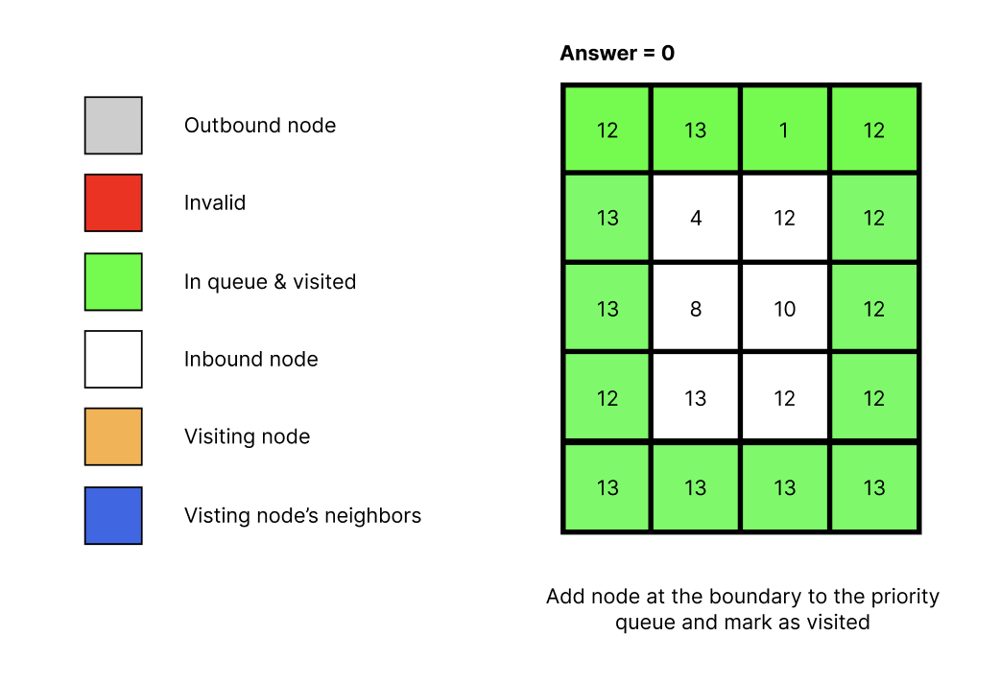
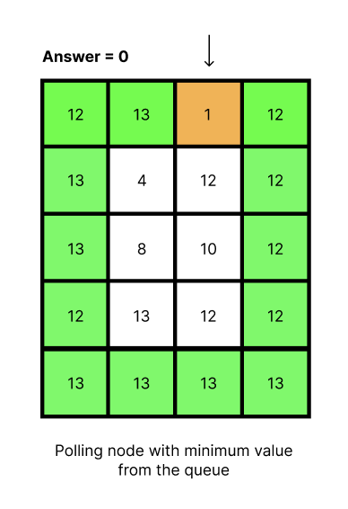
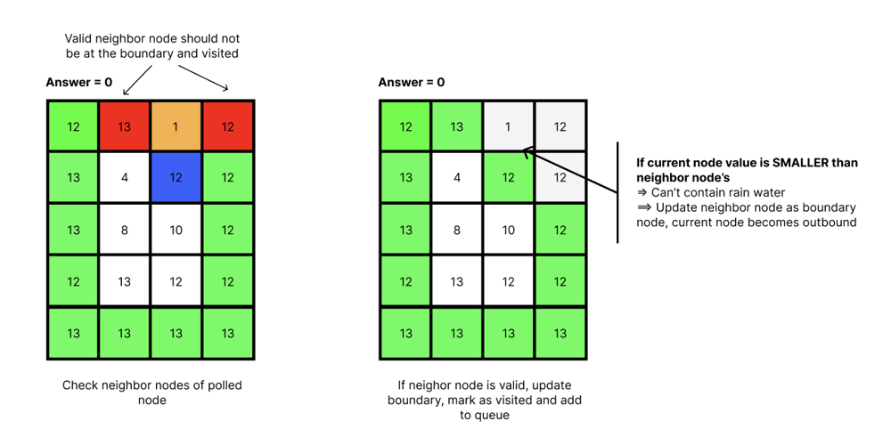
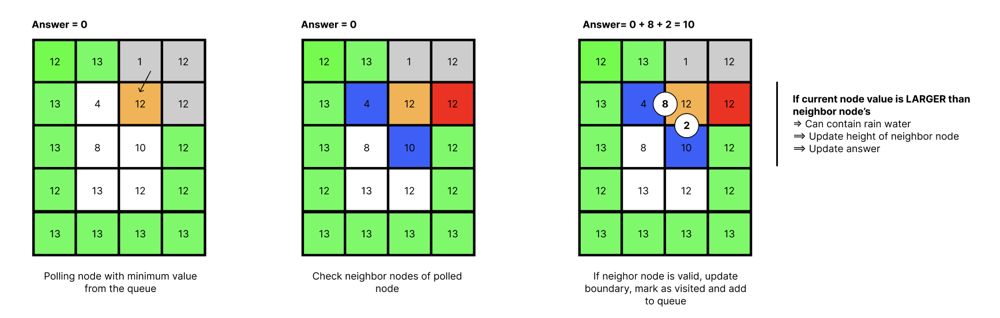
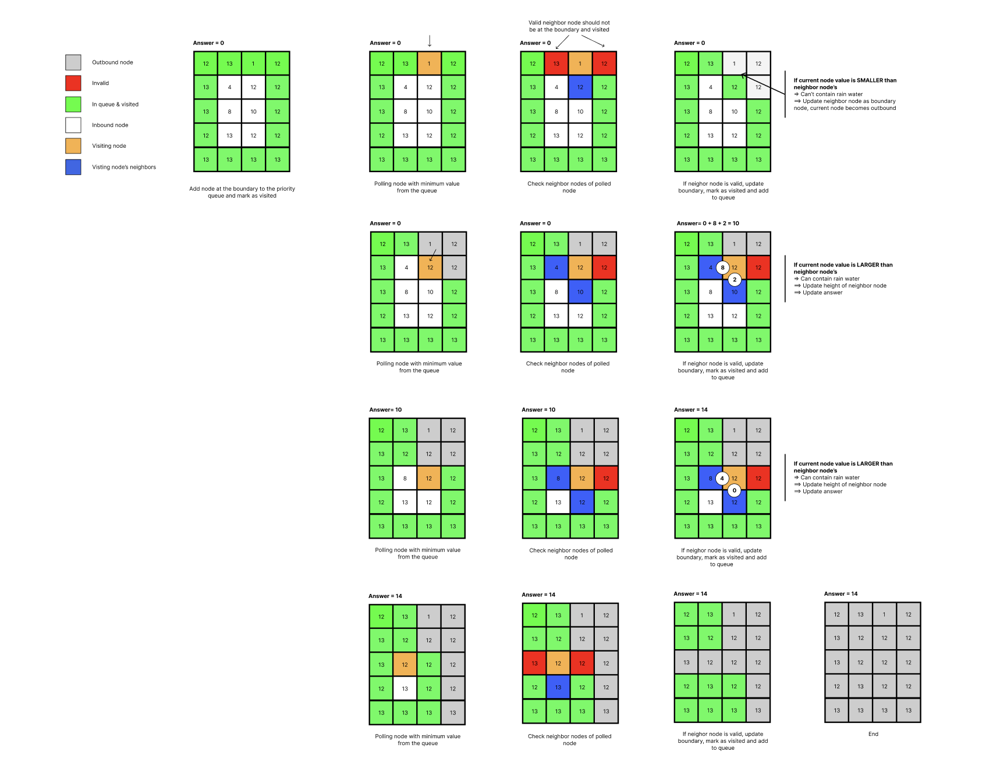

# Priority Queue solution (with explanation) - 100% Faster - Rust

**Author:** chungquantin
**Votes:** 9
**Link:** [https://leetcode.com/problems/trapping-rain-water-ii/solutions/2234909/](https://leetcode.com/problems/trapping-rain-water-ii/solutions/2234909/)

---

## Explanation
I will use this input as an example
```
Input:
[
	[12, 13, 01, 12],
	[13, 04, 12, 12],
	[13, 08, 10, 12],
	[12, 13, 12, 12],
	[13, 13, 13, 13]
]

Output: 14
```
The idea is using Priority Queue (implemented with Min Heap) to polling out the node with minimum value. Then applying BFS algorithm to traverse through neighbor nodes. These illustration below is well-explained:

### Step 1: Understand states and initialize visited matrix
To avoid traversing visited node twice, we must have a visited matrix (O(MN) => Space complexity). The reason why in the image below, I mark all boundary node as visited and in priority queue because rain water can't be contain in those nodes. Rain water must be contained by a container (formed by boundary nodes). In that way, we will add all boundary nodes to priority queue.

### Step 2: Polling node with minimum value
A node with minimum value is like a hole of the container. Therefore, rain water can only contain up to the height of the hole. So we must get the node with minimum value aka a hole. That is the reason why Min heap is applied into priority queue implementation to solve this problem.

### Step 3: Get and validate neighbor node of polled node
#### Case 1: Invalid neighbor node (is a boundary node and is visited already)
To check if the current node is suitable for containing water, we must check its neighbors, if these neighbors are higher than the current node then it is suitable to contain water. However, if the current node is the boundary, it can no longer a boundary node and we should update the neighbor which has a value higher than the current node as a boundary node.

#### Case 2: Valid neighbor node and is an inbound node
Keep traversing the matrix and we will get another case when the neighbor node is valid and it is an inbound node (heigh is smaller than the current node). Facing the case, we will then update the boundary via updaing the neighbor node's height as the boundary. And because this neighbor node meets all requirement, ANSWER will be updated with a simple operation
```
ANSWER += current_node.height - neighbor_node.height
```


Keep repeating the whole steps until there is no node to visit. Here is a full image to illustrate all steps of the above input/output.


## Implementation
To implement Min Heap in Rust, you can use Binary Heap from the standard collection package combines with std::cmp::Reverse. See the documentation for an example: https://doc.rust-lang.org/stable/std/collections/struct.BinaryHeap.html#min-heap

Note: The solution uses Priority Queue (implemented with Min Heap). This is similar to BFS, however, to solve the problme, we must apply Min Heap into the solution to select a correct next node to operate.

```
use std::cmp::Reverse;
use std::collections::binary_heap::BinaryHeap;

pub struct Solution;

impl Solution {
 /// ## Trapping Rain Water II
 /// - **Time complexity**: O(m*n*long(m*n)) | Each cell will be pushed into and popped out of the queue only once,
 /// which will cost O(log(queue_size)). (*Time complexity of Min heap operation*)
 /// Iterate the 2D matrix will cost M*N time complexity (M: rows, N: columns)
 ///
 /// - **Space complexity**: O(m*n) | Because priority queue will store all the node of the matrix
 ///
 /// Note: Using Min Heap (std::cmp::Reverse + std::collections::binary_heap::BinaryHeap)
 pub fn trap_rain_water(height_map: Vec<Vec<i32>>) -> i32 {
  let mut ans = 0;
  let dirs: Vec<(i32, i32)> = vec![(0, 1), (0, -1), (1, 0), (-1, 0)];
  let (r, c) = (height_map.len(), height_map[0].len());
  let mut visited: Vec<Vec<bool>> = vec![vec![false; c]; r];

  // The element in the PriorityQueue is an array with three elements encoding
  // the row number, column number and the height of the cell on the boundary.
  let mut pq = BinaryHeap::new();

  // We first build the initial boundary by enqueuing all cells
  // on the outer edges of the input matrix and mark them as visited
  for r in 0..height_map.len() {
   for c in 0..height_map[r].len() {
    if r > 0 && r < height_map.len() - 1 && c > 0 && c < height_map[r].len() - 1 {
     continue;
    }
    visited[r][c] = true;
    // Using Reverse to construct a Min Heap in Rust
    pq.push(Reverse((height_map[r][c], r, c)));
   }
  }

  while !pq.is_empty() {
   // Polling the cell with minimum height
   match pq.pop() {
    Some(node) => {
     let (cur_height, cur_row, cur_col) = ((node.0).0, (node.0).1, (node.0).2);

     for dir in dirs.iter() {
      let dr = (cur_row as i32 + dir.0) as usize;
      let dc = (cur_col as i32 + dir.1) as usize;

      let is_not_border = dr > 0 && dr < r - 1 && dc > 0 && dc < c - 1;
      if is_not_border && !visited[dr][dc] {
       // After obtaining the water contained for each of its neighbor,
       // we replace it with its neighbor and form a new boundary.
       // Again we continue until the container shrinks to a point.
       ans += std::cmp::max(0, cur_height - height_map[dr][dc]);
       visited[dr][dc] = true;
       pq.push(Reverse((
        std::cmp::max(cur_height, height_map[dr][dc]),
        dr,
        dc,
       )));
      }
     }
    }
    None => {
     unreachable!();
    }
   }
  }

  ans
 }
}
```