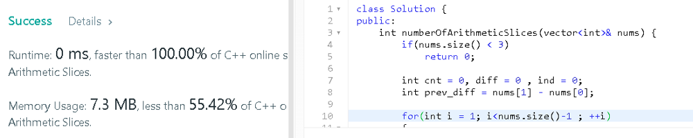

# ✅ C++ || Easy To Understand || Full Explanation

**Author:** knockcat
**Votes:** 179
**Link:** [https://leetcode.com/problems/arithmetic-slices/solutions/1814371/](https://leetcode.com/problems/arithmetic-slices/solutions/1814371/)

---

# 413. Arithmetic Slices
**KNOCKCAT**

```
1. Easy C++
2. Line by Line Explanation with Comments.
3. Detailed Explanation \u2705
4. Brute force  Apprachwith O(n) & O(n*n).
5. Please Upvote if it helps\u2B06\uFE0F
6. Link to my Github Profile contains a repository of Leetcode with all my Solutions. \u2B07\uFE0F
	// \uD83D\uDE09If you Like the repository don't foget to star & fork the repository\uD83D\uDE09 

```

[LeetCode](https://github.com/knockcat/Leetcode)   **LINK TO LEETCODE REPOSITORY**

Please upvote my comment so that i get to win the 2022 giveaway and motivate to make such discussion post.
**Happy new Year 2023 to all of you**
**keep solving keep improving**
Link To comment
[Leetcode Give away comment](https://leetcode.com/discuss/general-discussion/2946993/2022-Annual-Badge-and-the-Giveaway/1734919)

**EXPLANATION**

* The Idea is Simple , the array is called **arithmetic** if it **consists of at least 3 elements**.
* So, firstly **if arr_size is < 3** , we will **return false.**
* The **second requirement** of the question is, that the d**ifference b/w any two consecutive elements** should be **same.**
* so running a **loop from i = 0 to nums.size() - 2** as we need at least 2 consecutive elements.
* now we will store the difference of first 2 elements in a diff variable.
* Again, we will traverse a loop to find how many consecutive pairs are with same diff.
* running a i**nner loop from i + 2** as the outer for loop has **calculcated the diff of first 2 elements** for us.
* now if the **difference of arr[j] - arr[j-1]** ,current and previous element is same , this means we find a **consecutive pair**, with **same diff**, therefore we will i**ncrease the count.**
* If the **diff is not same** then we will **break the loop**, a**s we need  consecutive elements diff** to be **same**.
* **Return the Count.**

**TIME COMPLEXITY
O(N * N)**

**SPACE COMPLEXITY
O(1)**

**CODE WITH EXPLANATION**
```
				// \uD83D\uDE09\uD83D\uDE09\uD83D\uDE09\uD83D\uDE09Please upvote if it helps \uD83D\uDE09\uD83D\uDE09\uD83D\uDE09\uD83D\uDE09
class Solution {
public:
    int numberOfArithmeticSlices(vector<int>& nums) {
		// if nums size is less than 3 return false
        if(nums.size() < 3)
            return 0;
        
        int cnt = 0, diff;
        
        for(int i = 0; i<nums.size()-2; ++i)
        {
			// storing diff of first 2 elements
            diff = nums[i+1] - nums[i];
			
			// checking for consecutive elements with same difference.
            for(int j = i+2; j<nums.size(); ++j)
            {
				// if we find the same diff of next 2 elements
				// this means we  find consecutive elements
				// increase the Count
                if(nums[j] - nums[j-1] == diff)
                    ++cnt;
                else
				// break as we need to cnt for consecutive diff elements
                    break;
            }
        }
		// return cnt
        return cnt;
    }
};
```

**OPTIMISED IN O(N)**



**EXPLANATION**
* The Idea is Simple , the array is called **arithmetic** if it **consists of at least 3 elements**.
* So, firstly **if arr_size is < 3** , we will **return false.**
* The **second requirement** of the question is, that the d**ifference b/w any two consecutive elements** should be **same.**
* Storing diff of first 2 elements in diff as **prev_diff = nums[1] - nums[0]**.
* Now iterating a **loop from i = 1 to nums.size()-1** and **finding the diff of next consecutive elements**.
* If the **diff is equal to prev_diff,** **increase the cnt of ind** variable;
* **else set ind to zero** and **update prev_diff with curr diff**.
* add **ind to cnt.**
* **Return cnt.**

**TIME COMPLEXITY
O(N)**

**SPACE COMPLEXITY
O(1)**


**CODE WITH EXPLANATION**

```
					// \uD83D\uDE09\uD83D\uDE09\uD83D\uDE09\uD83D\uDE09Please upvote if it helps \uD83D\uDE09\uD83D\uDE09\uD83D\uDE09\uD83D\uDE09
class Solution {
public:
    int numberOfArithmeticSlices(vector<int>& nums) {
        if(nums.size() < 3)
            return 0;
        
        int cnt = 0, diff = 0 , ind = 0;
        int prev_diff = nums[1] - nums[0];
        
        for(int i = 1; i<nums.size()-1 ; ++i)
        {
            // curr difference
            int diff = nums[i+1] - nums[i];
            
            // if we find same diff of consecutive elements
            // increase count
            if(diff ==  prev_diff)
                ++ind;
            
            else
            {
                // update prev diff with curr diff
                // as we don't find consecutive elements with same diff
                prev_diff = diff;
                ind = 0;  // make ind to 0
            }
            
            // add cosecutive arithmetic sequence cnt
                cnt += ind;
        }
        
       
        return cnt;
    }
};
```