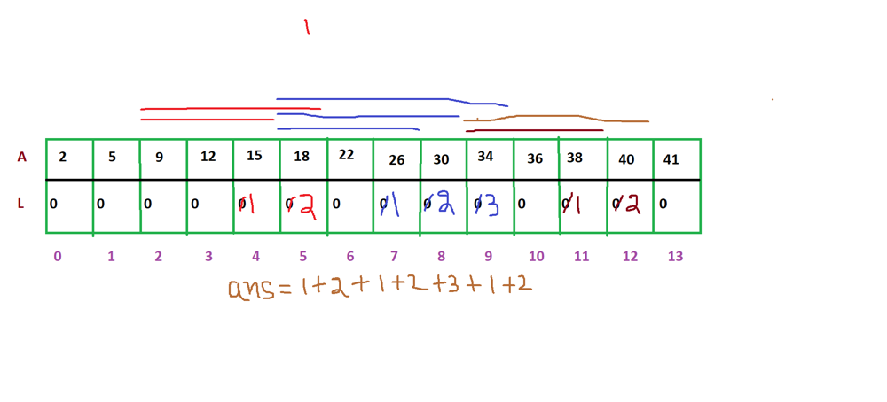

# Faster than 99.44% PYTHON 3 Simple solution

**Author:** Anurag_Tiwari
**Votes:** 82
**Link:** [https://leetcode.com/problems/arithmetic-slices/solutions/982169/](https://leetcode.com/problems/arithmetic-slices/solutions/982169/)

---




**-->**  Create an array of size le (le=len(A))

**-->** as given ''A sequence of numbers is called arithmetic if it consists of at **least three elements**'', start for loop from 2 to le.(**because first two elements(index 0 and 1) will never from a sequence as minimum length of a sequence is 3**)

**-->** it is also given that ''A sequence of numbers is called arithmetic if it consists of at least three elements and **if the difference between any two consecutive elements is the same.**''
here i is current element ,if  A[i]-A[i-1] == A[i-1]-A[i-2]  then **sequence length for current element i.e l[i] will be 1+sequence length of previous element(l[i-1)**

TO return the total number of arithmetic slices in the array A  **return Caluculated Sum of array l**

```
class Solution:
    def numberOfArithmeticSlices(self, A: List[int]) -> int:
        le=len(A)
        l=[0]*(le)
        for i in range(2,le):
            if A[i]-A[i-1] == A[i-1]-A[i-2]:
                l[i]=1+l[i-1]
        return sum(l)

