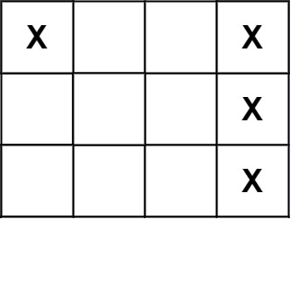

# [419. Battleships in a Board](https://leetcode.com/problems/battleships-in-a-board/)

| Category | Difficulty | Likes | Dislikes |
| :------: | :--------: | :---: | :------: |
| Algorithms | Medium | 2478 | 1022 |

**Tags:** [`array`](https://leetcode.com/tag/array), [`depth-first-search`](https://leetcode.com/tag/depth-first-search), [`matrix`](https://leetcode.com/tag/matrix)

**Companies:** `facebook`, `microsoft`, `amazon`, `microstrategy`, `google`, `tinkoff`

## Description

Given an `m x n` matrix `board` where each cell is a battleship `'X'` or empty `'.'`, return *the number of the **battleships** on* `board`.

**Battleships** can only be placed horizontally or vertically on `board`. In other words, they can only be made of the shape `1 x k` (`1` row, `k` columns) or `k x 1` (`k` rows, `1` column), where `k` can be of any size. At least one horizontal or vertical cell separates between two battleships (i.e., there are no adjacent battleships).

 

**Example 1:**


```

Input: board = [[&quot;X&quot;,&quot;.&quot;,&quot;.&quot;,&quot;X&quot;],[&quot;.&quot;,&quot;.&quot;,&quot;.&quot;,&quot;X&quot;],[&quot;.&quot;,&quot;.&quot;,&quot;.&quot;,&quot;X&quot;]]
Output: 2

```

**Example 2:**

```

Input: board = [[&quot;.&quot;]]
Output: 0

```

 

**Constraints:**

	- `m == board.length`

	- `n == board[i].length`

	- `1 <= m, n <= 200`

	- `board[i][j]` is either `'.'` or `'X'`.

 

**Follow up:** Could you do it in one-pass, using only `O(1)` extra memory and without modifying the values `board`?

---

**Links:** [Submissions](https://leetcode.com/problems/battleships-in-a-board/) | [Solutions](https://leetcode.com/problems/battleships-in-a-board/)
