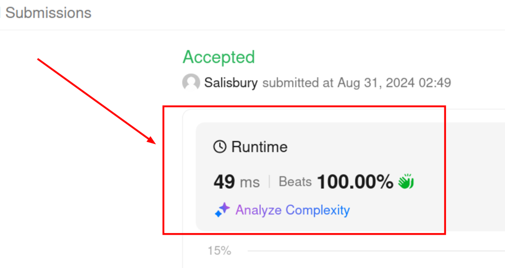

# 100% runtime beats

**Author:** salisbury-espinosa
**Votes:** 0
**Link:** [https://leetcode.com/problems/battleships-in-a-board/solutions/5712947/](https://leetcode.com/problems/battleships-in-a-board/solutions/5712947/)

---



# Code
```typescript []
function countBattleships(board: string[][]): number {
    const m = board.length;
    const n = board[0].length;
    let count = 0;

    let currentRowToSkip = [];

    for (let height = 0; height < m; height += 1) {
        let currentBattleshipStart = null;

        let currentRowToSkipIndex = currentRowToSkip.length > 0 ? 0 : null;
        let currentTupleToSkip = currentRowToSkipIndex != null ? currentRowToSkip[currentRowToSkipIndex] : null;

        let forNextRowToSkip = [];
        for (let width = 0; width < n; width += 1) {
            if (currentTupleToSkip != null && width === currentTupleToSkip[0]) {
                if (currentBattleshipStart != null && currentBattleshipStart < (width - 1)) {
                    forNextRowToSkip.push([currentBattleshipStart, width -1]);
                }
                currentBattleshipStart = null;
                width = currentTupleToSkip[1];
                currentRowToSkipIndex =  (currentRowToSkipIndex + 1) < currentRowToSkip.length ? (currentRowToSkipIndex + 1) : null;
                currentTupleToSkip = currentRowToSkipIndex != null ? currentRowToSkip[currentRowToSkipIndex] : null;
                continue;
            }

            const val = board[height][width];
            if (val === "X") {
                if (currentBattleshipStart == null) {
                    if (height > 0 && board[height-1][width] === "X") {
                        width += 1;
                        continue;
                    }
                    else {
                        count += 1;
                        currentBattleshipStart = width;
                    }
                }
                else if (width === (n - 1)) {
                    forNextRowToSkip.push([currentBattleshipStart, width]);
                }
            }
            else if (val === "." && currentBattleshipStart != null) {
                if (currentBattleshipStart < (width - 1)) {
                    forNextRowToSkip.push([currentBattleshipStart, width -1]);
                }
                currentBattleshipStart = null;
            }
        }
        currentRowToSkip = forNextRowToSkip;
    }
    return count;
};
```