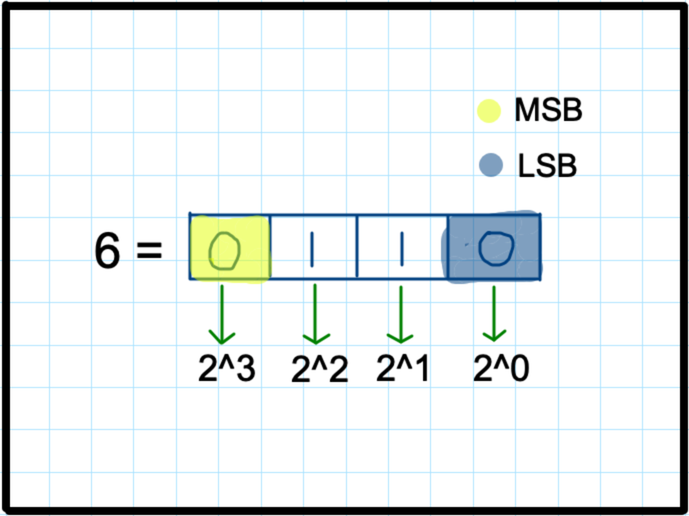
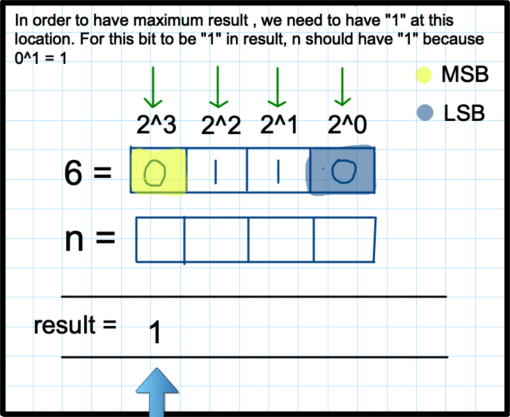

# 📌[ Java] A very detailed explanation with sim. understanding | Trie + Bit

**Author:** Nam_22
**Votes:** 124
**Link:** [https://leetcode.com/problems/maximum-xor-of-two-numbers-in-an-array/solutions/1722805/](https://leetcode.com/problems/maximum-xor-of-two-numbers-in-an-array/solutions/1722805/)

---

****
Please upvote if the explanation helps, as it keeps up the motivation to provide such posts. 
****
PS : This must be a Hard Problem.

**Explanation Flow :** 
* Given statements/Observations
* Simulation of logic
* Approach
* Code
* Bit Logic 

**\u2714\uFE0F Given statements:** 

Given an integer array `nums`, 
return the maximum result of `nums[i]` XOR `nums[j]`, where `0 <= i <= j < n.`

**Let's first solve a smaller version of this problem:** 

Given an array `nums` and a no `x`, find the maximum result of `nums[i]` XOR `x`.
We can generalise the outcome from this to solve our main problem.
`nums : [ 4, 5, 8, 9 ]`
`x` : `6`

Let's create a trie from `nums`.
In order to get a maximum number after xor, we want to have our bits set from `MSB` because of powers of 2 are high. Let me take an example : 



****

So,  our code flow will be something like this : [ Simulation ]
See how we have removing those inputs which does not help us reach the maximum result ! This is achieved by Trie, we keep moving in the correct direction hence, removing the invalid inputs from the way.

****
If the simulation is bit too fast, here is the link of files :
https://drive.google.com/drive/folders/1VeNW7_jFif6-czvbsgEZFxiOSOCeQb3b?usp=sharing





****

We have to perform this action for every `A[i]` and get the maximum.

**\u2714\uFE0F Approach :** 

1. We insert A[i] in Binary Trie, starting from `MSB` to `LSB`.
2. Each A[i] will be stored in `1` and `0` corresponding to its bit position.
3. For every element `A[i]`, we check what is the current maximum result we could get from xor ( refer simulation )
4. Get overall maximum

**\u2714\uFE0F Code :** 

```
class Node {
    HashMap<Integer, Node> children;
    Node() {
        this.children = new HashMap<>();
    }
}

class Trie {
    Node root;
    
    Trie() {
        this.root = new Node();
    }
    
    public void insert(int[] A) {
        for(int num : A) {
            Node curr = this.root;
            for(int i=31;i>=0;i--) {
                int currBit = (num >> i) & 1;
                if(!curr.children.containsKey(currBit)) 
                    curr.children.put(currBit, new Node());
                curr = curr.children.get(currBit);
            }
        }
    }
}
class Solution {
    public int findMaximumXOR(int[] nums) {
        Trie trie = new Trie();
        trie.insert(nums);
        
        int max = 0;

        for(int num : nums) {
            Node curr = trie.root;
            int currSum = 0;
            for(int i=31;i>=0;i--) {
                int requiredBit = 1-((num >> i) & 1); // if A[i] is 0, we need 1 and if A[i] is 1, we need 0. Thus, 1 - A[i]
                if(curr.children.containsKey(requiredBit)) {
                    currSum |= (1<<i); // set ith bit of curr result
                    curr = curr.children.get(requiredBit);
                } else {
                    curr = curr.children.get(1-requiredBit);
                }
            }
            max = Math.max(max, currSum); // get max number
        }
        return max;
    }
}

```


**\u2714\uFE0F Complexity Analysis** : 
* TC : `O(n * 32)` + `O(n)` = `O(n)`
* SC : `O(2^h - 1)` == `O(2^32 - 1)` == `O(1)` [ refer @kazuwuqt comment below ]

**Bit Logic :**

Shift operators are used to shift the bits of a number left or right, i.e. multiplying or dividing the number by two, respectively.
**Syntax : "num" "op" "positions_to_shift"**

`>>` is a right shift operator. There are two ways to think about it : 
1. It shift the number by *positions* specified to the right. ( fill unoccupied positions with 0 ) or,
2. It divides the number by 2^positions

by doing `num >> i` , **main aim is to get the ith bit of number.**
I am shifting the num by `i` positions ( we get decimal number ) and getting the bit at that position ( by doing `& 1` -> 1&0 = 0 and 1&1 = 1 ).

For eg : 
`num = 5 ( 0 1 0 1 )`
num >> `2` means 
1. shifting the num by 2 position -> 0 0 1 0 -> 0 0 0 1 i.e. 1 ( in decimal )  `& 1`  yields `1` i.e. the 2nd bit of number 5 is `1` 
2. divide num by 2^`2` ->  5/4 -> 1 `& 1` yields `1` i.e. the 2nd bit of number 5 is `1` .

****
If there is any suggestion, pls let me know
****