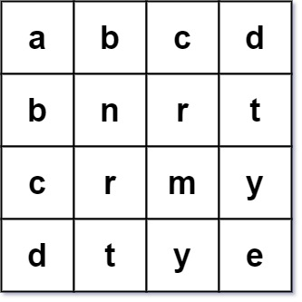
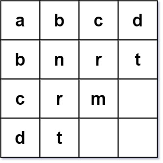
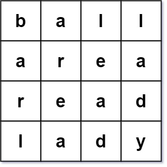

# [422. Valid Word Square](https://leetcode.com/problems/valid-word-square/)

| Category | Difficulty | Likes | Dislikes |
| :------: | :--------: | :---: | :------: |
| Algorithms | Easy | 442 | 271 |

**Tags:** [`array`](https://leetcode.com/tag/array), [`matrix`](https://leetcode.com/tag/matrix)

**Companies:** `apple`, `google`

## Description

Given an array of strings `words`, return `true` *if it forms a valid **word square***.

A sequence of strings forms a valid **word square** if the `k^th` row and column read the same string, where `0 <= k < max(numRows, numColumns)`.

 

**Example 1:**


```

Input: words = [&quot;abcd&quot;,&quot;bnrt&quot;,&quot;crmy&quot;,&quot;dtye&quot;]
Output: true
Explanation:
The 1st row and 1st column both read &quot;abcd&quot;.
The 2nd row and 2nd column both read &quot;bnrt&quot;.
The 3rd row and 3rd column both read &quot;crmy&quot;.
The 4th row and 4th column both read &quot;dtye&quot;.
Therefore, it is a valid word square.

```

**Example 2:**


```

Input: words = [&quot;abcd&quot;,&quot;bnrt&quot;,&quot;crm&quot;,&quot;dt&quot;]
Output: true
Explanation:
The 1st row and 1st column both read &quot;abcd&quot;.
The 2nd row and 2nd column both read &quot;bnrt&quot;.
The 3rd row and 3rd column both read &quot;crm&quot;.
The 4th row and 4th column both read &quot;dt&quot;.
Therefore, it is a valid word square.

```

**Example 3:**


```

Input: words = [&quot;ball&quot;,&quot;area&quot;,&quot;read&quot;,&quot;lady&quot;]
Output: false
Explanation:
The 3rd row reads &quot;read&quot; while the 3rd column reads &quot;lead&quot;.
Therefore, it is NOT a valid word square.

```

 

**Constraints:**

	- `1 <= words.length <= 500`

	- `1 <= words[i].length <= 500`

	- `words[i]` consists of only lowercase English letters.

---

**Links:** [Submissions](https://leetcode.com/problems/valid-word-square/) | [Solutions](https://leetcode.com/problems/valid-word-square/)
